# Intrinsic models in the rSPDE package

### Introduction

In this vignette we provide a brief introduction to the intrinsic models
implemented in the `rSPDE` package.

### A fractional intrinsic model

A basic intrinsic model which is implemented in `rSPDE` is defined as  
``` math
(-\Delta)^{\beta/2}(\tau u) = \mathcal{W},
```
where $`\beta > d/2`$ and $`d`$ is the dimension of the spatial domain.

To illustrate these models, we begin by defining a mesh over
$`[0,2]\times [0, 2]`$:

``` r

library(fmesher)
bnd <- fm_segm(rbind(c(0, 0), c(2, 0), c(2, 2), c(0, 2)), is.bnd = TRUE)
mesh_2d <- fm_mesh_2d(
    boundary = bnd, 
    cutoff = 0.02,
    max.edge = c(0.1)
)
plot(mesh_2d, main = "")
```

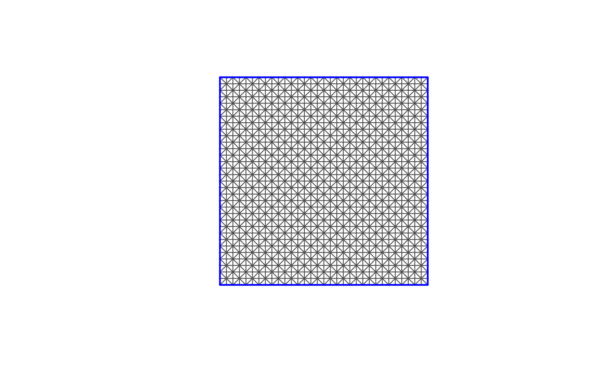

We now use the
[`intrinsic.operators()`](https://davidbolin.github.io/rSPDE/reference/intrinsic.operators.md)
function to construct the `rSPDE` representation of the general model.

``` r

library(rSPDE)
tau <- 0.2
beta <- 1.8
fem <- fm_fem(mesh_2d)
op <- intrinsic.operators(tau = tau, beta = beta, mesh = mesh_2d, m = 2)
```

To see that the `rSPDE` model is approximating the true model, we can
compare the variogram of the approximation (implemented in the function
`variogram` in the model object) with the true variogram (implemented in
[`variogram.intrinsic.spde()`](https://davidbolin.github.io/rSPDE/reference/variogram.intrinsic.spde.md))
as follows.

``` r

point <- matrix(c(1,1),1,2)
Gamma <- op$variogram(point)
vario <- variogram.intrinsic.spde(point, mesh_2d$loc[,1:2], tau = tau,
                                  beta = beta, L = 2, d = 2)
d = sqrt((mesh_2d$loc[,1]-point[1])^2 +  (mesh_2d$loc[,2]-point[2])^2)
plot(d, Gamma, xlim = c(0,0.7), ylim = c(0,3),
     ylab = "variogram(h)", xlab = "h")
points(d,vario,col=2)
```

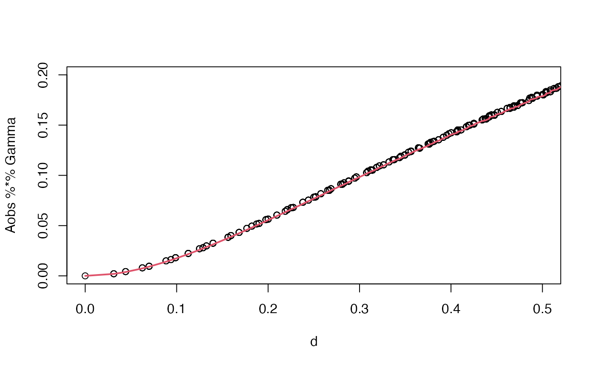

If we want to increase the accuracy, we can either use a finer mesh or
increase the order of the rational approximation through the argument
`m` in `intrinsic.operators`. The default value of `m` is 1. We can now
use the `simulate` function to simulate a realization of the field
$`u`$:

``` r

u <- simulate(op,nsim = 1)

proj <- fm_evaluator(mesh_2d, dims = c(100, 100))
field <- fm_evaluate(proj, field = as.vector(u))
field.df <- data.frame(x1 = proj$lattice$loc[,1],
                       x2 = proj$lattice$loc[,2], 
                       y = as.vector(field))

library(ggplot2)
library(viridis)
#> Loading required package: viridisLite
ggplot(field.df, aes(x = x1, y = x2, fill = y)) +
    geom_raster() +
    scale_fill_viridis()
```

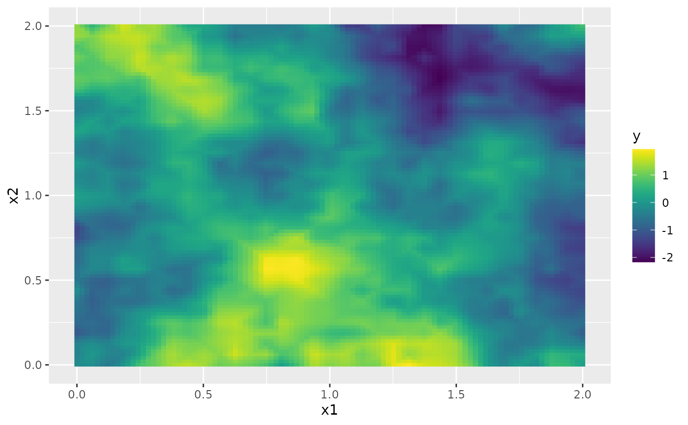

By default, the field is simulated with a zero-integral constraint.

### Fitting the model with `R-INLA`

Let us now consider a simple Gaussian linear model where the spatial
field $`u(\mathbf{s})`$ is observed at $`m`$ locations,
$`\{\mathbf{s}_1 , \ldots , \mathbf{s}_m \}`$ under Gaussian measurement
noise. For each $`i = 1,\ldots,m,`$ we have
``` math
\begin{align} 
y_i &= u(\mathbf{s}_i)+\varepsilon_i\\
\end{align},
```
where $`\varepsilon_1,\ldots,\varepsilon_{m}`$ are iid normally
distributed with mean 0 and standard deviation 0.1.

To generate a data set `y` from this model, we first draw some
observation locations at random in the domain and then use the
[`spde.make.A()`](https://davidbolin.github.io/rSPDE/reference/spde.make.A.md)
functions (that wraps the functions
[`fm_basis()`](https://inlabru-org.github.io/fmesher/reference/fm_basis.html),
[`fm_block()`](https://inlabru-org.github.io/fmesher/reference/fm_block.html)
and
[`fm_row_kron()`](https://inlabru-org.github.io/fmesher/reference/fm_row_kron.html)
of the `fmesher` package) to construct the observation matrix which can
be used to evaluate the simulated field $`u`$ at the observation
locations. After this we simply add the measurment noise.

``` r

n_loc <- 1000
loc_2d_mesh <- matrix(2*runif(n_loc * 2), n_loc, 2)

A <- spde.make.A(
  mesh = mesh_2d,
  loc = loc_2d_mesh
)
sigma.e <- 0.1
y <- A %*% u + rnorm(n_loc) * sigma.e
```

The generated data can be seen in the following image.

``` r

df <- data.frame(x1 = as.double(loc_2d_mesh[, 1]),
  x2 = as.double(loc_2d_mesh[, 2]), y = as.double(y))
ggplot(df, aes(x = x1, y = x2, col = y)) +
  geom_point() +
  scale_color_viridis()
```

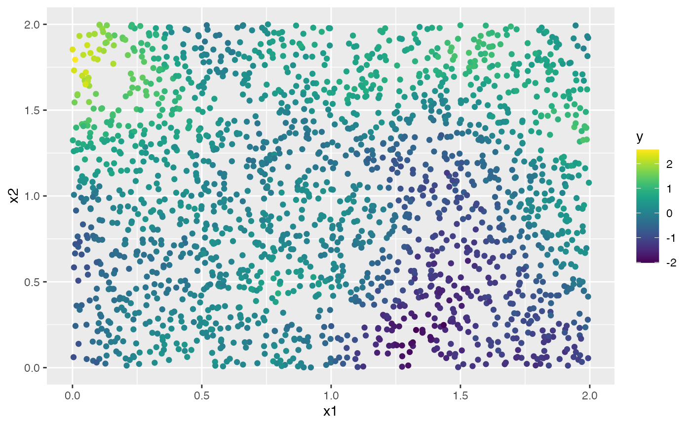

We will now fit the model using our [`R-INLA`](https://www.r-inla.org)
implementation of the rational SPDE approach. Further details on this
implementation can be found in [R-INLA implementation of the rational
SPDE
approach](https://davidbolin.github.io/rSPDE/articles/rspde_inla.md).

``` r

library(INLA)
#> 
rspde.order <- 2
mesh.index <- rspde.make.index(name = "field", mesh = mesh_2d, rspde.order = rspde.order)
Abar <- rspde.make.A(mesh = mesh_2d, loc = loc_2d_mesh, rspde.order = rspde.order)
st.dat <- inla.stack(data = list(y = as.vector(y)), A = Abar, effects = mesh.index)
```

We now create the model object.

``` r

rspde_model <- rspde.intrinsic(mesh = mesh_2d, rspde.order = rspde.order)
```

Finally, we create the formula and fit the model to the data:

``` r

f <- y ~ -1 + f(field, model = rspde_model)
rspde_fit <- inla(f,
                  data = inla.stack.data(st.dat),
                  family = "gaussian",
                  control.predictor = list(A = inla.stack.A(st.dat)))
```

To compare the estimated parameters to the true parameters, we can do
the following:

``` r

result_fit <- rspde.result(rspde_fit, "field", rspde_model)
summary(result_fit)
#>         mean        sd 0.025quant 0.5quant 0.975quant     mode
#> tau 0.124746 0.0260819  0.0806449 0.122381   0.182702 0.117717
#> nu  0.969155 0.0737597  0.8270630 0.968124   1.116210 0.964822
tau <- op$tau
nu <- op$beta - 1 #beta = nu + d/2 
result_df <- data.frame(
    parameter = c("tau", "nu", "sigma.e"),
    true = c(tau, nu, sigma.e), 
    mean = c(result_fit$summary.tau$mean,result_fit$summary.nu$mean,
             sqrt(1/rspde_fit$summary.hyperpar[1,1])),
    mode = c(result_fit$summary.tau$mode, result_fit$summary.nu$mode,
             sqrt(1/rspde_fit$summary.hyperpar[1,6]))
)
print(result_df)
#>   parameter true       mean       mode
#> 1       tau  0.2 0.12474573 0.11771678
#> 2        nu  0.8 0.96915504 0.96482167
#> 3   sigma.e  0.1 0.09783034 0.09818051
```

### Extreme value models

When used for extreme value statistics, one might want to use a
particular form of the mean value of the latent field $`u`$, which is
zero at one location $`k`$ and is given by the diagonal of
$`Q_{-k,-k}^{-1}`$ for the remaining locations. This option can be
specified via the `mean.correction` argument of `rspde.intrinsic`:

``` r

rspde_model2 <- rspde.intrinsic(mesh = mesh_2d, rspde.order = rspde.order,
                                mean.correction = TRUE)
```

We can then fit this model as before:

``` r

f <- y ~ -1 + f(field, model = rspde_model2)
rspde_fit <- inla(f,
                  data = inla.stack.data(st.dat),
                  family = "gaussian",
                  control.predictor = list(A = inla.stack.A(st.dat)))
```

To see the posterior distributions of the parameters we can do:

``` r

result_fit <- rspde.result(rspde_fit, "field", rspde_model2)
posterior_df_fit <- gg_df(result_fit)

ggplot(posterior_df_fit) + geom_line(aes(x = x, y = y)) + 
facet_wrap(~parameter, scales = "free") + labs(y = "Density")
```

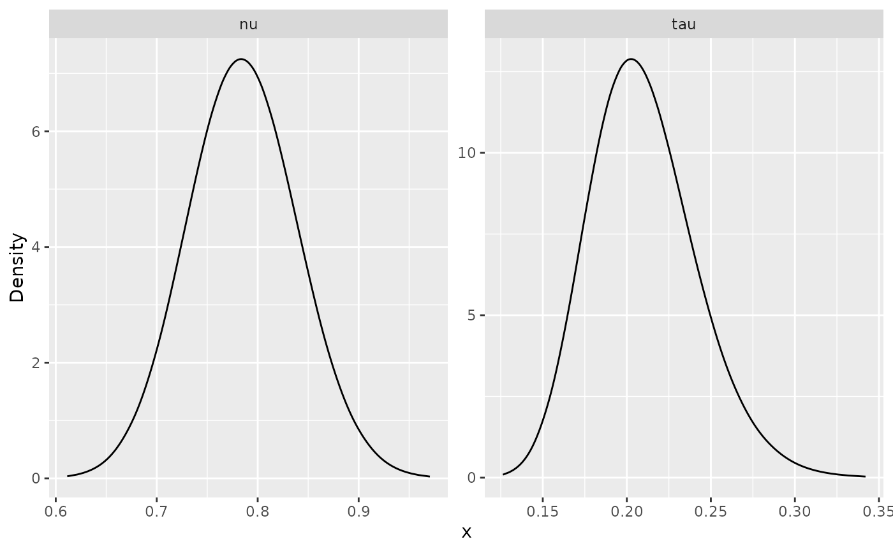

### An example with replicates

Let us redo the previous example with replicated data to illustrate that
replicates are handled in the same way as any other `rSPDE` model. We
start by generating some data with 200 observations per replicate

``` r

set.seed(1)
tau <- 0.2
beta <- 1.9
op <- intrinsic.operators(tau = tau, beta = beta, mesh = mesh_2d)
n.rep <- 5
m <- 1000
loc_2d_mesh <- matrix(2*runif(m * 2), m, 2)

A <- spde.make.A(
  mesh = mesh_2d,
  loc = loc_2d_mesh,
  index = rep(1:m, times = n.rep),
  repl = rep(1:n.rep, each = m)
)

u <- simulate(op, nsim = n.rep)
y <- as.vector(A %*% as.vector(u)) +
  rnorm(m * n.rep) * 0.1
```

We now create the stack, A matrix and index and fit the model:

``` r

Abar.rep <- rspde.make.A(
  mesh = mesh_2d, loc = loc_2d_mesh, index = rep(1:m, times = n.rep),
  repl = rep(1:n.rep, each = m)
)
mesh.index.rep <- rspde.make.index(
  name = "field", mesh = mesh_2d,
  n.repl = n.rep
)

st.dat.rep <- inla.stack(
  data = list(y = y),
  A = Abar.rep,
  effects = mesh.index.rep
)

rspde_model.rep <- rspde.intrinsic(mesh = mesh_2d, prior.nu.dist = "beta")

f.rep <-
  y ~ -1 + f(field,
    model = rspde_model.rep,
    replicate = field.repl
  )
rspde_fit.rep <-
  inla(f.rep,
    data = inla.stack.data(st.dat.rep),
    family = "gaussian",
    control.predictor =
      list(A = inla.stack.A(st.dat.rep))
  )
```

We then compare with the true parameter estimates as before

``` r

result_fit <- rspde.result(rspde_fit.rep, "field", rspde_model.rep)
summary(result_fit)
#>         mean        sd 0.025quant 0.5quant 0.975quant     mode
#> tau 0.178770 0.0141989   0.152653 0.178154   0.208396 0.176764
#> nu  0.924008 0.0180611   0.888363 0.924091   0.959294 0.924398
tau <- op$tau
nu <- op$beta - 1 #beta = nu + d/2 
result_df <- data.frame(
    parameter = c("tau", "nu", "sigma.e"),
    true = c(tau, nu, sigma.e), 
    mean = c(result_fit$summary.tau$mean,result_fit$summary.nu$mean,
             sqrt(1/rspde_fit.rep$summary.hyperpar[1,1])),
    mode = c(result_fit$summary.tau$mode, result_fit$summary.nu$mode,
             sqrt(1/rspde_fit.rep$summary.hyperpar[1,6]))
)
print(result_df)
#>   parameter true       mean      mode
#> 1       tau  0.2 0.17877044 0.1767640
#> 2        nu  0.9 0.92400787 0.9243979
#> 3   sigma.e  0.1 0.09990679 0.1001103
```

To see the posterior distributions of the parameters we can do:

``` r

result_fit <- rspde.result(rspde_fit.rep, "field", rspde_model.rep)
posterior_df_fit <- gg_df(result_fit)

ggplot(posterior_df_fit) + geom_line(aes(x = x, y = y)) + 
facet_wrap(~parameter, scales = "free") + labs(y = "Density")
```

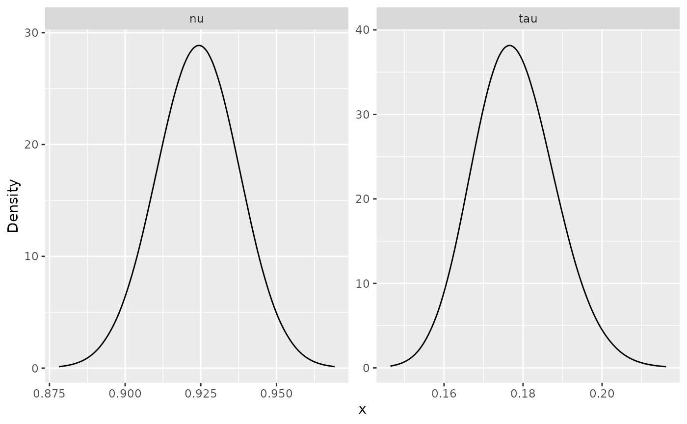

## A more general model

The `rSPDE` package also contains a partial implementation of a more
general intrinsic model, which we refer to as an intrinsic Matérn model.
The model is defined as  
``` math
(-\Delta)^{\beta/2}(\kappa^2-\Delta)^{\alpha/2}(\tau u) = \mathcal{W},
```
where $`\alpha + \beta > d/2`$ and $`d`$ is the dimension of the spatial
domain. These models are handled by performing two rational
approximations, one for each fractional operator.

To illustrate this model, we consider the same mesh as before and use
the
[`intrinsic.matern.operators()`](https://davidbolin.github.io/rSPDE/reference/intrinsic.matern.operators.md)
function to construct the `rSPDE` representation of the general model.

``` r

bnd <- fm_segm(rbind(c(0, 0), c(2, 0), c(2, 2), c(0, 2)), is.bnd = TRUE)
mesh_2d <- fm_mesh_2d(
    boundary = bnd, 
    cutoff = 0.01,
    max.edge = c(0.05)
)

kappa <- 10
tau <- 0.0025
alpha <- 2
beta <- 1
op <- intrinsic.matern.operators(kappa = kappa, tau = tau, alpha = alpha, 
                                 beta = beta, mesh = mesh_2d)
```

To see that the `rSPDE` model is approximating the true model, we can
compare the variogram of the approximation with the true variogram
(implemented in
[`variogram.intrinsic.spde()`](https://davidbolin.github.io/rSPDE/reference/variogram.intrinsic.spde.md))
as follows.

``` r

point <- matrix(c(1,1),1,2)
Gamma <- op$variogram(point)
vario <- variogram.intrinsic.spde(point, mesh_2d$loc[,1:2], kappa = kappa, 
                                  alpha = alpha, tau = tau,
                                  beta = beta, L = 2, d = 2)

d = sqrt((mesh_2d$loc[,1]-point[1])^2 +  (mesh_2d$loc[,2]-point[2])^2)
plot(d, Gamma, xlim = c(0,0.5), ylim = c(0,4),
     ylab = "variogram(h)", xlab = "h")
lines(sort(d),sort(vario),col=2, lwd = 2)
```

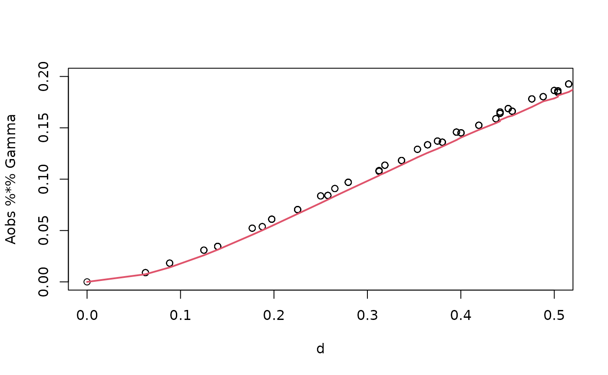

We can now use the `simulate` function to simulate a realization of the
field $`u`$:

``` r

u <- simulate(op,nsim = 1, use_kl = FALSE)

proj <- fm_evaluator(mesh_2d, dims = c(100, 100))
field <- fm_evaluate(proj, field = as.vector(u))
field.df <- data.frame(x1 = proj$lattice$loc[,1],
                       x2 = proj$lattice$loc[,2], 
                       y = as.vector(field))

library(ggplot2)
library(viridis)
ggplot(field.df, aes(x = x1, y = x2, fill = y)) +
    geom_raster() +
    scale_fill_viridis()
```

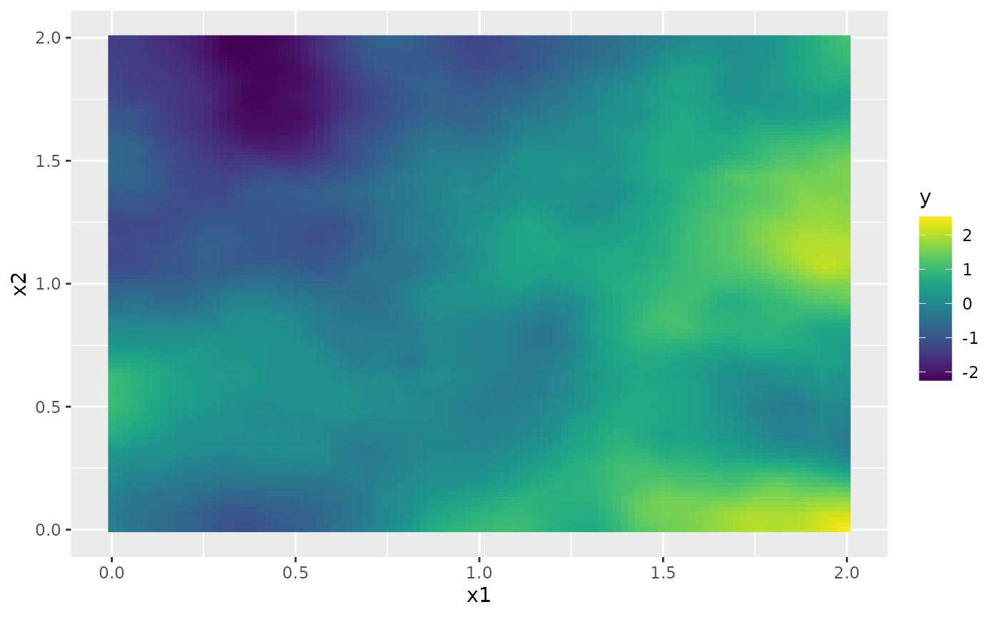

By default, the field is simulated with a zero-integral constraint.

### Fitting the model with `R-INLA`

We will now fit the model using our [`R-INLA`](https://www.r-inla.org)
implementation of the rational SPDE approach. Further details on this
implementation can be found in [R-INLA implementation of the rational
SPDE
approach](https://davidbolin.github.io/rSPDE/articles/rspde_inla.md).

We begin by simulating some data as before.

``` r

n_loc <- 2000
loc_2d_mesh <- matrix(2*runif(n_loc * 2), n_loc, 2)

A <- spde.make.A(
  mesh = mesh_2d,
  loc = loc_2d_mesh
)
sigma.e <- 0.1
y <- A %*% u + rnorm(n_loc) * sigma.e
```

The generated data can be seen in the following image.

``` r

df <- data.frame(x1 = as.double(loc_2d_mesh[, 1]),
  x2 = as.double(loc_2d_mesh[, 2]), y = as.double(y))
ggplot(df, aes(x = x1, y = x2, col = y)) +
  geom_point() +
  scale_color_viridis()
```

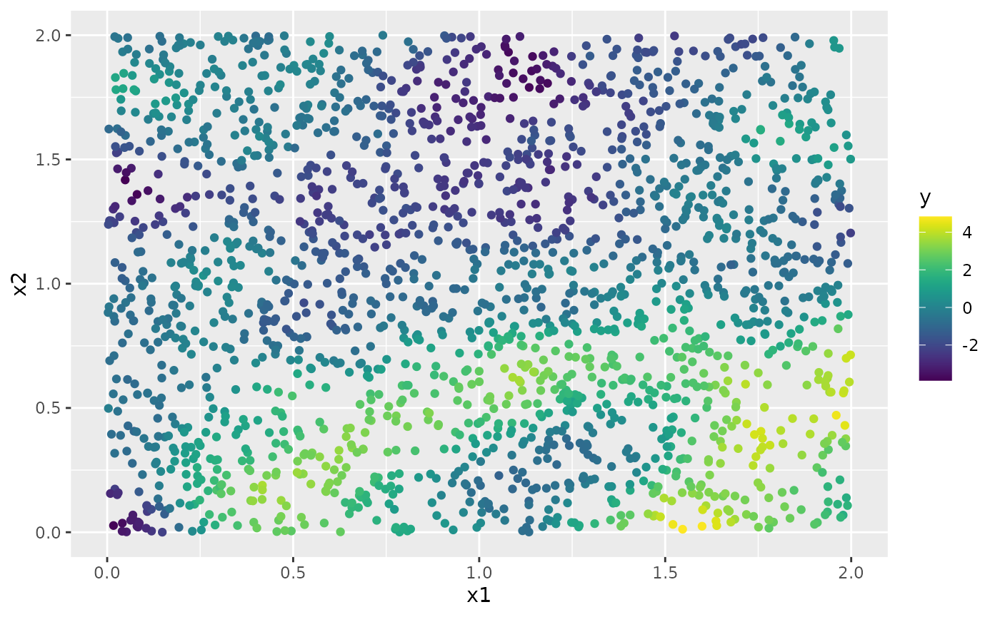

To fit the model, we create the $`A`$ matrix, the index, and the
`inla.stack` object. For now, these more general models can only be
estimated with $`\beta = 1`$ and $`\alpha = 1`$ or $`\alpha = 2`$. For
these non-fractional models, we can use the standard INLA functions to
make the required elements.

``` r

mesh.index <- inla.spde.make.index(name = "field", n.spde = mesh_2d$n)

st.dat <- inla.stack(data = list(y = as.vector(y)), A = A, effects = mesh.index)
```

We now create the model object.

``` r

rspde_model <- rspde.intrinsic.matern(mesh = mesh_2d, alpha = alpha)
```

Finally, we create the formula and fit the model to the data:

``` r

f <- y ~ -1 + f(field, model = rspde_model)
rspde_fit <- inla(f,
                  data = inla.stack.data(st.dat),
                  family = "gaussian",
                  control.predictor = list(A = inla.stack.A(st.dat)))
```

We can get a summary of the fit:

``` r

summary(rspde_fit)
#> Time used:
#>     Pre = 0.139, Running = 15.8, Post = 0.0482, Total = 15.9 
#> Random effects:
#>   Name     Model
#>     field CGeneric
#> 
#> Model hyperparameters:
#>                                           mean    sd 0.025quant 0.5quant
#> Precision for the Gaussian observations 100.68 4.490      92.10   100.59
#> Theta1 for field                         -5.98 0.048      -6.07    -5.98
#> Theta2 for field                          2.35 0.086       2.17     2.35
#>                                         0.975quant   mode
#> Precision for the Gaussian observations     109.78 100.44
#> Theta1 for field                             -5.88  -5.98
#> Theta2 for field                              2.51   2.35
#> 
#> Marginal log-Likelihood:  727.86 
#>  is computed 
#> Posterior summaries for the linear predictor and the fitted values are computed
#> (Posterior marginals needs also 'control.compute=list(return.marginals.predictor=TRUE)')
```

To get a summary of the fit of the random field only, we can do the
following:

``` r

result_fit <- rspde.result(rspde_fit, "field", rspde_model)
summary(result_fit)
#>              mean          sd 0.025quant    0.5quant  0.975quant        mode
#> tau    0.00253239 0.000121275 0.00230557  0.00252733  0.00278182  0.00251641
#> kappa 10.49120000 0.897568000 8.79934000 10.47040000 12.32040000 10.44910000
tau <- op$tau
result_df <- data.frame(
  parameter = c("tau", "kappa"),
  true = c(tau, kappa), mean = c(result_fit$summary.tau$mean,
                                     result_fit$summary.kappa$mean),
  mode = c(result_fit$summary.tau$mode, result_fit$summary.kappa$mode)
)
print(result_df)
#>   parameter    true         mean         mode
#> 1       tau  0.0025  0.002532386  0.002516414
#> 2     kappa 10.0000 10.491181009 10.449138970
```

### Kriging with `R-INLA` implementation

Let us now obtain predictions (i.e., do kriging) of the latent field on
a dense grid in the region.

We begin by creating the grid of locations where we want to compute the
predictions. To this end, we can use the
[`rspde.mesh.projector()`](https://davidbolin.github.io/rSPDE/reference/rspde.mesh.project.md)
function. This function has the same arguments as the function
[`inla.mesh.projector()`](https://rdrr.io/pkg/INLA/man/inla.mesh.project.html)
the only difference being that the rSPDE version also has an argument
`nu` and an argument `rspde.order`. Thus, we proceed in the same fashion
as we would in [`R-INLA`](https://www.r-inla.org)’s standard SPDE
implementation:

``` r

projgrid <- inla.mesh.projector(mesh_2d,
  xlim = c(0, 2),
  ylim = c(0, 2)
)
#> Warning: `inla.mesh.projector()` was deprecated in INLA 23.06.07.
#> ℹ Please use `fmesher::fm_evaluator()` instead.
#> ℹ For more information, see
#>   https://inlabru-org.github.io/fmesher/articles/inla_conversion.html
#> ℹ To silence these deprecation messages in old legacy code, set
#>   `inla.setOption(fmesher.evolution.warn = FALSE)`.
#> ℹ To ensure visibility of these messages in package tests, also set
#>   `inla.setOption(fmesher.evolution.verbosity = 'warn')`.
#> This warning is displayed once per session.
#> Call `lifecycle::last_lifecycle_warnings()` to see where this warning was
#> generated.
```

This lattice contains 100 × 100 locations (the default). Let us now
calculate the predictions jointly with the estimation. To this end,
first, we begin by linking the prediction coordinates to the mesh nodes
through an $`A`$ matrix

``` r

A.prd <- projgrid$proj$A
```

We now make a stack for the prediction locations. We have no data at the
prediction locations, so we set `y= NA`. We then join this stack with
the estimation stack.

``` r

ef.prd <- list(c(mesh.index))
st.prd <- inla.stack(
  data = list(y = NA),
  A = list(A.prd), tag = "prd",
  effects = ef.prd
)
st.all <- inla.stack(st.dat, st.prd)
```

Doing the joint estimation takes a while, and we therefore turn off the
computation of certain things that we are not interested in, such as the
marginals for the random effect. We will also use a simplified
integration strategy (actually only using the posterior mode of the
hyper-parameters) through the command
`control.inla = list(int.strategy = "eb")`, i.e. empirical Bayes:

``` r

rspde_fitprd <- inla(f,
  family = "Gaussian",
  data = inla.stack.data(st.all),
  control.predictor = list(
    A = inla.stack.A(st.all),
    compute = TRUE, link = 1
  ),
  control.compute = list(
    return.marginals = FALSE,
    return.marginals.predictor = FALSE
  ),
  control.inla = list(int.strategy = "eb")
)
```

We then extract the indices to the prediction nodes and then extract the
mean and the standard deviation of the response:

``` r

id.prd <- inla.stack.index(st.all, "prd")$data
m.prd <- matrix(rspde_fitprd$summary.fitted.values$mean[id.prd], 100, 100)
sd.prd <- matrix(rspde_fitprd$summary.fitted.values$sd[id.prd], 100, 100)
```

Finally, we plot the results. First the mean:

``` r

field.pred.df <- data.frame(x1 = projgrid$lattice$loc[,1],
                        x2 = projgrid$lattice$loc[,2], 
                        y = as.vector(m.prd))
ggplot(field.pred.df, aes(x = x1, y = x2, fill = y)) +
  geom_raster()  + scale_fill_viridis()
```

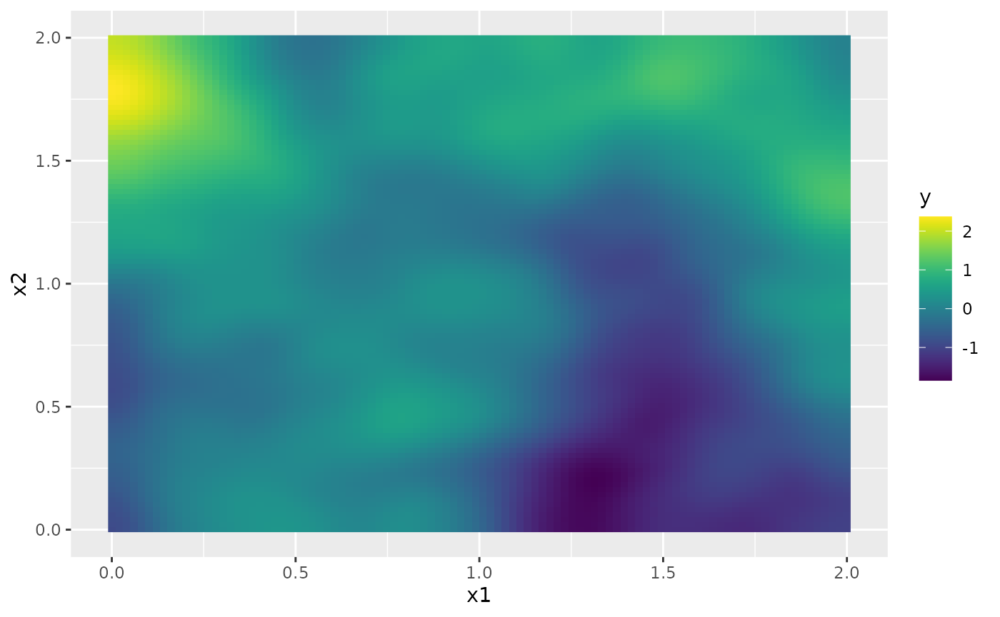

Then, the marginal standard deviations:

``` r

field.pred.sd.df <- data.frame(x1 = proj$lattice$loc[,1],
                        x2 = proj$lattice$loc[,2], 
                        sd = as.vector(sd.prd))
ggplot(field.pred.sd.df, aes(x = x1, y = x2, fill = sd)) +
  geom_raster() + scale_fill_viridis()
```

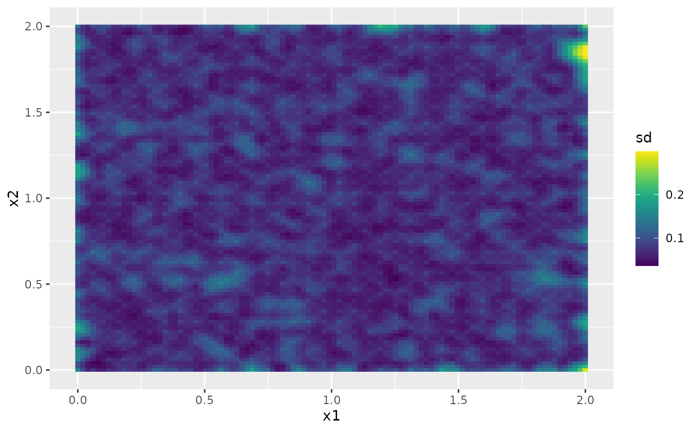

## Using intrinsic models without `R-INLA`

Currently, the more general model is only implemented in `R-INLA` using
fixed integer values of the smoothness parameters. However, all
intrinsic models are implemented in `rSPDE` in full generality. In this
section, we illustrate the `rSPDE` interface. Let us test a model in one
dimension.

Let us start with generating the model

``` r

L = 20
x <- seq(from = 0, to = L, length.out = 101)
mesh <- fm_mesh_1d(x)
beta <- 1.1
alpha <- 0
kappa <- 10
tau <- 10
op <- intrinsic.matern.operators(kappa = kappa, tau = tau, alpha = alpha,
                                 beta = beta, mesh = mesh, d = 1)

vario <- variogram.intrinsic.spde(c(L/2), mesh$loc, tau = tau,
                                  beta = beta, alpha = alpha, kappa = kappa, L = L, d = 1)
plot(x, vario, type = "l", col = 2, lwd = 2)
points(x,op$variogram(L/2),col=1)
```

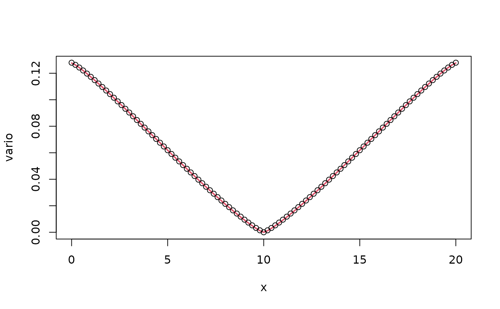

We now generate some data. The option to use a mean value correction for
extremes models is also implemented, so we generate some data using
this.

``` r

n.rep <- 100
u <- simulate(op,nsim = n.rep, integral.constraint = FALSE, use_kl = TRUE)

drift <- op$mean_correction()
u <- u + matrix(rep(drift, times = n.rep), nrow = op$n, ncol= n.rep)

sigma.e <- 0.01
n.obs <- 300
obs.loc <- runif(n = n.obs, min = 0, max = L)
A <- rSPDE.A1d(x, obs.loc)
Y <- as.matrix(A %*% u + sigma.e * matrix(rnorm(n.obs*n.rep),n.obs,n.rep))
```

Let us now show how to do kriging prediction for this model.

``` r

A <- make_A(op, loc = obs.loc)
A.krig <- make_A(op, loc = x)
u.krig <- predict(op,
  A = A, Aprd = A.krig, Y = Y[,1], sigma.e = sigma.e,
  compute.variances = TRUE
)


plot(obs.loc, Y[,1],
  ylab = "u(x)", xlab = "x", main = "Data and prediction",
  ylim = c(
    min(c(min(u.krig$mean - 2 * sqrt(u.krig$variance)),min(u[,1]))),
    max(c(max(u.krig$mean + 2 * sqrt(u.krig$variance)), max(u[,1])))
  )
)
lines(x,u[,1],col=3)
lines(x, u.krig$mean)
lines(x, u.krig$mean + 2 * sqrt(u.krig$variance), col = 2)
lines(x, u.krig$mean - 2 * sqrt(u.krig$variance), col = 2)
```

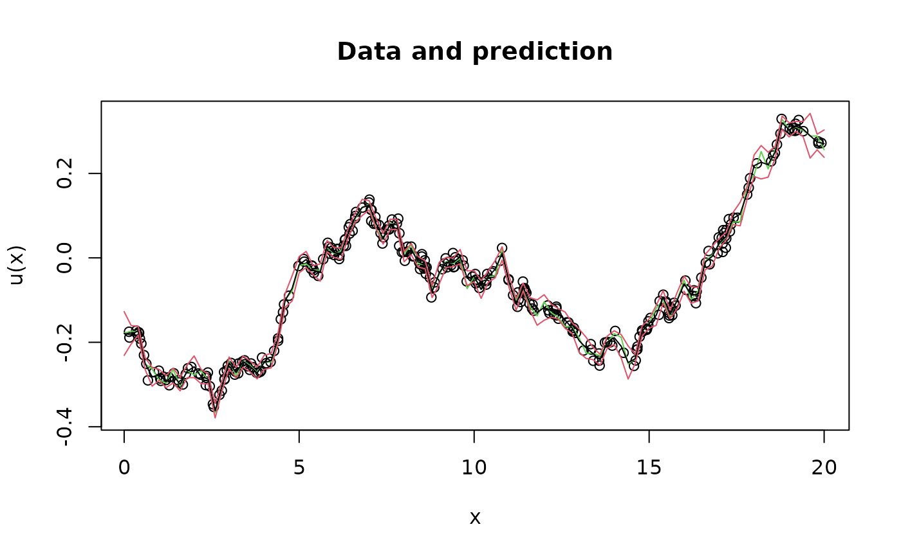

We now use `rspde_lme` to fit the parameters based on this data. Since
we generated data with `alpha=0`, we specify this in the function to
indicate that this parameter should not be fitted but kept fixed at
`alpha=0` by setting `fix_alpha=0` in `model_options`. We also specify
`mean_correction=TRUE` to indicate that we should use the mean value
correction when fitting.

``` r

data = data.frame(y = c(Y), loc = rep(obs.loc, n.rep), rep  = rep(1:n.rep, each = n.obs))

fit <- rspde_lme(y ~ -1, loc = "loc", repl  = "rep", data = data,
                 model = op, mean_correction = TRUE, parallel = FALSE,
                 model_options = list(fix_alpha = 0))
#> alpha =  0 , tau =  10 , beta = 1.1 , sigma_e =  0.02269796 , lik =  70630.21 nz =  3 , nz.p =  2 
#> alpha =  0 , tau =  10 , beta = 1.1 , sigma_e =  0.02269796 , lik =  70630.21 nz =  3 , nz.p =  2 
#> alpha =  0 , tau =  14.60163 , beta = 1.1 , sigma_e =  0.02269796 , lik =  70336.33 nz =  3 , nz.p =  2 
#> alpha =  0 , tau =  10 , beta = 1.376098 , sigma_e =  0.02269796 , lik =  70534.97 nz =  3 , nz.p =  2 
#> alpha =  0 , tau =  10 , beta = 1.1 , sigma_e =  0.03314272 , lik =  63228.04 nz =  3 , nz.p =  2 
#> alpha =  0 , tau =  12.87066 , beta = 1.27224 , sigma_e =  0.01554481 , lik =  75415.25 nz =  3 , nz.p =  2 
#> alpha =  0 , tau =  14.60163 , beta = 1.376098 , sigma_e =  0.01064594 , lik =  74292.27 nz =  3 , nz.p =  2 
#> alpha =  0 , tau =  8.103375 , beta = 1.413733 , sigma_e =  0.01763542 , lik =  74613.77 nz =  3 , nz.p =  2 
#> alpha =  0 , tau =  9.388577 , beta = 1.322531 , sigma_e =  0.01878392 , lik =  73774.86 nz =  3 , nz.p =  2 
#> alpha =  0 , tau =  10.28437 , beta = 1.14357 , sigma_e =  0.01490454 , lik =  77029.85 nz =  3 , nz.p =  2 
#> alpha =  0 , tau =  10.42958 , beta = 1.051592 , sigma_e =  0.01207771 , lik =  78894.39 nz =  3 , nz.p =  2 
#> alpha =  0 , tau =  10.57684 , beta = 1.388467 , sigma_e =  0.009787021 , lik =  77507.52 nz =  3 , nz.p =  2 
#> alpha =  0 , tau =  10.42958 , beta = 1.305414 , sigma_e =  0.01207771 , lik =  78235.19 nz =  3 , nz.p =  2 
#> alpha =  0 , tau =  15.4439 , beta = 1.036339 , sigma_e =  0.009787021 , lik =  78581.63 nz =  3 , nz.p =  2 
#> alpha =  0 , tau =  13.1442 , beta = 1.112752 , sigma_e =  0.01133925 , lik =  78789.12 nz =  3 , nz.p =  2 
#> alpha =  0 , tau =  9.860775 , beta = 1.043912 , sigma_e =  0.008997398 , lik =  79295.27 nz =  3 , nz.p =  2 
#> alpha =  0 , tau =  8.6311 , beta = 0.956475 , sigma_e =  0.006845145 , lik =  75084.89 nz =  0 , nz.p =  0 
#> alpha =  0 , tau =  11.72217 , beta = 0.9014225 , sigma_e =  0.009516399 , lik =  79355.99 nz =  0 , nz.p =  0 
#> alpha =  0 , tau =  12.42735 , beta = 0.7833956 , sigma_e =  0.008447276 , lik =  78642.73 nz =  0 , nz.p =  0 
#> alpha =  0 , tau =  8.617665 , beta = 0.8979978 , sigma_e =  0.009018447 , lik =  78493.79 nz =  0 , nz.p =  0 
#> alpha =  0 , tau =  11.82764 , beta = 1.05009 , sigma_e =  0.01070832 , lik =  79455.08 nz =  3 , nz.p =  2 
#> alpha =  0 , tau =  11.81076 , beta = 0.9413249 , sigma_e =  0.007814285 , lik =  77995.17 nz =  0 , nz.p =  0 
#> alpha =  0 , tau =  10.75894 , beta = 1.021678 , sigma_e =  0.01083205 , lik =  79402.74 nz =  3 , nz.p =  2 
#> alpha =  0 , tau =  13.23953 , beta = 0.9352747 , sigma_e =  0.01187097 , lik =  78741.33 nz =  0 , nz.p =  0 
#> alpha =  0 , tau =  10.61455 , beta = 1.014443 , sigma_e =  0.009642935 , lik =  79499.67 nz =  3 , nz.p =  2 
#> alpha =  0 , tau =  10.42409 , beta = 1.195848 , sigma_e =  0.01132283 , lik =  79159.66 nz =  3 , nz.p =  2 
#> alpha =  0 , tau =  11.38323 , beta = 0.9606063 , sigma_e =  0.009939012 , lik =  79393.77 nz =  0 , nz.p =  0 
#> alpha =  0 , tau =  10.73447 , beta = 1.106438 , sigma_e =  0.01084137 , lik =  79476.45 nz =  3 , nz.p =  2 
#> alpha =  0 , tau =  10.89311 , beta = 1.066138 , sigma_e =  0.01060838 , lik =  79535.39 nz =  3 , nz.p =  2 
#> alpha =  0 , tau =  11.45156 , beta = 1.065448 , sigma_e =  0.009810148 , lik =  79569.22 nz =  3 , nz.p =  2 
#> alpha =  0 , tau =  11.81442 , beta = 1.088691 , sigma_e =  0.009335937 , lik =  79373.95 nz =  3 , nz.p =  2 
#> alpha =  0 , tau =  10.19484 , beta = 1.046178 , sigma_e =  0.009360549 , lik =  79482.57 nz =  3 , nz.p =  2 
#> alpha =  0 , tau =  10.58059 , beta = 1.047153 , sigma_e =  0.009680689 , lik =  79574.95 nz =  3 , nz.p =  2 
#> alpha =  0 , tau =  11.33573 , beta = 1.108525 , sigma_e =  0.01042185 , lik =  79492.65 nz =  3 , nz.p =  2 
#> alpha =  0 , tau =  10.79042 , beta = 1.036504 , sigma_e =  0.009832028 , lik =  79578.86 nz =  3 , nz.p =  2 
#> alpha =  0 , tau =  10.97632 , beta = 1.033492 , sigma_e =  0.009005357 , lik =  79363.1 nz =  3 , nz.p =  2 
#> alpha =  0 , tau =  10.91385 , beta = 1.057793 , sigma_e =  0.01018268 , lik =  79598.14 nz =  3 , nz.p =  2 
#> alpha =  0 , tau =  10.11159 , beta = 1.029311 , sigma_e =  0.009983099 , lik =  79499.99 nz =  3 , nz.p =  2 
#> alpha =  0 , tau =  11.10078 , beta = 1.056189 , sigma_e =  0.009853102 , lik =  79599.19 nz =  3 , nz.p =  2 
#> alpha =  0 , tau =  11.29978 , beta = 1.053014 , sigma_e =  0.01023637 , lik =  79578.69 nz =  3 , nz.p =  2 
#> alpha =  0 , tau =  11.11553 , beta = 1.051543 , sigma_e =  0.01009453 , lik =  79596.43 nz =  3 , nz.p =  2 
#> alpha =  0 , tau =  11.3015 , beta = 1.074483 , sigma_e =  0.0102574 , lik =  79569.71 nz =  3 , nz.p =  2 
#> alpha =  0 , tau =  10.91598 , beta = 1.045756 , sigma_e =  0.009936689 , lik =  79597.48 nz =  3 , nz.p =  2 
#> alpha =  0 , tau =  10.83926 , beta = 1.054903 , sigma_e =  0.009886257 , lik =  79605.14 nz =  3 , nz.p =  2 
#> alpha =  0 , tau =  10.70371 , beta = 1.05659 , sigma_e =  0.00978374 , lik =  79600.61 nz =  3 , nz.p =  2 
#> alpha =  0 , tau =  10.98562 , beta = 1.067034 , sigma_e =  0.01000928 , lik =  79608.35 nz =  3 , nz.p =  2 
#> alpha =  0 , tau =  11.0206 , beta = 1.077982 , sigma_e =  0.01004578 , lik =  79603.51 nz =  3 , nz.p =  2 
#> alpha =  0 , tau =  11.03588 , beta = 1.060909 , sigma_e =  0.00965628 , lik =  79584.01 nz =  3 , nz.p =  2 
#> alpha =  0 , tau =  10.94423 , beta = 1.058571 , sigma_e =  0.01004845 , lik =  79606.19 nz =  3 , nz.p =  2 
#> alpha =  0 , tau =  10.7478 , beta = 1.064132 , sigma_e =  0.01011074 , lik =  79609.1 nz =  3 , nz.p =  2 
#> alpha =  0 , tau =  10.57554 , beta = 1.068146 , sigma_e =  0.01024207 , lik =  79600.43 nz =  3 , nz.p =  2 
#> alpha =  0 , tau =  10.94511 , beta = 1.071692 , sigma_e =  0.0102288 , lik =  79597.79 nz =  3 , nz.p =  2 
#> alpha =  0 , tau =  10.86562 , beta = 1.059053 , sigma_e =  0.009970801 , lik =  79609.17 nz =  3 , nz.p =  2 
#> alpha =  0 , tau =  10.78815 , beta = 1.068265 , sigma_e =  0.01001179 , lik =  79614.71 nz =  3 , nz.p =  2 
#> alpha =  0 , tau =  10.71095 , beta = 1.073175 , sigma_e =  0.009993506 , lik =  79618.26 nz =  3 , nz.p =  2 
#> alpha =  0 , tau =  10.56761 , beta = 1.063816 , sigma_e =  0.0100404 , lik =  79610.78 nz =  3 , nz.p =  2 
#> alpha =  0 , tau =  10.6706 , beta = 1.064619 , sigma_e =  0.01003261 , lik =  79612.95 nz =  3 , nz.p =  2 
#> alpha =  0 , tau =  10.74966 , beta = 1.067043 , sigma_e =  0.009888378 , lik =  79613.93 nz =  3 , nz.p =  2 
#> alpha =  0 , tau =  10.7492 , beta = 1.066314 , sigma_e =  0.009943505 , lik =  79614.71 nz =  3 , nz.p =  2 
#> alpha =  0 , tau =  10.557 , beta = 1.077139 , sigma_e =  0.01000885 , lik =  79621.59 nz =  3 , nz.p =  2 
#> alpha =  0 , tau =  10.406 , beta = 1.0864 , sigma_e =  0.01002793 , lik =  79625.94 nz =  3 , nz.p =  2 
#> alpha =  0 , tau =  10.57149 , beta = 1.086052 , sigma_e =  0.009944091 , lik =  79623.86 nz =  3 , nz.p =  2 
#> alpha =  0 , tau =  10.59618 , beta = 1.080619 , sigma_e =  0.009966148 , lik =  79622.69 nz =  3 , nz.p =  2 
#> alpha =  0 , tau =  10.37822 , beta = 1.097797 , sigma_e =  0.0100336 , lik =  79628.28 nz =  3 , nz.p =  2 
#> alpha =  0 , tau =  10.19756 , beta = 1.114189 , sigma_e =  0.01007895 , lik =  79628.71 nz =  3 , nz.p =  2 
#> alpha =  0 , tau =  10.07974 , beta = 1.118493 , sigma_e =  0.01004022 , lik =  79631.77 nz =  3 , nz.p =  2 
#> alpha =  0 , tau =  9.893493 , beta = 1.127024 , sigma_e =  0.01015503 , lik =  79627.69 nz =  3 , nz.p =  2 
#> alpha =  0 , tau =  10.0588 , beta = 1.11652 , sigma_e =  0.01010188 , lik =  79630.32 nz =  3 , nz.p =  2 
#> alpha =  0 , tau =  9.826016 , beta = 1.147932 , sigma_e =  0.01011958 , lik =  79619.97 nz =  3 , nz.p =  2 
#> alpha =  0 , tau =  10.25787 , beta = 1.101212 , sigma_e =  0.01005076 , lik =  79630.02 nz =  3 , nz.p =  2 
#> alpha =  0 , tau =  10.06636 , beta = 1.10987 , sigma_e =  0.01004957 , lik =  79632.37 nz =  3 , nz.p =  2 
#> alpha =  0 , tau =  10.0014 , beta = 1.107722 , sigma_e =  0.01003492 , lik =  79632.02 nz =  3 , nz.p =  2 
#> alpha =  0 , tau =  9.88223 , beta = 1.129002 , sigma_e =  0.01007696 , lik =  79631.55 nz =  3 , nz.p =  2 
#> alpha =  0 , tau =  9.97483 , beta = 1.121936 , sigma_e =  0.01007041 , lik =  79632.05 nz =  3 , nz.p =  2 
#> alpha =  0 , tau =  10.02163 , beta = 1.116971 , sigma_e =  0.01000514 , lik =  79633.69 nz =  3 , nz.p =  2 
#> alpha =  0 , tau =  10.0031 , beta = 1.117197 , sigma_e =  0.009957113 , lik =  79633.94 nz =  3 , nz.p =  2 
#> alpha =  0 , tau =  9.950061 , beta = 1.114144 , sigma_e =  0.01001096 , lik =  79633.76 nz =  3 , nz.p =  2 
#> alpha =  0 , tau =  9.982324 , beta = 1.115228 , sigma_e =  0.01001826 , lik =  79633.81 nz =  3 , nz.p =  2 
#> alpha =  0 , tau =  10.05975 , beta = 1.106344 , sigma_e =  0.009946466 , lik =  79632.8 nz =  3 , nz.p =  2 
#> alpha =  0 , tau =  10.03845 , beta = 1.110205 , sigma_e =  0.009977307 , lik =  79633.63 nz =  3 , nz.p =  2 
#> alpha =  0 , tau =  9.94984 , beta = 1.118567 , sigma_e =  0.009919242 , lik =  79633.67 nz =  3 , nz.p =  2 
#> alpha =  0 , tau =  9.978843 , beta = 1.116381 , sigma_e =  0.009951666 , lik =  79634.11 nz =  3 , nz.p =  2 
#> alpha =  0 , tau =  9.93797 , beta = 1.122392 , sigma_e =  0.009973965 , lik =  79634.1 nz =  3 , nz.p =  2 
#> alpha =  0 , tau =  9.962995 , beta = 1.119322 , sigma_e =  0.0099748 , lik =  79634.22 nz =  3 , nz.p =  2 
#> alpha =  0 , tau =  9.980942 , beta = 1.120046 , sigma_e =  0.009904437 , lik =  79632.77 nz =  3 , nz.p =  2 
#> alpha =  0 , tau =  9.981978 , beta = 1.116429 , sigma_e =  0.009989686 , lik =  79634.18 nz =  3 , nz.p =  2 
#> alpha =  0 , tau =  9.946185 , beta = 1.117555 , sigma_e =  0.009986986 , lik =  79634.34 nz =  3 , nz.p =  2 
#> alpha =  0 , tau =  9.917849 , beta = 1.117734 , sigma_e =  0.01000196 , lik =  79634.24 nz =  3 , nz.p =  2 
#> alpha =  0 , tau =  9.948597 , beta = 1.119157 , sigma_e =  0.01001608 , lik =  79634.03 nz =  3 , nz.p =  2 
#> alpha =  0 , tau =  9.971273 , beta = 1.117074 , sigma_e =  0.009967731 , lik =  79634.26 nz =  3 , nz.p =  2 
#> alpha =  0 , tau =  9.938361 , beta = 1.119541 , sigma_e =  0.009963337 , lik =  79634.35 nz =  3 , nz.p =  2 
#> alpha =  0 , tau =  9.916624 , beta = 1.121103 , sigma_e =  0.009950188 , lik =  79634.28 nz =  3 , nz.p =  2 
#> alpha =  0 , tau =  9.940877 , beta = 1.116791 , sigma_e =  0.009970559 , lik =  79634.34 nz =  3 , nz.p =  2 
#> alpha =  0 , tau =  9.946402 , beta = 1.117423 , sigma_e =  0.009971619 , lik =  79634.36 nz =  3 , nz.p =  2 
#> alpha =  0 , tau =  9.9161 , beta = 1.119272 , sigma_e =  0.009980225 , lik =  79634.46 nz =  3 , nz.p =  2 
#> alpha =  0 , tau =  9.888629 , beta = 1.120375 , sigma_e =  0.009986477 , lik =  79634.49 nz =  3 , nz.p =  2 
#> alpha =  0 , tau =  9.902724 , beta = 1.120672 , sigma_e =  0.009960644 , lik =  79634.45 nz =  3 , nz.p =  2 
#> alpha =  0 , tau =  9.913572 , beta = 1.119891 , sigma_e =  0.009967223 , lik =  79634.46 nz =  3 , nz.p =  2 
#> alpha =  0 , tau =  9.894034 , beta = 1.118916 , sigma_e =  0.009986883 , lik =  79634.41 nz =  3 , nz.p =  2 
#> alpha =  0 , tau =  9.905097 , beta = 1.119072 , sigma_e =  0.009980991 , lik =  79634.46 nz =  3 , nz.p =  2 
#> alpha =  0 , tau =  9.858647 , beta = 1.122144 , sigma_e =  0.00998484 , lik =  79634.52 nz =  3 , nz.p =  2 
#> alpha =  0 , tau =  9.81506 , beta = 1.124518 , sigma_e =  0.009991457 , lik =  79634.46 nz =  3 , nz.p =  2 
#> alpha =  0 , tau =  9.858647 , beta = 1.122144 , sigma_e =  0.00998484 , lik =  79634.52 nz =  3 , nz.p =  2 
#> alpha =  0 , tau =  9.86851 , beta = 1.122144 , sigma_e =  0.00998484 , lik =  79634.53 nz =  3 , nz.p =  2 
#> alpha =  0 , tau =  9.848793 , beta = 1.122144 , sigma_e =  0.00998484 , lik =  79634.5 nz =  3 , nz.p =  2 
#> alpha =  0 , tau =  9.858647 , beta = 1.122767 , sigma_e =  0.00998484 , lik =  79634.53 nz =  3 , nz.p =  2 
#> alpha =  0 , tau =  9.858647 , beta = 1.121522 , sigma_e =  0.00998484 , lik =  79634.5 nz =  3 , nz.p =  2 
#> alpha =  0 , tau =  9.858647 , beta = 1.122144 , sigma_e =  0.00999483 , lik =  79634.46 nz =  3 , nz.p =  2 
#> alpha =  0 , tau =  9.858647 , beta = 1.122144 , sigma_e =  0.00997486 , lik =  79634.54 nz =  3 , nz.p =  2 
#> alpha =  0 , tau =  13.14265 , beta = 1.409395 , sigma_e =  0.004144288 , lik =  38792.98 nz =  3 , nz.p =  2 
#> alpha =  0 , tau =  13.1558 , beta = 1.409395 , sigma_e =  0.004144288 , lik =  38764.02 nz =  3 , nz.p =  2 
#> alpha =  0 , tau =  13.12952 , beta = 1.409395 , sigma_e =  0.004144288 , lik =  38821.89 nz =  3 , nz.p =  2 
#> alpha =  0 , tau =  13.14265 , beta = 1.410305 , sigma_e =  0.004144288 , lik =  38750.92 nz =  3 , nz.p =  2 
#> alpha =  0 , tau =  13.14265 , beta = 1.408486 , sigma_e =  0.004144288 , lik =  38834.92 nz =  3 , nz.p =  2 
#> alpha =  0 , tau =  13.14265 , beta = 1.409395 , sigma_e =  0.004148434 , lik =  38895.13 nz =  3 , nz.p =  2 
#> alpha =  0 , tau =  13.14265 , beta = 1.409395 , sigma_e =  0.004140146 , lik =  38690.61 nz =  3 , nz.p =  2 
#> alpha =  0 , tau =  9.862927 , beta = 1.122501 , sigma_e =  0.009971592 , lik =  79634.54 nz =  3 , nz.p =  2 
#> alpha =  0 , tau =  9.872795 , beta = 1.122501 , sigma_e =  0.009971592 , lik =  79634.53 nz =  3 , nz.p =  2 
#> alpha =  0 , tau =  9.853069 , beta = 1.122501 , sigma_e =  0.009971592 , lik =  79634.54 nz =  3 , nz.p =  2 
#> alpha =  0 , tau =  9.862927 , beta = 1.123124 , sigma_e =  0.009971592 , lik =  79634.53 nz =  3 , nz.p =  2 
#> alpha =  0 , tau =  9.862927 , beta = 1.121879 , sigma_e =  0.009971592 , lik =  79634.53 nz =  3 , nz.p =  2 
#> alpha =  0 , tau =  9.862927 , beta = 1.122501 , sigma_e =  0.009981569 , lik =  79634.54 nz =  3 , nz.p =  2 
#> alpha =  0 , tau =  9.862927 , beta = 1.122501 , sigma_e =  0.009961625 , lik =  79634.5 nz =  3 , nz.p =  2 
#> alpha =  0 , tau =  9.861838 , beta = 1.122449 , sigma_e =  0.009976011 , lik =  79634.55 nz =  3 , nz.p =  2 
#> alpha =  0 , tau =  9.871704 , beta = 1.122449 , sigma_e =  0.009976011 , lik =  79634.54 nz =  3 , nz.p =  2 
#> alpha =  0 , tau =  9.851981 , beta = 1.122449 , sigma_e =  0.009976011 , lik =  79634.54 nz =  3 , nz.p =  2 
#> alpha =  0 , tau =  9.861838 , beta = 1.123072 , sigma_e =  0.009976011 , lik =  79634.54 nz =  3 , nz.p =  2 
#> alpha =  0 , tau =  9.861838 , beta = 1.121827 , sigma_e =  0.009976011 , lik =  79634.54 nz =  3 , nz.p =  2 
#> alpha =  0 , tau =  9.861838 , beta = 1.122449 , sigma_e =  0.009985992 , lik =  79634.53 nz =  3 , nz.p =  2 
#> alpha =  0 , tau =  9.861838 , beta = 1.122449 , sigma_e =  0.00996604 , lik =  79634.52 nz =  3 , nz.p =  2 
#> alpha =  0 , tau =  9.861668 , beta = 1.122479 , sigma_e =  0.009976172 , lik =  79634.55 nz =  3 , nz.p =  2 
#> alpha =  0 , tau =  9.871535 , beta = 1.122479 , sigma_e =  0.009976172 , lik =  79634.54 nz =  3 , nz.p =  2 
#> alpha =  0 , tau =  9.851812 , beta = 1.122479 , sigma_e =  0.009976172 , lik =  79634.54 nz =  3 , nz.p =  2 
#> alpha =  0 , tau =  9.861668 , beta = 1.123102 , sigma_e =  0.009976172 , lik =  79634.54 nz =  3 , nz.p =  2 
#> alpha =  0 , tau =  9.861668 , beta = 1.121857 , sigma_e =  0.009976172 , lik =  79634.54 nz =  3 , nz.p =  2 
#> alpha =  0 , tau =  9.861668 , beta = 1.122479 , sigma_e =  0.009986154 , lik =  79634.52 nz =  3 , nz.p =  2 
#> alpha =  0 , tau =  9.861668 , beta = 1.122479 , sigma_e =  0.009966201 , lik =  79634.52 nz =  3 , nz.p =  2 
#> alpha =  0 , tau =  9.881411 , beta = 1.122479 , sigma_e =  0.009976172 , lik =  79634.51 nz =  3 , nz.p =  2 
#> alpha =  0 , tau =  9.861668 , beta = 1.122479 , sigma_e =  0.009976172 , lik =  79634.55 nz =  3 , nz.p =  2 
#> alpha =  0 , tau =  9.871535 , beta = 1.123102 , sigma_e =  0.009976172 , lik =  79634.52 nz =  3 , nz.p =  2 
#> alpha =  0 , tau =  9.871535 , beta = 1.121857 , sigma_e =  0.009976172 , lik =  79634.54 nz =  3 , nz.p =  2 
#> alpha =  0 , tau =  9.871535 , beta = 1.122479 , sigma_e =  0.009986154 , lik =  79634.52 nz =  3 , nz.p =  2 
#> alpha =  0 , tau =  9.871535 , beta = 1.122479 , sigma_e =  0.009966201 , lik =  79634.51 nz =  3 , nz.p =  2 
#> alpha =  0 , tau =  9.861668 , beta = 1.122479 , sigma_e =  0.009976172 , lik =  79634.55 nz =  3 , nz.p =  2 
#> alpha =  0 , tau =  9.841965 , beta = 1.122479 , sigma_e =  0.009976172 , lik =  79634.52 nz =  3 , nz.p =  2 
#> alpha =  0 , tau =  9.851812 , beta = 1.123102 , sigma_e =  0.009976172 , lik =  79634.55 nz =  3 , nz.p =  2 
#> alpha =  0 , tau =  9.851812 , beta = 1.121857 , sigma_e =  0.009976172 , lik =  79634.52 nz =  3 , nz.p =  2 
#> alpha =  0 , tau =  9.851812 , beta = 1.122479 , sigma_e =  0.009986154 , lik =  79634.52 nz =  3 , nz.p =  2 
#> alpha =  0 , tau =  9.851812 , beta = 1.122479 , sigma_e =  0.009966201 , lik =  79634.52 nz =  3 , nz.p =  2 
#> alpha =  0 , tau =  9.871535 , beta = 1.123102 , sigma_e =  0.009976172 , lik =  79634.52 nz =  3 , nz.p =  2 
#> alpha =  0 , tau =  9.851812 , beta = 1.123102 , sigma_e =  0.009976172 , lik =  79634.55 nz =  3 , nz.p =  2 
#> alpha =  0 , tau =  9.861668 , beta = 1.123726 , sigma_e =  0.009976172 , lik =  79634.52 nz =  3 , nz.p =  2 
#> alpha =  0 , tau =  9.861668 , beta = 1.122479 , sigma_e =  0.009976172 , lik =  79634.55 nz =  3 , nz.p =  2 
#> alpha =  0 , tau =  9.861668 , beta = 1.123102 , sigma_e =  0.009986154 , lik =  79634.52 nz =  3 , nz.p =  2 
#> alpha =  0 , tau =  9.861668 , beta = 1.123102 , sigma_e =  0.009966201 , lik =  79634.52 nz =  3 , nz.p =  2 
#> alpha =  0 , tau =  9.871535 , beta = 1.121857 , sigma_e =  0.009976172 , lik =  79634.54 nz =  3 , nz.p =  2 
#> alpha =  0 , tau =  9.851812 , beta = 1.121857 , sigma_e =  0.009976172 , lik =  79634.52 nz =  3 , nz.p =  2 
#> alpha =  0 , tau =  9.861668 , beta = 1.122479 , sigma_e =  0.009976172 , lik =  79634.55 nz =  3 , nz.p =  2 
#> alpha =  0 , tau =  9.861668 , beta = 1.121236 , sigma_e =  0.009976172 , lik =  79634.51 nz =  3 , nz.p =  2 
#> alpha =  0 , tau =  9.861668 , beta = 1.121857 , sigma_e =  0.009986154 , lik =  79634.51 nz =  3 , nz.p =  2 
#> alpha =  0 , tau =  9.861668 , beta = 1.121857 , sigma_e =  0.009966201 , lik =  79634.52 nz =  3 , nz.p =  2 
#> alpha =  0 , tau =  9.871535 , beta = 1.122479 , sigma_e =  0.009986154 , lik =  79634.52 nz =  3 , nz.p =  2 
#> alpha =  0 , tau =  9.851812 , beta = 1.122479 , sigma_e =  0.009986154 , lik =  79634.52 nz =  3 , nz.p =  2 
#> alpha =  0 , tau =  9.861668 , beta = 1.123102 , sigma_e =  0.009986154 , lik =  79634.52 nz =  3 , nz.p =  2 
#> alpha =  0 , tau =  9.861668 , beta = 1.121857 , sigma_e =  0.009986154 , lik =  79634.51 nz =  3 , nz.p =  2 
#> alpha =  0 , tau =  9.861668 , beta = 1.122479 , sigma_e =  0.009996145 , lik =  79634.46 nz =  3 , nz.p =  2 
#> alpha =  0 , tau =  9.861668 , beta = 1.122479 , sigma_e =  0.009976172 , lik =  79634.55 nz =  3 , nz.p =  2 
#> alpha =  0 , tau =  9.871535 , beta = 1.122479 , sigma_e =  0.009966201 , lik =  79634.51 nz =  3 , nz.p =  2 
#> alpha =  0 , tau =  9.851812 , beta = 1.122479 , sigma_e =  0.009966201 , lik =  79634.52 nz =  3 , nz.p =  2 
#> alpha =  0 , tau =  9.861668 , beta = 1.123102 , sigma_e =  0.009966201 , lik =  79634.52 nz =  3 , nz.p =  2 
#> alpha =  0 , tau =  9.861668 , beta = 1.121857 , sigma_e =  0.009966201 , lik =  79634.52 nz =  3 , nz.p =  2 
#> alpha =  0 , tau =  9.861668 , beta = 1.122479 , sigma_e =  0.009976172 , lik =  79634.55 nz =  3 , nz.p =  2 
#> alpha =  0 , tau =  9.861668 , beta = 1.122479 , sigma_e =  0.00995624 , lik =  79634.46 nz =  3 , nz.p =  2

rbind(c(fit$coeff$random_effects[c("beta", "tau")], fit$coeff$measurement_error), 
      c(beta, tau, sigma.e))
#>          beta       tau    std. dev
#> [1,] 1.122479  9.861668 0.009976172
#> [2,] 1.100000 10.000000 0.010000000
```

### An example with estimated alpha and beta parameters

In the previous example, we fixed the alpha parameter and only estimated
beta. Now, let us demonstrate how to estimate both alpha and beta
simultaneously. We will set up a new model with different parameter
values:

``` r

L = 20
x <- seq(from = 0, to = L, length.out = 101)
mesh <- fm_mesh_1d(x)
beta <- 1.2
alpha <- 0.3
kappa <- 15
tau <- 7
op <- intrinsic.matern.operators(kappa = kappa, tau = tau, alpha = alpha,
                                 beta = beta, mesh = mesh, d = 1)

vario <- variogram.intrinsic.spde(c(L/2), mesh$loc, tau = tau,
                                  beta = beta, alpha = alpha, kappa = kappa, L = L, d = 1)
plot(x, vario, type = "l", col = 2, lwd = 2)
points(x, op$variogram(L/2), col = 1)
```

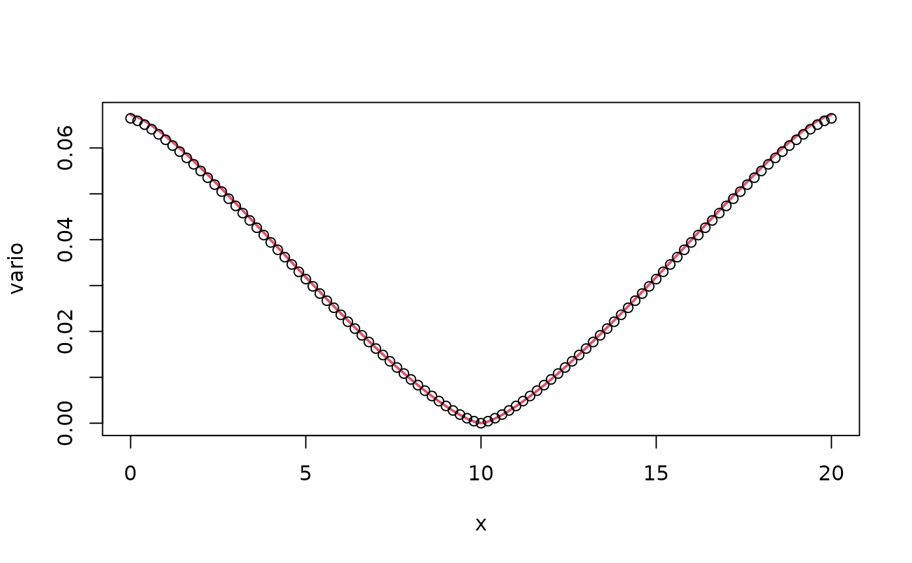

We can note here that the variogram of the approximate model is not
particularly close to the variogram of the true continuous model. The
reason for this is that the value of `alpha` is very small, and we
therefore need a larger order of the rational approximation than the
default value of 2. We can adjust the orders of the rational
approximations through the `m_alpha` and `m_beta` values in
`intrinsic.matern.operators`. Let us increase the value of `m_alpha` and
decrease the value of `m_beta`.

``` r

op <- intrinsic.matern.operators(kappa = kappa, tau = tau, alpha = alpha,
                                 beta = beta, mesh = mesh, d = 1, m_alpha = 6, 
                                 m_beta = 1)

vario <- variogram.intrinsic.spde(c(L/2), mesh$loc, tau = tau,
                                  beta = beta, alpha = alpha, kappa = kappa, L = L, d = 1)
plot(x, vario, type = "l", col = 2, lwd = 2)
points(x, op$variogram(L/2), col = 1)
```

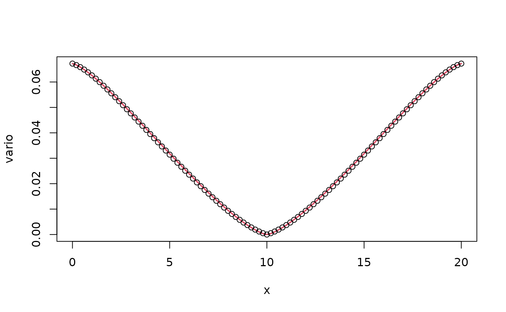

We now have a better approximation. Similar to the previous example, we
will generate data with the mean value correction for extremes models:

``` r

n.rep <- 100
u <- simulate(op, nsim = n.rep, integral.constraint = FALSE, use_kl = TRUE)

drift <- op$mean_correction()
u <- u + matrix(rep(drift, times = n.rep), nrow = op$n, ncol = n.rep)

sigma.e <- 0.015
n.obs <- 300
obs.loc <- runif(n = n.obs, min = 0, max = L)
A <- rSPDE.A1d(x, obs.loc)
Y <- as.matrix(A %*% u + sigma.e * matrix(rnorm(n.obs*n.rep), n.obs, n.rep))
```

Let’s visualize the data and predictions for this model:

``` r

A <- make_A(op, loc = obs.loc)
A.krig <- make_A(op, loc = x)
u.krig <- predict(op,
  A = A, Aprd = A.krig, Y = Y[,1], sigma.e = sigma.e,
  compute.variances = TRUE
)

plot(obs.loc, Y[,1],
  ylab = "u(x)", xlab = "x", main = "Data and prediction with fractional alpha and beta",
  ylim = c(
    min(c(min(u.krig$mean - 2 * sqrt(u.krig$variance)), min(u[,1]))),
    max(c(max(u.krig$mean + 2 * sqrt(u.krig$variance)), max(u[,1])))
  )
)
lines(x, u[,1], col = 3)
lines(x, u.krig$mean)
lines(x, u.krig$mean + 2 * sqrt(u.krig$variance), col = 2)
lines(x, u.krig$mean - 2 * sqrt(u.krig$variance), col = 2)
```

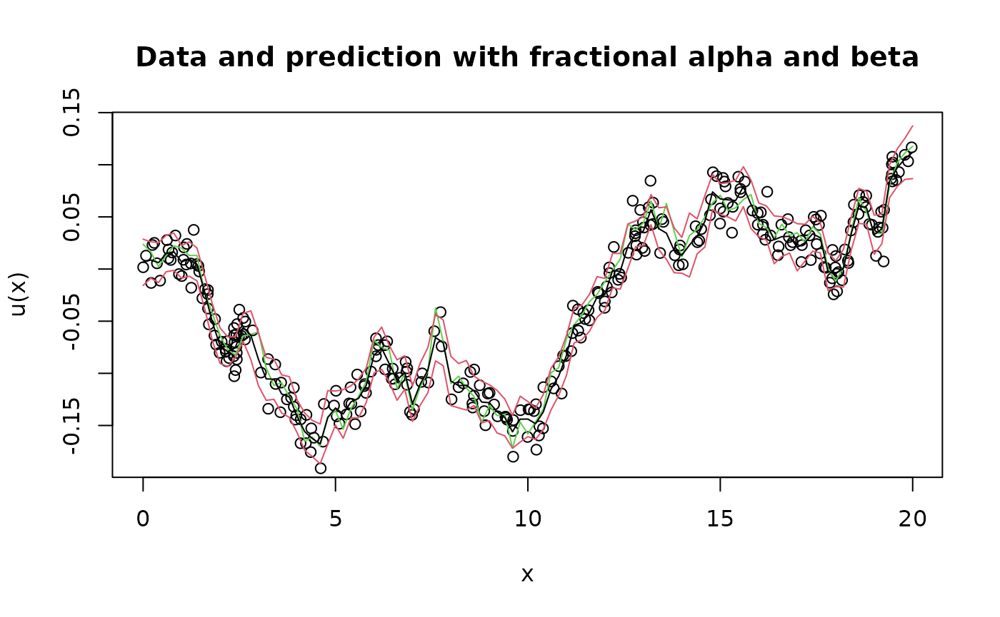

Now, we will use `rspde_lme` to fit the parameters but this time we will
not fix alpha, allowing both alpha and beta to be estimated. Unlike the
previous example where we set `fix_alpha=0`, we do not include this
constraint:

``` r

data = data.frame(y = c(Y), loc = rep(obs.loc, n.rep), rep = rep(1:n.rep, each = n.obs))
op <- intrinsic.matern.operators(kappa = kappa, tau = tau, alpha = 1.3, beta = 1.05, mesh = mesh, d = 1, m_alpha = 3, m_beta = 1)
fit <- rspde_lme(y ~ -1, loc = "loc", repl = "rep", data = data,
                 model = op, mean_correction = TRUE, parallel = FALSE)
#> alpha =  1.3 , tau =  7 , beta = 1.05 , sigma_e =  0.0166008 , lik =  -21079.95 nz =  8 , nz.p =  7 
#> alpha =  1.3 , tau =  7 , beta = 1.05 , sigma_e =  0.0166008 , lik =  -21079.95 nz =  8 , nz.p =  7 
#> alpha =  1.3 , tau =  10.54594 , beta = 1.05 , sigma_e =  0.0166008 , lik =  -90037.53 nz =  8 , nz.p =  7 
#> alpha =  1.3 , tau =  7 , beta = 1.05 , sigma_e =  0.0166008 , lik =  -117986.7 nz =  8 , nz.p =  7 
#> alpha =  1.958531 , tau =  7 , beta = 1.05 , sigma_e =  0.0166008 , lik =  -683746.5 nz =  8 , nz.p =  7 
#> alpha =  1.3 , tau =  7 , beta = 1.58189 , sigma_e =  0.0166008 , lik =  12962.15 nz =  8 , nz.p =  7 
#> alpha =  1.3 , tau =  7 , beta = 1.05 , sigma_e =  0.02501013 , lik =  800.3292 nz =  8 , nz.p =  7 
#> alpha =  0.8628916 , tau =  8.246941 , beta = 1.237041 , sigma_e =  0.01955797 , lik =  52313.09 nz =  8 , nz.p =  7 
#> alpha =  0.5727553 , tau =  8.951386 , beta = 1.342708 , sigma_e =  0.02122859 , lik =  66241.59 nz =  8 , nz.p =  7 
#> alpha =  0.9365989 , tau =  9.099338 , beta = 1.364901 , sigma_e =  0.02157946 , lik =  57061.29 nz =  8 , nz.p =  7 
#> alpha =  1.016602 , tau =  8.52181 , beta = 1.278272 , sigma_e =  0.02020983 , lik =  47426.12 nz =  8 , nz.p =  7 
#> alpha =  0.8214815 , tau =  5.693673 , beta = 1.515883 , sigma_e =  0.02396654 , lik =  64912.08 nz =  8 , nz.p =  7 
#> alpha =  0.9213702 , tau =  6.642257 , beta = 1.382919 , sigma_e =  0.02186433 , lik =  58895.24 nz =  8 , nz.p =  7 
#> alpha =  0.6836905 , tau =  7.897642 , beta = 1.755724 , sigma_e =  0.0277585 , lik =  64300.46 nz =  8 , nz.p =  7 
#> alpha =  0.8028428 , tau =  7.662978 , beta = 1.543973 , sigma_e =  0.02441064 , lik =  62103.59 nz =  8 , nz.p =  7 
#> alpha =  0.5287204 , tau =  8.288142 , beta = 2.156568 , sigma_e =  0.01920971 , lik =  66040.15 nz =  8 , nz.p =  7 
#> alpha =  0.6620722 , tau =  7.94543 , beta = 1.801439 , sigma_e =  0.02051963 , lik =  66618.45 nz =  8 , nz.p =  7 
#> alpha =  0.4036555 , tau =  8.718965 , beta = 1.604178 , sigma_e =  0.03150099 , lik =  65289.68 nz =  8 , nz.p =  7 
#> alpha =  0.5407468 , tau =  8.253216 , beta = 1.526016 , sigma_e =  0.02683956 , lik =  66683.73 nz =  8 , nz.p =  7 
#> alpha =  0.4497557 , tau =  6.450577 , beta = 1.877553 , sigma_e =  0.02644273 , lik =  67804.29 nz =  8 , nz.p =  7 
#> alpha =  0.3116651 , tau =  5.431165 , beta = 2.302639 , sigma_e =  0.02927111 , lik =  65820.86 nz =  8 , nz.p =  7 
#> alpha =  0.5210959 , tau =  6.854115 , beta = 1.44344 , sigma_e =  0.02016114 , lik =  70111.32 nz =  8 , nz.p =  7 
#> alpha =  0.4549322 , tau =  6.385257 , beta = 1.353858 , sigma_e =  0.01718204 , lik =  72189.91 nz =  8 , nz.p =  7 
#> alpha =  0.3423883 , tau =  9.953381 , beta = 1.734029 , sigma_e =  0.0204406 , lik =  70360.04 nz =  8 , nz.p =  7 
#> alpha =  0.4261266 , tau =  8.656176 , beta = 1.634934 , sigma_e =  0.0212702 , lik =  69761.29 nz =  8 , nz.p =  7 
#> alpha =  0.3997307 , tau =  6.605489 , beta = 1.997986 , sigma_e =  0.02273038 , lik =  68991.01 nz =  8 , nz.p =  7 
#> alpha =  0.4373387 , tau =  7.12691 , beta = 1.803141 , sigma_e =  0.02234525 , lik =  70029.01 nz =  8 , nz.p =  7 
#> alpha =  0.2929519 , tau =  7.125107 , beta = 1.602172 , sigma_e =  0.02433126 , lik =  69889.66 nz =  8 , nz.p =  7 
#> alpha =  0.3591894 , tau =  7.321885 , beta = 1.627994 , sigma_e =  0.02331663 , lik =  70125.34 nz =  8 , nz.p =  7 
#> alpha =  0.3045366 , tau =  6.538611 , beta = 1.825493 , sigma_e =  0.01758389 , lik =  72668.15 nz =  8 , nz.p =  7 
#> alpha =  0.22854 , tau =  5.819915 , beta = 1.956126 , sigma_e =  0.01423262 , lik =  72106.72 nz =  8 , nz.p =  7 
#> alpha =  0.3132723 , tau =  8.411334 , beta = 1.487185 , sigma_e =  0.01516029 , lik =  72653.92 nz =  8 , nz.p =  7 
#> alpha =  0.3429143 , tau =  7.871333 , beta = 1.572961 , sigma_e =  0.01742237 , lik =  72387.34 nz =  8 , nz.p =  7 
#> alpha =  0.2819177 , tau =  8.134813 , beta = 1.433177 , sigma_e =  0.01536163 , lik =  73011.91 nz =  8 , nz.p =  7 
#> alpha =  0.2263469 , tau =  8.69102 , beta = 1.288922 , sigma_e =  0.01273689 , lik =  72562.15 nz =  8 , nz.p =  7 
#> alpha =  0.311556 , tau =  8.258779 , beta = 1.500078 , sigma_e =  0.01245849 , lik =  70840.17 nz =  8 , nz.p =  7 
#> alpha =  0.3228368 , tau =  8.013876 , beta = 1.53064 , sigma_e =  0.01457188 , lik =  72296.92 nz =  8 , nz.p =  7 
#> alpha =  0.3192467 , tau =  5.570792 , beta = 1.344927 , sigma_e =  0.01241213 , lik =  72732.6 nz =  8 , nz.p =  7 
#> alpha =  0.3248812 , tau =  6.44066 , beta = 1.43095 , sigma_e =  0.01406074 , lik =  73162.98 nz =  8 , nz.p =  7 
#> alpha =  0.2099955 , tau =  8.713849 , beta = 1.669256 , sigma_e =  0.0136282 , lik =  72781.27 nz =  8 , nz.p =  7 
#> alpha =  0.2547675 , tau =  8.062173 , beta = 1.606521 , sigma_e =  0.01444101 , lik =  72997.04 nz =  8 , nz.p =  7 
#> alpha =  0.269177 , tau =  6.959685 , beta = 1.567611 , sigma_e =  0.01601145 , lik =  73470.8 nz =  8 , nz.p =  7 
#> alpha =  0.2457907 , tau =  6.485792 , beta = 1.582731 , sigma_e =  0.01678372 , lik =  73517.52 nz =  8 , nz.p =  7 
#> alpha =  0.2517424 , tau =  5.975944 , beta = 1.651479 , sigma_e =  0.01602917 , lik =  73613.95 nz =  8 , nz.p =  7 
#> alpha =  0.2399748 , tau =  7.415738 , beta = 1.31441 , sigma_e =  0.01331748 , lik =  73303.72 nz =  8 , nz.p =  7 
#> alpha =  0.254703 , tau =  7.185999 , beta = 1.421001 , sigma_e =  0.01427563 , lik =  73489.37 nz =  8 , nz.p =  7 
#> alpha =  0.286825 , tau =  5.743833 , beta = 1.403823 , sigma_e =  0.0161413 , lik =  73709.73 nz =  8 , nz.p =  7 
#> alpha =  0.3043361 , tau =  4.848156 , beta = 1.30919 , sigma_e =  0.0170651 , lik =  73522.92 nz =  8 , nz.p =  7 
#> alpha =  0.2609977 , tau =  4.952768 , beta = 1.562103 , sigma_e =  0.01547745 , lik =  73743.58 nz =  8 , nz.p =  7 
#> alpha =  0.2511273 , tau =  3.864543 , beta = 1.629524 , sigma_e =  0.01553568 , lik =  73309.73 nz =  8 , nz.p =  7 
#> alpha =  0.207491 , tau =  5.631605 , beta = 1.599692 , sigma_e =  0.01757134 , lik =  73227.27 nz =  8 , nz.p =  7 
#> alpha =  0.3248812 , tau =  6.44066 , beta = 1.43095 , sigma_e =  0.01406074 , lik =  73162.98 nz =  8 , nz.p =  7 
#> alpha =  0.2736068 , tau =  5.333654 , beta = 1.481522 , sigma_e =  0.01580589 , lik =  73767 nz =  8 , nz.p =  7 
#> alpha =  0.2327116 , tau =  5.281291 , beta = 1.582406 , sigma_e =  0.01649119 , lik =  73559.32 nz =  8 , nz.p =  7 
#> alpha =  0.2563283 , tau =  5.440355 , beta = 1.606244 , sigma_e =  0.01575089 , lik =  73722.47 nz =  8 , nz.p =  7 
#> alpha =  0.2578311 , tau =  5.965784 , beta = 1.489396 , sigma_e =  0.0148644 , lik =  73774.85 nz =  8 , nz.p =  7 
#> alpha =  0.2532801 , tau =  5.667682 , beta = 1.572528 , sigma_e =  0.01611736 , lik =  73687.59 nz =  8 , nz.p =  7 
#> alpha =  0.2461266 , tau =  5.370656 , beta = 1.562419 , sigma_e =  0.01603808 , lik =  73692.11 nz =  8 , nz.p =  7 
#> alpha =  0.2644969 , tau =  5.150774 , beta = 1.507451 , sigma_e =  0.01506453 , lik =  73804.06 nz =  8 , nz.p =  7 
#> alpha =  0.2702902 , tau =  4.910277 , beta = 1.475553 , sigma_e =  0.01456419 , lik =  73789.83 nz =  8 , nz.p =  7 
#> alpha =  0.2801353 , tau =  5.345504 , beta = 1.494052 , sigma_e =  0.01476447 , lik =  73781.28 nz =  8 , nz.p =  7 
#> alpha =  0.2712161 , tau =  5.351781 , beta = 1.511475 , sigma_e =  0.01507307 , lik =  73797.75 nz =  8 , nz.p =  7 
#> alpha =  0.2751297 , tau =  5.242486 , beta = 1.419319 , sigma_e =  0.01477147 , lik =  73826.8 nz =  8 , nz.p =  7 
#> alpha =  0.2850414 , tau =  5.146266 , beta = 1.333293 , sigma_e =  0.01430484 , lik =  73797.73 nz =  8 , nz.p =  7 
#> alpha =  0.2759673 , tau =  5.891044 , beta = 1.4048 , sigma_e =  0.01475433 , lik =  73769.38 nz =  8 , nz.p =  7 
#> alpha =  0.2721463 , tau =  5.641001 , beta = 1.4427 , sigma_e =  0.01493188 , lik =  73804.35 nz =  8 , nz.p =  7 
#> alpha =  0.2626865 , tau =  5.594327 , beta = 1.46589 , sigma_e =  0.01412271 , lik =  73707.44 nz =  8 , nz.p =  7 
#> alpha =  0.2708349 , tau =  5.397661 , beta = 1.477602 , sigma_e =  0.01536716 , lik =  73805.86 nz =  8 , nz.p =  7 
#> alpha =  0.2843 , tau =  4.805299 , beta = 1.45254 , sigma_e =  0.01521838 , lik =  73816.07 nz =  8 , nz.p =  7 
#> alpha =  0.2774383 , tau =  5.072326 , beta = 1.46199 , sigma_e =  0.0151291 , lik =  73820.53 nz =  8 , nz.p =  7 
#> alpha =  0.2727326 , tau =  5.242919 , beta = 1.413518 , sigma_e =  0.01502999 , lik =  73836.51 nz =  8 , nz.p =  7 
#> alpha =  0.273494 , tau =  5.189321 , beta = 1.367291 , sigma_e =  0.01500849 , lik =  73844.38 nz =  8 , nz.p =  7 
#> alpha =  0.2691077 , tau =  5.227306 , beta = 1.469925 , sigma_e =  0.01505241 , lik =  73818.38 nz =  8 , nz.p =  7 
#> alpha =  0.2742273 , tau =  4.839263 , beta = 1.434409 , sigma_e =  0.0151983 , lik =  73801.27 nz =  8 , nz.p =  7 
#> alpha =  0.272665 , tau =  5.428901 , beta = 1.440626 , sigma_e =  0.01499804 , lik =  73823.37 nz =  8 , nz.p =  7 
#> alpha =  0.2762984 , tau =  5.069117 , beta = 1.38646 , sigma_e =  0.01462487 , lik =  73822.92 nz =  8 , nz.p =  7 
#> alpha =  0.2749223 , tau =  5.149329 , beta = 1.408688 , sigma_e =  0.01480701 , lik =  73831.23 nz =  8 , nz.p =  7 
#> alpha =  0.2804596 , tau =  5.202943 , beta = 1.369874 , sigma_e =  0.01483285 , lik =  73843.75 nz =  8 , nz.p =  7 
#> alpha =  0.2775775 , tau =  5.209023 , beta = 1.394317 , sigma_e =  0.01488743 , lik =  73839.48 nz =  8 , nz.p =  7 
#> alpha =  0.2732194 , tau =  5.416722 , beta = 1.34294 , sigma_e =  0.01464138 , lik =  73839.2 nz =  8 , nz.p =  7 
#> alpha =  0.2742681 , tau =  5.328491 , beta = 1.371508 , sigma_e =  0.01476181 , lik =  73840.38 nz =  8 , nz.p =  7 
#> alpha =  0.278655 , tau =  5.023296 , beta = 1.335734 , sigma_e =  0.01467582 , lik =  73823.75 nz =  8 , nz.p =  7 
#> alpha =  0.2771453 , tau =  5.121764 , beta = 1.361186 , sigma_e =  0.01475572 , lik =  73835.53 nz =  8 , nz.p =  7 
#> alpha =  0.2769663 , tau =  5.153667 , beta = 1.333421 , sigma_e =  0.01489457 , lik =  73848.29 nz =  8 , nz.p =  7 
#> alpha =  0.2778892 , tau =  5.109824 , beta = 1.292712 , sigma_e =  0.0149565 , lik =  73847.88 nz =  8 , nz.p =  7 
#> alpha =  0.2779977 , tau =  5.24867 , beta = 1.314296 , sigma_e =  0.0148939 , lik =  73851.42 nz =  8 , nz.p =  7 
#> alpha =  0.2795483 , tau =  5.299057 , beta = 1.269764 , sigma_e =  0.01493753 , lik =  73850.86 nz =  8 , nz.p =  7 
#> alpha =  0.2761068 , tau =  5.328834 , beta = 1.341034 , sigma_e =  0.0150015 , lik =  73855.23 nz =  8 , nz.p =  7 
#> alpha =  0.27975 , tau =  5.122226 , beta = 1.318951 , sigma_e =  0.01509222 , lik =  73848.98 nz =  8 , nz.p =  7 
#> alpha =  0.2783693 , tau =  5.173031 , beta = 1.331916 , sigma_e =  0.01500893 , lik =  73850.96 nz =  8 , nz.p =  7 
#> alpha =  0.2727568 , tau =  5.233742 , beta = 1.30619 , sigma_e =  0.01509102 , lik =  73848.95 nz =  8 , nz.p =  7 
#> alpha =  0.2746624 , tau =  5.226025 , beta = 1.321705 , sigma_e =  0.01502606 , lik =  73851.23 nz =  8 , nz.p =  7 
#> alpha =  0.2801809 , tau =  5.262296 , beta = 1.290651 , sigma_e =  0.01492139 , lik =  73857.09 nz =  8 , nz.p =  7 
#> alpha =  0.2835853 , tau =  5.299168 , beta = 1.253895 , sigma_e =  0.01487802 , lik =  73857.98 nz =  8 , nz.p =  7 
#> alpha =  0.2792944 , tau =  5.35804 , beta = 1.291369 , sigma_e =  0.01502884 , lik =  73860.48 nz =  8 , nz.p =  7 
#> alpha =  0.2804657 , tau =  5.463246 , beta = 1.270872 , sigma_e =  0.01509642 , lik =  73863.55 nz =  8 , nz.p =  7 
#> alpha =  0.2787219 , tau =  5.455812 , beta = 1.268926 , sigma_e =  0.01494903 , lik =  73863.33 nz =  8 , nz.p =  7 
#> alpha =  0.2786337 , tau =  5.3837 , beta = 1.284335 , sigma_e =  0.01496399 , lik =  73861.16 nz =  8 , nz.p =  7 
#> alpha =  0.2841463 , tau =  5.494248 , beta = 1.257686 , sigma_e =  0.01490133 , lik =  73865.95 nz =  8 , nz.p =  7 
#> alpha =  0.2890103 , tau =  5.633478 , beta = 1.226581 , sigma_e =  0.01483935 , lik =  73867.18 nz =  8 , nz.p =  7 
#> alpha =  0.2851338 , tau =  5.627576 , beta = 1.230568 , sigma_e =  0.01501151 , lik =  73870.49 nz =  8 , nz.p =  7 
#> alpha =  0.2887703 , tau =  5.827167 , beta = 1.190674 , sigma_e =  0.01507067 , lik =  73868.91 nz =  8 , nz.p =  7 
#> alpha =  0.2908048 , tau =  5.665185 , beta = 1.165203 , sigma_e =  0.01490782 , lik =  73853.17 nz =  8 , nz.p =  7 
#> alpha =  0.2797101 , tau =  5.411002 , beta = 1.294765 , sigma_e =  0.01497802 , lik =  73863.29 nz =  8 , nz.p =  7 
#> alpha =  0.2815819 , tau =  5.744691 , beta = 1.262358 , sigma_e =  0.01507187 , lik =  73869.58 nz =  8 , nz.p =  7 
#> alpha =  0.2820814 , tau =  5.629916 , beta = 1.26024 , sigma_e =  0.01502317 , lik =  73869.42 nz =  8 , nz.p =  7 
#> alpha =  0.2862456 , tau =  5.762252 , beta = 1.210195 , sigma_e =  0.0150087 , lik =  73869.57 nz =  8 , nz.p =  7 
#> alpha =  0.2845976 , tau =  5.672358 , beta = 1.230803 , sigma_e =  0.01500102 , lik =  73869.91 nz =  8 , nz.p =  7 
#> alpha =  0.2896677 , tau =  5.804598 , beta = 1.219587 , sigma_e =  0.0150587 , lik =  73871.26 nz =  8 , nz.p =  7 
#> alpha =  0.2953008 , tau =  5.987266 , beta = 1.195288 , sigma_e =  0.01511384 , lik =  73867.48 nz =  8 , nz.p =  7 
#> alpha =  0.291608 , tau =  5.938947 , beta = 1.197804 , sigma_e =  0.01489676 , lik =  73867.7 nz =  8 , nz.p =  7 
#> alpha =  0.2887816 , tau =  5.816273 , beta = 1.215761 , sigma_e =  0.01494643 , lik =  73870.67 nz =  8 , nz.p =  7 
#> alpha =  0.282897 , tau =  5.833522 , beta = 1.236869 , sigma_e =  0.01519847 , lik =  73868.42 nz =  8 , nz.p =  7 
#> alpha =  0.2844131 , tau =  5.782855 , beta = 1.234308 , sigma_e =  0.01510789 , lik =  73870.73 nz =  8 , nz.p =  7 
#> alpha =  0.2915244 , tau =  5.735761 , beta = 1.190892 , sigma_e =  0.0149783 , lik =  73868.37 nz =  8 , nz.p =  7 
#> alpha =  0.2840353 , tau =  5.742457 , beta = 1.244172 , sigma_e =  0.01504842 , lik =  73870.98 nz =  8 , nz.p =  7 
#> alpha =  0.2882073 , tau =  5.837512 , beta = 1.226898 , sigma_e =  0.01506804 , lik =  73870.37 nz =  8 , nz.p =  7 
#> alpha =  0.2873006 , tau =  5.795778 , beta = 1.227879 , sigma_e =  0.01505126 , lik =  73871.21 nz =  8 , nz.p =  7 
#> alpha =  0.2885376 , tau =  5.953688 , beta = 1.226057 , sigma_e =  0.01507345 , lik =  73869.82 nz =  8 , nz.p =  7 
#> alpha =  0.285981 , tau =  5.70739 , beta = 1.229444 , sigma_e =  0.01502697 , lik =  73871.26 nz =  8 , nz.p =  7 
#> alpha =  0.2837845 , tau =  5.717153 , beta = 1.246512 , sigma_e =  0.01517166 , lik =  73868.94 nz =  8 , nz.p =  7 
#> alpha =  0.2875241 , tau =  5.791333 , beta = 1.223396 , sigma_e =  0.01500242 , lik =  73871.38 nz =  8 , nz.p =  7 
#> alpha =  0.2894 , tau =  5.753562 , beta = 1.223439 , sigma_e =  0.01496752 , lik =  73871.14 nz =  8 , nz.p =  7 
#> alpha =  0.2881451 , tau =  5.760871 , beta = 1.226161 , sigma_e =  0.01500249 , lik =  73871.41 nz =  8 , nz.p =  7 
#> alpha =  0.291455 , tau =  5.801463 , beta = 1.206591 , sigma_e =  0.01500831 , lik =  73870.75 nz =  8 , nz.p =  7 
#> alpha =  0.2858723 , tau =  5.757152 , beta = 1.23471 , sigma_e =  0.01503838 , lik =  73871.35 nz =  8 , nz.p =  7 
#> alpha =  0.2875686 , tau =  5.732736 , beta = 1.225434 , sigma_e =  0.01500034 , lik =  73871.2 nz =  8 , nz.p =  7 
#> alpha =  0.2873676 , tau =  5.779953 , beta = 1.227267 , sigma_e =  0.01503851 , lik =  73871.39 nz =  8 , nz.p =  7 
#> alpha =  0.2843105 , tau =  5.714291 , beta = 1.236808 , sigma_e =  0.01498488 , lik =  73871.09 nz =  8 , nz.p =  7 
#> alpha =  0.288319 , tau =  5.781889 , beta = 1.223888 , sigma_e =  0.01504021 , lik =  73871.42 nz =  8 , nz.p =  7 
#> alpha =  0.2889151 , tau =  5.841842 , beta = 1.22471 , sigma_e =  0.01502182 , lik =  73871.16 nz =  8 , nz.p =  7 
#> alpha =  0.2867117 , tau =  5.74071 , beta = 1.228263 , sigma_e =  0.01502568 , lik =  73871.42 nz =  8 , nz.p =  7 
#> alpha =  0.2893642 , tau =  5.784727 , beta = 1.216919 , sigma_e =  0.01500535 , lik =  73871.26 nz =  8 , nz.p =  7 
#> alpha =  0.2867413 , tau =  5.764033 , beta = 1.230247 , sigma_e =  0.01503012 , lik =  73871.43 nz =  8 , nz.p =  7 
#> alpha =  0.2873882 , tau =  5.739726 , beta = 1.230947 , sigma_e =  0.01505241 , lik =  73871.36 nz =  8 , nz.p =  7 
#> alpha =  0.2874901 , tau =  5.778388 , beta = 1.225279 , sigma_e =  0.01501491 , lik =  73871.44 nz =  8 , nz.p =  7 
#> alpha =  0.2875938 , tau =  5.750405 , beta = 1.226267 , sigma_e =  0.01500686 , lik =  73871.4 nz =  8 , nz.p =  7 
#> alpha =  0.2875372 , tau =  5.757777 , beta = 1.226517 , sigma_e =  0.01501476 , lik =  73871.44 nz =  8 , nz.p =  7 
#> alpha =  0.2865755 , tau =  5.768212 , beta = 1.227513 , sigma_e =  0.01504781 , lik =  73871.39 nz =  8 , nz.p =  7 
#> alpha =  0.2877519 , tau =  5.762706 , beta = 1.2265 , sigma_e =  0.01501381 , lik =  73871.45 nz =  8 , nz.p =  7 
#> alpha =  0.2884258 , tau =  5.79733 , beta = 1.224706 , sigma_e =  0.01501983 , lik =  73871.42 nz =  8 , nz.p =  7 
#> alpha =  0.2879963 , tau =  5.783123 , beta = 1.225596 , sigma_e =  0.0150213 , lik =  73871.45 nz =  8 , nz.p =  7 
#> alpha =  0.2866894 , tau =  5.756534 , beta = 1.229768 , sigma_e =  0.01499777 , lik =  73871.37 nz =  8 , nz.p =  7 
#> alpha =  0.2879108 , tau =  5.775539 , beta = 1.225358 , sigma_e =  0.01502959 , lik =  73871.45 nz =  8 , nz.p =  7 
#> alpha =  0.2879108 , tau =  5.775539 , beta = 1.225358 , sigma_e =  0.01502959 , lik =  73871.45 nz =  8 , nz.p =  7 
#> alpha =  0.2879108 , tau =  5.769767 , beta = 1.225358 , sigma_e =  0.01502959 , lik =  73871.45 nz =  8 , nz.p =  7 
#> alpha =  0.2879108 , tau =  5.775539 , beta = 1.225358 , sigma_e =  0.01502959 , lik =  73871.45 nz =  8 , nz.p =  7 
#> alpha =  0.2879108 , tau =  5.775539 , beta = 1.225358 , sigma_e =  0.01502959 , lik =  73871.45 nz =  8 , nz.p =  7 
#> alpha =  0.2881988 , tau =  5.775539 , beta = 1.225069 , sigma_e =  0.01502959 , lik =  73871.44 nz =  8 , nz.p =  7 
#> alpha =  0.287623 , tau =  5.775539 , beta = 1.225645 , sigma_e =  0.01502959 , lik =  73871.46 nz =  8 , nz.p =  7 
#> alpha =  0.2879108 , tau =  5.775539 , beta = 1.226371 , sigma_e =  0.01502959 , lik =  73871.45 nz =  8 , nz.p =  7 
#> alpha =  0.2879108 , tau =  5.775539 , beta = 1.225358 , sigma_e =  0.01504463 , lik =  73871.42 nz =  8 , nz.p =  7 
#> alpha =  0.2879108 , tau =  5.775539 , beta = 1.225358 , sigma_e =  0.01501457 , lik =  73871.44 nz =  8 , nz.p =  7 
#> alpha =  0.2879108 , tau =  2.847738 , beta = 2.267114 , sigma_e =  0.01502959 , lik =  70491.5 nz =  8 , nz.p =  7 
#> alpha =  0.2879108 , tau =  2.850587 , beta = 2.267114 , sigma_e =  0.01502959 , lik =  70492.21 nz =  8 , nz.p =  7 
#> alpha =  0.2879108 , tau =  2.844891 , beta = 2.267114 , sigma_e =  0.01502959 , lik =  70494.93 nz =  8 , nz.p =  7 
#> alpha =  0.2879108 , tau =  2.847738 , beta = 2.267114 , sigma_e =  0.01502959 , lik =  70493.2 nz =  8 , nz.p =  7 
#> alpha =  0.2879108 , tau =  2.847738 , beta = 2.267114 , sigma_e =  0.01502959 , lik =  70493.95 nz =  8 , nz.p =  7 
#> alpha =  0.2881988 , tau =  2.847738 , beta = 2.266826 , sigma_e =  0.01502959 , lik =  70493.94 nz =  8 , nz.p =  7 
#> alpha =  0.287623 , tau =  2.847738 , beta = 2.267402 , sigma_e =  0.01502959 , lik =  70493.2 nz =  8 , nz.p =  7 
#> alpha =  0.2879108 , tau =  2.847738 , beta = 2.26917 , sigma_e =  0.01502959 , lik =  70481.16 nz =  8 , nz.p =  7 
#> alpha =  0.2879108 , tau =  2.847738 , beta = 2.26506 , sigma_e =  0.01502959 , lik =  70505.93 nz =  8 , nz.p =  7 
#> alpha =  0.2879108 , tau =  2.847738 , beta = 2.267114 , sigma_e =  0.01504463 , lik =  70500.46 nz =  8 , nz.p =  7 
#> alpha =  0.2879108 , tau =  2.847738 , beta = 2.267114 , sigma_e =  0.01501457 , lik =  70486.63 nz =  8 , nz.p =  7 
#> alpha =  0.2879108 , tau =  4.562768 , beta = 1.494682 , sigma_e =  0.01502959 , lik =  73754.17 nz =  8 , nz.p =  7 
#> alpha =  0.2879108 , tau =  4.567333 , beta = 1.494682 , sigma_e =  0.01502959 , lik =  73755.15 nz =  8 , nz.p =  7 
#> alpha =  0.2879108 , tau =  4.558207 , beta = 1.494682 , sigma_e =  0.01502959 , lik =  73753.18 nz =  8 , nz.p =  7 
#> alpha =  0.2879108 , tau =  4.562768 , beta = 1.494682 , sigma_e =  0.01502959 , lik =  73754.44 nz =  8 , nz.p =  7 
#> alpha =  0.2879108 , tau =  4.562768 , beta = 1.494682 , sigma_e =  0.01502959 , lik =  73753.89 nz =  8 , nz.p =  7 
#> alpha =  0.2881988 , tau =  4.562768 , beta = 1.494394 , sigma_e =  0.01502959 , lik =  73755.18 nz =  8 , nz.p =  7 
#> alpha =  0.287623 , tau =  4.562768 , beta = 1.494969 , sigma_e =  0.01502959 , lik =  73753.15 nz =  8 , nz.p =  7 
#> alpha =  0.2879108 , tau =  4.562768 , beta = 1.4934 , sigma_e =  0.01502959 , lik =  73754.28 nz =  8 , nz.p =  7 
#> alpha =  0.2879108 , tau =  4.562768 , beta = 1.494682 , sigma_e =  0.01504463 , lik =  73753.95 nz =  8 , nz.p =  7 
#> alpha =  0.2879108 , tau =  4.562768 , beta = 1.494682 , sigma_e =  0.01501457 , lik =  73754.34 nz =  8 , nz.p =  7 
#> alpha =  0.2879108 , tau =  5.227913 , beta = 1.331498 , sigma_e =  0.01502959 , lik =  73852.26 nz =  8 , nz.p =  7 
#> alpha =  0.2879108 , tau =  5.233144 , beta = 1.331498 , sigma_e =  0.01502959 , lik =  73852.6 nz =  8 , nz.p =  7 
#> alpha =  0.2879108 , tau =  5.222688 , beta = 1.331498 , sigma_e =  0.01502959 , lik =  73851.91 nz =  8 , nz.p =  7 
#> alpha =  0.2879108 , tau =  5.227913 , beta = 1.331498 , sigma_e =  0.01502959 , lik =  73852.36 nz =  8 , nz.p =  7 
#> alpha =  0.2879108 , tau =  5.227913 , beta = 1.331498 , sigma_e =  0.01502959 , lik =  73852.16 nz =  8 , nz.p =  7 
#> alpha =  0.2881988 , tau =  5.227913 , beta = 1.33121 , sigma_e =  0.01502959 , lik =  73852.62 nz =  8 , nz.p =  7 
#> alpha =  0.287623 , tau =  5.227913 , beta = 1.331786 , sigma_e =  0.01502959 , lik =  73851.9 nz =  8 , nz.p =  7 
#> alpha =  0.2879108 , tau =  5.227913 , beta = 1.332618 , sigma_e =  0.01502959 , lik =  73852.21 nz =  8 , nz.p =  7 
#> alpha =  0.2879108 , tau =  5.227913 , beta = 1.330379 , sigma_e =  0.01502959 , lik =  73852.31 nz =  8 , nz.p =  7 
#> alpha =  0.2879108 , tau =  5.227913 , beta = 1.331498 , sigma_e =  0.01504463 , lik =  73852.18 nz =  8 , nz.p =  7 
#> alpha =  0.2879108 , tau =  5.227913 , beta = 1.331498 , sigma_e =  0.01501457 , lik =  73852.3 nz =  8 , nz.p =  7 
#> alpha =  0.2879108 , tau =  5.586903 , beta = 1.259569 , sigma_e =  0.01502959 , lik =  73869.46 nz =  8 , nz.p =  7 
#> alpha =  0.2879108 , tau =  5.592493 , beta = 1.259569 , sigma_e =  0.01502959 , lik =  73869.56 nz =  8 , nz.p =  7 
#> alpha =  0.2879108 , tau =  5.581319 , beta = 1.259569 , sigma_e =  0.01502959 , lik =  73869.35 nz =  8 , nz.p =  7 
#> alpha =  0.2879108 , tau =  5.586903 , beta = 1.259569 , sigma_e =  0.01502959 , lik =  73869.49 nz =  8 , nz.p =  7 
#> alpha =  0.2879108 , tau =  5.586903 , beta = 1.259569 , sigma_e =  0.01502959 , lik =  73869.43 nz =  8 , nz.p =  7 
#> alpha =  0.2881988 , tau =  5.586903 , beta = 1.259281 , sigma_e =  0.01502959 , lik =  73869.57 nz =  8 , nz.p =  7 
#> alpha =  0.287623 , tau =  5.586903 , beta = 1.259857 , sigma_e =  0.01502959 , lik =  73869.35 nz =  8 , nz.p =  7 
#> alpha =  0.2879108 , tau =  5.586903 , beta = 1.260617 , sigma_e =  0.01502959 , lik =  73869.43 nz =  8 , nz.p =  7 
#> alpha =  0.2879108 , tau =  5.586903 , beta = 1.258523 , sigma_e =  0.01502959 , lik =  73869.48 nz =  8 , nz.p =  7 
#> alpha =  0.2879108 , tau =  5.586903 , beta = 1.259569 , sigma_e =  0.01504463 , lik =  73869.41 nz =  8 , nz.p =  7 
#> alpha =  0.2879108 , tau =  5.586903 , beta = 1.259569 , sigma_e =  0.01501457 , lik =  73869.46 nz =  8 , nz.p =  7 
#> alpha =  0.2879108 , tau =  5.711963 , beta = 1.236636 , sigma_e =  0.01502959 , lik =  73871.29 nz =  8 , nz.p =  7 
#> alpha =  0.2879108 , tau =  5.717678 , beta = 1.236636 , sigma_e =  0.01502959 , lik =  73871.31 nz =  8 , nz.p =  7 
#> alpha =  0.2879108 , tau =  5.706254 , beta = 1.236636 , sigma_e =  0.01502959 , lik =  73871.25 nz =  8 , nz.p =  7 
#> alpha =  0.2879108 , tau =  5.711963 , beta = 1.236636 , sigma_e =  0.01502959 , lik =  73871.29 nz =  8 , nz.p =  7 
#> alpha =  0.2879108 , tau =  5.711963 , beta = 1.236636 , sigma_e =  0.01502959 , lik =  73871.28 nz =  8 , nz.p =  7 
#> alpha =  0.2881988 , tau =  5.711963 , beta = 1.236347 , sigma_e =  0.01502959 , lik =  73871.32 nz =  8 , nz.p =  7 
#> alpha =  0.2879108 , tau =  5.711963 , beta = 1.237661 , sigma_e =  0.01502959 , lik =  73871.28 nz =  8 , nz.p =  7 
#> alpha =  0.2879108 , tau =  5.711963 , beta = 1.235611 , sigma_e =  0.01502959 , lik =  73871.29 nz =  8 , nz.p =  7 
#> alpha =  0.2879108 , tau =  5.711963 , beta = 1.236636 , sigma_e =  0.01504463 , lik =  73871.25 nz =  8 , nz.p =  7 
#> alpha =  0.2879108 , tau =  5.711963 , beta = 1.236636 , sigma_e =  0.01501457 , lik =  73871.28 nz =  8 , nz.p =  7 
#> alpha =  0.2879108 , tau =  5.754269 , beta = 1.229103 , sigma_e =  0.01502959 , lik =  73871.45 nz =  8 , nz.p =  7 
#> alpha =  0.2879108 , tau =  5.760026 , beta = 1.229103 , sigma_e =  0.01502959 , lik =  73871.45 nz =  8 , nz.p =  7 
#> alpha =  0.2879108 , tau =  5.748518 , beta = 1.229103 , sigma_e =  0.01502959 , lik =  73871.44 nz =  8 , nz.p =  7 
#> alpha =  0.2879108 , tau =  5.754269 , beta = 1.229103 , sigma_e =  0.01502959 , lik =  73871.45 nz =  8 , nz.p =  7 
#> alpha =  0.2879108 , tau =  5.754269 , beta = 1.229103 , sigma_e =  0.01502959 , lik =  73871.45 nz =  8 , nz.p =  7 
#> alpha =  0.2881988 , tau =  5.754269 , beta = 1.228815 , sigma_e =  0.01502959 , lik =  73871.46 nz =  8 , nz.p =  7 
#> alpha =  0.287623 , tau =  5.754269 , beta = 1.229391 , sigma_e =  0.01502959 , lik =  73871.44 nz =  8 , nz.p =  7 
#> alpha =  0.2879108 , tau =  5.754269 , beta = 1.230121 , sigma_e =  0.01502959 , lik =  73871.45 nz =  8 , nz.p =  7 
#> alpha =  0.2879108 , tau =  5.754269 , beta = 1.228086 , sigma_e =  0.01502959 , lik =  73871.45 nz =  8 , nz.p =  7 
#> alpha =  0.2879108 , tau =  5.754269 , beta = 1.229103 , sigma_e =  0.01504463 , lik =  73871.42 nz =  8 , nz.p =  7 
#> alpha =  0.2879108 , tau =  5.754269 , beta = 1.229103 , sigma_e =  0.01501457 , lik =  73871.45 nz =  8 , nz.p =  7 
#> alpha =  0.2879108 , tau =  5.774223 , beta = 1.226603 , sigma_e =  0.01502959 , lik =  73871.45 nz =  8 , nz.p =  7 
#> alpha =  0.2879108 , tau =  5.762686 , beta = 1.226603 , sigma_e =  0.01502959 , lik =  73871.46 nz =  8 , nz.p =  7 
#> alpha =  0.2879108 , tau =  5.768451 , beta = 1.226603 , sigma_e =  0.01502959 , lik =  73871.46 nz =  8 , nz.p =  7 
#> alpha =  0.2879108 , tau =  5.768451 , beta = 1.226603 , sigma_e =  0.01502959 , lik =  73871.46 nz =  8 , nz.p =  7 
#> alpha =  0.2881988 , tau =  5.768451 , beta = 1.226315 , sigma_e =  0.01502959 , lik =  73871.45 nz =  8 , nz.p =  7 
#> alpha =  0.287623 , tau =  5.768451 , beta = 1.22689 , sigma_e =  0.01502959 , lik =  73871.46 nz =  8 , nz.p =  7 
#> alpha =  0.2879108 , tau =  5.768451 , beta = 1.227618 , sigma_e =  0.01502959 , lik =  73871.45 nz =  8 , nz.p =  7 
#> alpha =  0.2879108 , tau =  5.768451 , beta = 1.225589 , sigma_e =  0.01502959 , lik =  73871.45 nz =  8 , nz.p =  7 
#> alpha =  0.2879108 , tau =  5.77464 , beta = 1.225515 , sigma_e =  0.01502959 , lik =  73871.45 nz =  8 , nz.p =  7 
#> alpha =  0.2879108 , tau =  5.780418 , beta = 1.225515 , sigma_e =  0.01502959 , lik =  73871.44 nz =  8 , nz.p =  7 
#> alpha =  0.2879108 , tau =  5.768868 , beta = 1.225515 , sigma_e =  0.01502959 , lik =  73871.45 nz =  8 , nz.p =  7 
#> alpha =  0.2879108 , tau =  5.77464 , beta = 1.225515 , sigma_e =  0.01502959 , lik =  73871.45 nz =  8 , nz.p =  7 
#> alpha =  0.2879108 , tau =  5.77464 , beta = 1.225515 , sigma_e =  0.01502959 , lik =  73871.46 nz =  8 , nz.p =  7 
#> alpha =  0.2881988 , tau =  5.77464 , beta = 1.225227 , sigma_e =  0.01502959 , lik =  73871.44 nz =  8 , nz.p =  7 
#> alpha =  0.287623 , tau =  5.77464 , beta = 1.225803 , sigma_e =  0.01502959 , lik =  73871.46 nz =  8 , nz.p =  7 
#> alpha =  0.2879108 , tau =  5.77464 , beta = 1.226529 , sigma_e =  0.01502959 , lik =  73871.45 nz =  8 , nz.p =  7 
#> alpha =  0.2879108 , tau =  5.77464 , beta = 1.224502 , sigma_e =  0.01502959 , lik =  73871.45 nz =  8 , nz.p =  7 
#> alpha =  0.2879108 , tau =  5.77464 , beta = 1.225515 , sigma_e =  0.01504463 , lik =  73871.42 nz =  8 , nz.p =  7 
#> alpha =  0.2879108 , tau =  5.77464 , beta = 1.225515 , sigma_e =  0.01501457 , lik =  73871.44 nz =  8 , nz.p =  7 
#> alpha =  0.2879108 , tau =  5.77524 , beta = 1.22541 , sigma_e =  0.01502959 , lik =  73871.45 nz =  8 , nz.p =  7 
#> alpha =  0.2879108 , tau =  5.781018 , beta = 1.22541 , sigma_e =  0.01502959 , lik =  73871.44 nz =  8 , nz.p =  7 
#> alpha =  0.2879108 , tau =  5.769468 , beta = 1.22541 , sigma_e =  0.01502959 , lik =  73871.45 nz =  8 , nz.p =  7 
#> alpha =  0.2879108 , tau =  5.77524 , beta = 1.22541 , sigma_e =  0.01502959 , lik =  73871.45 nz =  8 , nz.p =  7 
#> alpha =  0.2879108 , tau =  5.77524 , beta = 1.22541 , sigma_e =  0.01502959 , lik =  73871.45 nz =  8 , nz.p =  7 
#> alpha =  0.2881988 , tau =  5.77524 , beta = 1.225122 , sigma_e =  0.01502959 , lik =  73871.44 nz =  8 , nz.p =  7 
#> alpha =  0.287623 , tau =  5.77524 , beta = 1.225698 , sigma_e =  0.01502959 , lik =  73871.46 nz =  8 , nz.p =  7 
#> alpha =  0.2879108 , tau =  5.77524 , beta = 1.226424 , sigma_e =  0.01502959 , lik =  73871.45 nz =  8 , nz.p =  7 
#> alpha =  0.2879108 , tau =  5.77524 , beta = 1.22541 , sigma_e =  0.01504463 , lik =  73871.42 nz =  8 , nz.p =  7 
#> alpha =  0.2879108 , tau =  5.77524 , beta = 1.22541 , sigma_e =  0.01501457 , lik =  73871.44 nz =  8 , nz.p =  7 
#> alpha =  0.2879108 , tau =  5.775461 , beta = 1.225371 , sigma_e =  0.01502959 , lik =  73871.45 nz =  8 , nz.p =  7 
#> alpha =  0.2879108 , tau =  5.78124 , beta = 1.225371 , sigma_e =  0.01502959 , lik =  73871.44 nz =  8 , nz.p =  7 
#> alpha =  0.2879108 , tau =  5.769689 , beta = 1.225371 , sigma_e =  0.01502959 , lik =  73871.45 nz =  8 , nz.p =  7 
#> alpha =  0.2879108 , tau =  5.775461 , beta = 1.225371 , sigma_e =  0.01502959 , lik =  73871.45 nz =  8 , nz.p =  7 
#> alpha =  0.2879108 , tau =  5.775461 , beta = 1.225371 , sigma_e =  0.01502959 , lik =  73871.45 nz =  8 , nz.p =  7 
#> alpha =  0.2881988 , tau =  5.775461 , beta = 1.225083 , sigma_e =  0.01502959 , lik =  73871.44 nz =  8 , nz.p =  7 
#> alpha =  0.287623 , tau =  5.775461 , beta = 1.225659 , sigma_e =  0.01502959 , lik =  73871.46 nz =  8 , nz.p =  7 
#> alpha =  0.2879108 , tau =  5.775461 , beta = 1.226385 , sigma_e =  0.01502959 , lik =  73871.45 nz =  8 , nz.p =  7 
#> alpha =  0.2879108 , tau =  5.775461 , beta = 1.224358 , sigma_e =  0.01502959 , lik =  73871.45 nz =  8 , nz.p =  7 
#> alpha =  0.2879108 , tau =  5.775461 , beta = 1.225371 , sigma_e =  0.01504463 , lik =  73871.42 nz =  8 , nz.p =  7 
#> alpha =  0.2879108 , tau =  5.775461 , beta = 1.225371 , sigma_e =  0.01501457 , lik =  73871.44 nz =  8 , nz.p =  7 
#> alpha =  0.2879108 , tau =  5.775513 , beta = 1.225362 , sigma_e =  0.01502959 , lik =  73871.45 nz =  8 , nz.p =  7 
#> alpha =  0.2879108 , tau =  5.781292 , beta = 1.225362 , sigma_e =  0.01502959 , lik =  73871.44 nz =  8 , nz.p =  7 
#> alpha =  0.2879108 , tau =  5.769741 , beta = 1.225362 , sigma_e =  0.01502959 , lik =  73871.45 nz =  8 , nz.p =  7 
#> alpha =  0.2879108 , tau =  5.775513 , beta = 1.225362 , sigma_e =  0.01502959 , lik =  73871.45 nz =  8 , nz.p =  7 
#> alpha =  0.2879108 , tau =  5.775513 , beta = 1.225362 , sigma_e =  0.01502959 , lik =  73871.45 nz =  8 , nz.p =  7 
#> alpha =  0.2881988 , tau =  5.775513 , beta = 1.225074 , sigma_e =  0.01502959 , lik =  73871.44 nz =  8 , nz.p =  7 
#> alpha =  0.287623 , tau =  5.775513 , beta = 1.22565 , sigma_e =  0.01502959 , lik =  73871.46 nz =  8 , nz.p =  7 
#> alpha =  0.2879108 , tau =  5.775513 , beta = 1.226376 , sigma_e =  0.01502959 , lik =  73871.45 nz =  8 , nz.p =  7 
#> alpha =  0.2879108 , tau =  5.775513 , beta = 1.224349 , sigma_e =  0.01502959 , lik =  73871.45 nz =  8 , nz.p =  7 
#> alpha =  0.2879108 , tau =  5.775513 , beta = 1.225362 , sigma_e =  0.01501457 , lik =  73871.44 nz =  8 , nz.p =  7 
#> alpha =  0.2879108 , tau =  5.781309 , beta = 1.225359 , sigma_e =  0.01502959 , lik =  73871.44 nz =  8 , nz.p =  7 
#> alpha =  0.2879108 , tau =  5.769758 , beta = 1.225359 , sigma_e =  0.01502959 , lik =  73871.45 nz =  8 , nz.p =  7 
#> alpha =  0.2879108 , tau =  5.775531 , beta = 1.225359 , sigma_e =  0.01502959 , lik =  73871.45 nz =  8 , nz.p =  7 
#> alpha =  0.2879108 , tau =  5.775531 , beta = 1.225359 , sigma_e =  0.01502959 , lik =  73871.45 nz =  8 , nz.p =  7 
#> alpha =  0.2881988 , tau =  5.775531 , beta = 1.225071 , sigma_e =  0.01502959 , lik =  73871.44 nz =  8 , nz.p =  7 
#> alpha =  0.287623 , tau =  5.775531 , beta = 1.225647 , sigma_e =  0.01502959 , lik =  73871.46 nz =  8 , nz.p =  7 
#> alpha =  0.2879108 , tau =  5.775531 , beta = 1.226373 , sigma_e =  0.01502959 , lik =  73871.45 nz =  8 , nz.p =  7 
#> alpha =  0.2879108 , tau =  5.775531 , beta = 1.224346 , sigma_e =  0.01502959 , lik =  73871.45 nz =  8 , nz.p =  7 
#> alpha =  0.2879108 , tau =  5.775531 , beta = 1.225359 , sigma_e =  0.01504463 , lik =  73871.42 nz =  8 , nz.p =  7 
#> alpha =  0.2879108 , tau =  5.775531 , beta = 1.225359 , sigma_e =  0.01501457 , lik =  73871.44 nz =  8 , nz.p =  7 
#> alpha =  0.2879108 , tau =  5.775539 , beta = 1.225358 , sigma_e =  0.01502959 , lik =  73871.45 nz =  8 , nz.p =  7 
#> alpha =  0.2879108 , tau =  5.781318 , beta = 1.225358 , sigma_e =  0.01502959 , lik =  73871.44 nz =  8 , nz.p =  7 
#> alpha =  0.2879108 , tau =  5.769767 , beta = 1.225358 , sigma_e =  0.01502959 , lik =  73871.45 nz =  8 , nz.p =  7 
#> alpha =  0.2879108 , tau =  5.775539 , beta = 1.225358 , sigma_e =  0.01502959 , lik =  73871.45 nz =  8 , nz.p =  7 
#> alpha =  0.2879108 , tau =  5.775539 , beta = 1.225358 , sigma_e =  0.01502959 , lik =  73871.45 nz =  8 , nz.p =  7 
#> alpha =  0.2881988 , tau =  5.775539 , beta = 1.225069 , sigma_e =  0.01502959 , lik =  73871.44 nz =  8 , nz.p =  7 
#> alpha =  0.287623 , tau =  5.775539 , beta = 1.225645 , sigma_e =  0.01502959 , lik =  73871.46 nz =  8 , nz.p =  7 
#> alpha =  0.2879108 , tau =  5.775539 , beta = 1.226371 , sigma_e =  0.01502959 , lik =  73871.45 nz =  8 , nz.p =  7 
#> alpha =  0.2879108 , tau =  5.775539 , beta = 1.224345 , sigma_e =  0.01502959 , lik =  73871.45 nz =  8 , nz.p =  7 
#> alpha =  0.2879108 , tau =  5.775539 , beta = 1.225358 , sigma_e =  0.01504463 , lik =  73871.42 nz =  8 , nz.p =  7 
#> alpha =  0.2879108 , tau =  5.775539 , beta = 1.225358 , sigma_e =  0.01501457 , lik =  73871.44 nz =  8 , nz.p =  7 
#> alpha =  0.2879108 , tau =  5.775539 , beta = 1.225358 , sigma_e =  0.01502959 , lik =  73871.45 nz =  8 , nz.p =  7 
#> alpha =  0.2879108 , tau =  5.781318 , beta = 1.225358 , sigma_e =  0.01502959 , lik =  73871.44 nz =  8 , nz.p =  7 
#> alpha =  0.2879108 , tau =  5.769767 , beta = 1.225358 , sigma_e =  0.01502959 , lik =  73871.45 nz =  8 , nz.p =  7 
#> alpha =  0.2879108 , tau =  5.775539 , beta = 1.225358 , sigma_e =  0.01502959 , lik =  73871.45 nz =  8 , nz.p =  7 
#> alpha =  0.2879108 , tau =  5.775539 , beta = 1.225358 , sigma_e =  0.01502959 , lik =  73871.45 nz =  8 , nz.p =  7 
#> alpha =  0.2881988 , tau =  5.775539 , beta = 1.225069 , sigma_e =  0.01502959 , lik =  73871.44 nz =  8 , nz.p =  7 
#> alpha =  0.287623 , tau =  5.775539 , beta = 1.225645 , sigma_e =  0.01502959 , lik =  73871.46 nz =  8 , nz.p =  7 
#> alpha =  0.2879108 , tau =  5.775539 , beta = 1.226371 , sigma_e =  0.01502959 , lik =  73871.45 nz =  8 , nz.p =  7 
#> alpha =  0.2879108 , tau =  5.775539 , beta = 1.224345 , sigma_e =  0.01502959 , lik =  73871.45 nz =  8 , nz.p =  7 
#> alpha =  0.2879108 , tau =  5.775539 , beta = 1.225358 , sigma_e =  0.01504463 , lik =  73871.42 nz =  8 , nz.p =  7 
#> alpha =  0.2879108 , tau =  5.775539 , beta = 1.225358 , sigma_e =  0.01501457 , lik =  73871.44 nz =  8 , nz.p =  7 
#> alpha =  0.2879108 , tau =  5.775539 , beta = 1.225358 , sigma_e =  0.01502959 , lik =  73871.45 nz =  8 , nz.p =  7 
#> alpha =  0.2879108 , tau =  5.781318 , beta = 1.225358 , sigma_e =  0.01502959 , lik =  73871.44 nz =  8 , nz.p =  7 
#> alpha =  0.2879108 , tau =  5.769767 , beta = 1.225358 , sigma_e =  0.01502959 , lik =  73871.45 nz =  8 , nz.p =  7 
#> alpha =  0.2879108 , tau =  5.775539 , beta = 1.225358 , sigma_e =  0.01502959 , lik =  73871.45 nz =  8 , nz.p =  7 
#> alpha =  0.2879108 , tau =  5.775539 , beta = 1.225358 , sigma_e =  0.01502959 , lik =  73871.45 nz =  8 , nz.p =  7 
#> alpha =  0.2881988 , tau =  5.775539 , beta = 1.225069 , sigma_e =  0.01502959 , lik =  73871.44 nz =  8 , nz.p =  7 
#> alpha =  0.287623 , tau =  5.775539 , beta = 1.225645 , sigma_e =  0.01502959 , lik =  73871.46 nz =  8 , nz.p =  7 
#> alpha =  0.2879108 , tau =  5.775539 , beta = 1.226371 , sigma_e =  0.01502959 , lik =  73871.45 nz =  8 , nz.p =  7 
#> alpha =  0.2879108 , tau =  5.775539 , beta = 1.224345 , sigma_e =  0.01502959 , lik =  73871.45 nz =  8 , nz.p =  7 
#> alpha =  0.2879108 , tau =  5.775539 , beta = 1.225358 , sigma_e =  0.01504463 , lik =  73871.42 nz =  8 , nz.p =  7 
#> alpha =  0.2879108 , tau =  5.775539 , beta = 1.225358 , sigma_e =  0.01501457 , lik =  73871.44 nz =  8 , nz.p =  7 
#> alpha =  0.2879108 , tau =  5.775539 , beta = 1.225358 , sigma_e =  0.01502959 , lik =  73871.45 nz =  8 , nz.p =  7 
#> alpha =  0.2879108 , tau =  5.781318 , beta = 1.225358 , sigma_e =  0.01502959 , lik =  73871.44 nz =  8 , nz.p =  7 
#> alpha =  0.2879108 , tau =  5.769767 , beta = 1.225358 , sigma_e =  0.01502959 , lik =  73871.45 nz =  8 , nz.p =  7 
#> alpha =  0.2879108 , tau =  5.775539 , beta = 1.225358 , sigma_e =  0.01502959 , lik =  73871.45 nz =  8 , nz.p =  7 
#> alpha =  0.2879108 , tau =  5.775539 , beta = 1.225358 , sigma_e =  0.01502959 , lik =  73871.45 nz =  8 , nz.p =  7 
#> alpha =  0.2881988 , tau =  5.775539 , beta = 1.225069 , sigma_e =  0.01502959 , lik =  73871.44 nz =  8 , nz.p =  7 
#> alpha =  0.287623 , tau =  5.775539 , beta = 1.225645 , sigma_e =  0.01502959 , lik =  73871.46 nz =  8 , nz.p =  7 
#> alpha =  0.2879108 , tau =  5.775539 , beta = 1.226371 , sigma_e =  0.01502959 , lik =  73871.45 nz =  8 , nz.p =  7 
#> alpha =  0.2879108 , tau =  5.775539 , beta = 1.224345 , sigma_e =  0.01502959 , lik =  73871.45 nz =  8 , nz.p =  7 
#> alpha =  0.2879108 , tau =  5.775539 , beta = 1.225358 , sigma_e =  0.01504463 , lik =  73871.42 nz =  8 , nz.p =  7 
#> alpha =  0.2879108 , tau =  5.775539 , beta = 1.225358 , sigma_e =  0.01501457 , lik =  73871.44 nz =  8 , nz.p =  7 
#> alpha =  0.2879108 , tau =  5.775539 , beta = 1.225358 , sigma_e =  0.01502959 , lik =  73871.45 nz =  8 , nz.p =  7 
#> alpha =  0.2879108 , tau =  5.781318 , beta = 1.225358 , sigma_e =  0.01502959 , lik =  73871.44 nz =  8 , nz.p =  7 
#> alpha =  0.2879108 , tau =  5.769767 , beta = 1.225358 , sigma_e =  0.01502959 , lik =  73871.45 nz =  8 , nz.p =  7 
#> alpha =  0.2879108 , tau =  5.775539 , beta = 1.225358 , sigma_e =  0.01502959 , lik =  73871.45 nz =  8 , nz.p =  7 
#> alpha =  0.2879108 , tau =  5.775539 , beta = 1.225358 , sigma_e =  0.01502959 , lik =  73871.45 nz =  8 , nz.p =  7 
#> alpha =  0.2881988 , tau =  5.775539 , beta = 1.225069 , sigma_e =  0.01502959 , lik =  73871.44 nz =  8 , nz.p =  7 
#> alpha =  0.287623 , tau =  5.775539 , beta = 1.225645 , sigma_e =  0.01502959 , lik =  73871.46 nz =  8 , nz.p =  7 
#> alpha =  0.2879108 , tau =  5.775539 , beta = 1.226371 , sigma_e =  0.01502959 , lik =  73871.45 nz =  8 , nz.p =  7 
#> alpha =  0.2879108 , tau =  5.775539 , beta = 1.224345 , sigma_e =  0.01502959 , lik =  73871.45 nz =  8 , nz.p =  7 
#> alpha =  0.2879108 , tau =  5.775539 , beta = 1.225358 , sigma_e =  0.01504463 , lik =  73871.42 nz =  8 , nz.p =  7 
#> alpha =  0.2879108 , tau =  5.775539 , beta = 1.225358 , sigma_e =  0.01501457 , lik =  73871.44 nz =  8 , nz.p =  7 
#> alpha =  0.2879108 , tau =  5.775539 , beta = 1.225358 , sigma_e =  0.01502959 , lik =  73871.45 nz =  8 , nz.p =  7 
#> alpha =  0.2879108 , tau =  5.781318 , beta = 1.225358 , sigma_e =  0.01502959 , lik =  73871.44 nz =  8 , nz.p =  7 
#> alpha =  0.2879108 , tau =  5.769767 , beta = 1.225358 , sigma_e =  0.01502959 , lik =  73871.45 nz =  8 , nz.p =  7 
#> alpha =  0.2879108 , tau =  5.775539 , beta = 1.225358 , sigma_e =  0.01502959 , lik =  73871.45 nz =  8 , nz.p =  7 
#> alpha =  0.2879108 , tau =  5.775539 , beta = 1.225358 , sigma_e =  0.01502959 , lik =  73871.45 nz =  8 , nz.p =  7 
#> alpha =  0.2881988 , tau =  5.775539 , beta = 1.225069 , sigma_e =  0.01502959 , lik =  73871.44 nz =  8 , nz.p =  7 
#> alpha =  0.287623 , tau =  5.775539 , beta = 1.225645 , sigma_e =  0.01502959 , lik =  73871.46 nz =  8 , nz.p =  7 
#> alpha =  0.2879108 , tau =  5.775539 , beta = 1.226371 , sigma_e =  0.01502959 , lik =  73871.45 nz =  8 , nz.p =  7 
#> alpha =  0.2879108 , tau =  5.775539 , beta = 1.224345 , sigma_e =  0.01502959 , lik =  73871.45 nz =  8 , nz.p =  7 
#> alpha =  0.2879108 , tau =  5.775539 , beta = 1.225358 , sigma_e =  0.01504463 , lik =  73871.42 nz =  8 , nz.p =  7 
#> alpha =  0.2879108 , tau =  5.775539 , beta = 1.225358 , sigma_e =  0.01501457 , lik =  73871.44 nz =  8 , nz.p =  7 
#> alpha =  0.2879108 , tau =  5.775539 , beta = 1.225358 , sigma_e =  0.01502959 , lik =  73871.45 nz =  8 , nz.p =  7 
#> alpha =  0.2879108 , tau =  5.781318 , beta = 1.225358 , sigma_e =  0.01502959 , lik =  73871.44 nz =  8 , nz.p =  7 
#> alpha =  0.2879108 , tau =  5.769767 , beta = 1.225358 , sigma_e =  0.01502959 , lik =  73871.45 nz =  8 , nz.p =  7 
#> alpha =  0.2879108 , tau =  5.775539 , beta = 1.225358 , sigma_e =  0.01502959 , lik =  73871.45 nz =  8 , nz.p =  7 
#> alpha =  0.2879108 , tau =  5.775539 , beta = 1.225358 , sigma_e =  0.01502959 , lik =  73871.45 nz =  8 , nz.p =  7 
#> alpha =  0.2881988 , tau =  5.775539 , beta = 1.225069 , sigma_e =  0.01502959 , lik =  73871.44 nz =  8 , nz.p =  7 
#> alpha =  0.287623 , tau =  5.775539 , beta = 1.225645 , sigma_e =  0.01502959 , lik =  73871.46 nz =  8 , nz.p =  7 
#> alpha =  0.2879108 , tau =  5.775539 , beta = 1.226371 , sigma_e =  0.01502959 , lik =  73871.45 nz =  8 , nz.p =  7 
#> alpha =  0.2879108 , tau =  5.775539 , beta = 1.224345 , sigma_e =  0.01502959 , lik =  73871.45 nz =  8 , nz.p =  7 
#> alpha =  0.2879108 , tau =  5.775539 , beta = 1.225358 , sigma_e =  0.01504463 , lik =  73871.42 nz =  8 , nz.p =  7 
#> alpha =  0.2879108 , tau =  5.775539 , beta = 1.225358 , sigma_e =  0.01501457 , lik =  73871.44 nz =  8 , nz.p =  7 
#> alpha =  0.2879108 , tau =  5.775539 , beta = 1.225358 , sigma_e =  0.01502959 , lik =  73871.45 nz =  8 , nz.p =  7 
#> alpha =  0.2879108 , tau =  5.781318 , beta = 1.225358 , sigma_e =  0.01502959 , lik =  73871.44 nz =  8 , nz.p =  7 
#> alpha =  0.2879108 , tau =  5.769767 , beta = 1.225358 , sigma_e =  0.01502959 , lik =  73871.45 nz =  8 , nz.p =  7 
#> alpha =  0.2879108 , tau =  5.775539 , beta = 1.225358 , sigma_e =  0.01502959 , lik =  73871.45 nz =  8 , nz.p =  7 
#> alpha =  0.2881988 , tau =  5.775539 , beta = 1.225069 , sigma_e =  0.01502959 , lik =  73871.44 nz =  8 , nz.p =  7 
#> alpha =  0.287623 , tau =  5.775539 , beta = 1.225645 , sigma_e =  0.01502959 , lik =  73871.46 nz =  8 , nz.p =  7 
#> alpha =  0.2879108 , tau =  5.775539 , beta = 1.226371 , sigma_e =  0.01502959 , lik =  73871.45 nz =  8 , nz.p =  7 
#> alpha =  0.2879108 , tau =  5.775539 , beta = 1.224345 , sigma_e =  0.01502959 , lik =  73871.45 nz =  8 , nz.p =  7 
#> alpha =  0.2879108 , tau =  5.775539 , beta = 1.225358 , sigma_e =  0.01504463 , lik =  73871.42 nz =  8 , nz.p =  7 
#> alpha =  0.2879108 , tau =  5.775539 , beta = 1.225358 , sigma_e =  0.01501457 , lik =  73871.44 nz =  8 , nz.p =  7 
#> alpha =  0.2879108 , tau =  5.787102 , beta = 1.225358 , sigma_e =  0.01502959 , lik =  73871.42 nz =  8 , nz.p =  7 
#> alpha =  0.2879108 , tau =  5.775539 , beta = 1.225358 , sigma_e =  0.01502959 , lik =  73871.45 nz =  8 , nz.p =  7 
#> alpha =  0.2879108 , tau =  5.781318 , beta = 1.225358 , sigma_e =  0.01502959 , lik =  73871.43 nz =  8 , nz.p =  7 
#> alpha =  0.2879108 , tau =  5.781318 , beta = 1.225358 , sigma_e =  0.01502959 , lik =  73871.45 nz =  8 , nz.p =  7 
#> alpha =  0.287623 , tau =  5.781318 , beta = 1.225645 , sigma_e =  0.01502959 , lik =  73871.45 nz =  8 , nz.p =  7 
#> alpha =  0.2879108 , tau =  5.781318 , beta = 1.226371 , sigma_e =  0.01502959 , lik =  73871.43 nz =  8 , nz.p =  7 
#> alpha =  0.2879108 , tau =  5.781318 , beta = 1.224345 , sigma_e =  0.01502959 , lik =  73871.44 nz =  8 , nz.p =  7 
#> alpha =  0.2879108 , tau =  5.781318 , beta = 1.225358 , sigma_e =  0.01504463 , lik =  73871.41 nz =  8 , nz.p =  7 
#> alpha =  0.2879108 , tau =  5.781318 , beta = 1.225358 , sigma_e =  0.01501457 , lik =  73871.43 nz =  8 , nz.p =  7 
#> alpha =  0.2879108 , tau =  5.775539 , beta = 1.225358 , sigma_e =  0.01502959 , lik =  73871.45 nz =  8 , nz.p =  7 
#> alpha =  0.2879108 , tau =  5.764 , beta = 1.225358 , sigma_e =  0.01502959 , lik =  73871.45 nz =  8 , nz.p =  7 
#> alpha =  0.2879108 , tau =  5.769767 , beta = 1.225358 , sigma_e =  0.01502959 , lik =  73871.45 nz =  8 , nz.p =  7 
#> alpha =  0.2879108 , tau =  5.769767 , beta = 1.225358 , sigma_e =  0.01502959 , lik =  73871.45 nz =  8 , nz.p =  7 
#> alpha =  0.2881988 , tau =  5.769767 , beta = 1.225069 , sigma_e =  0.01502959 , lik =  73871.45 nz =  8 , nz.p =  7 
#> alpha =  0.287623 , tau =  5.769767 , beta = 1.225645 , sigma_e =  0.01502959 , lik =  73871.45 nz =  8 , nz.p =  7 
#> alpha =  0.2879108 , tau =  5.769767 , beta = 1.226371 , sigma_e =  0.01502959 , lik =  73871.46 nz =  8 , nz.p =  7 
#> alpha =  0.2879108 , tau =  5.769767 , beta = 1.224345 , sigma_e =  0.01502959 , lik =  73871.44 nz =  8 , nz.p =  7 
#> alpha =  0.2879108 , tau =  5.769767 , beta = 1.225358 , sigma_e =  0.01504463 , lik =  73871.42 nz =  8 , nz.p =  7 
#> alpha =  0.2879108 , tau =  5.769767 , beta = 1.225358 , sigma_e =  0.01501457 , lik =  73871.45 nz =  8 , nz.p =  7 
#> alpha =  0.2879108 , tau =  5.781318 , beta = 1.225358 , sigma_e =  0.01502959 , lik =  73871.43 nz =  8 , nz.p =  7 
#> alpha =  0.2879108 , tau =  5.769767 , beta = 1.225358 , sigma_e =  0.01502959 , lik =  73871.45 nz =  8 , nz.p =  7 
#> alpha =  0.2879108 , tau =  5.775539 , beta = 1.225358 , sigma_e =  0.01502959 , lik =  73871.44 nz =  8 , nz.p =  7 
#> alpha =  0.2879108 , tau =  5.775539 , beta = 1.225358 , sigma_e =  0.01502959 , lik =  73871.45 nz =  8 , nz.p =  7 
#> alpha =  0.2881988 , tau =  5.775539 , beta = 1.225069 , sigma_e =  0.01502959 , lik =  73871.44 nz =  8 , nz.p =  7 
#> alpha =  0.287623 , tau =  5.775539 , beta = 1.225645 , sigma_e =  0.01502959 , lik =  73871.45 nz =  8 , nz.p =  7 
#> alpha =  0.2879108 , tau =  5.775539 , beta = 1.226371 , sigma_e =  0.01502959 , lik =  73871.44 nz =  8 , nz.p =  7 
#> alpha =  0.2879108 , tau =  5.775539 , beta = 1.225358 , sigma_e =  0.01504463 , lik =  73871.41 nz =  8 , nz.p =  7 
#> alpha =  0.2879108 , tau =  5.775539 , beta = 1.225358 , sigma_e =  0.01501457 , lik =  73871.44 nz =  8 , nz.p =  7 
#> alpha =  0.2879108 , tau =  5.781318 , beta = 1.225358 , sigma_e =  0.01502959 , lik =  73871.45 nz =  8 , nz.p =  7 
#> alpha =  0.2879108 , tau =  5.769767 , beta = 1.225358 , sigma_e =  0.01502959 , lik =  73871.45 nz =  8 , nz.p =  7 
#> alpha =  0.2879108 , tau =  5.775539 , beta = 1.225358 , sigma_e =  0.01502959 , lik =  73871.45 nz =  8 , nz.p =  7 
#> alpha =  0.2879108 , tau =  5.775539 , beta = 1.225358 , sigma_e =  0.01502959 , lik =  73871.46 nz =  8 , nz.p =  7 
#> alpha =  0.2881988 , tau =  5.775539 , beta = 1.225069 , sigma_e =  0.01502959 , lik =  73871.45 nz =  8 , nz.p =  7 
#> alpha =  0.287623 , tau =  5.775539 , beta = 1.225645 , sigma_e =  0.01502959 , lik =  73871.46 nz =  8 , nz.p =  7 
#> alpha =  0.2879108 , tau =  5.775539 , beta = 1.226371 , sigma_e =  0.01502959 , lik =  73871.45 nz =  8 , nz.p =  7 
#> alpha =  0.2879108 , tau =  5.775539 , beta = 1.224345 , sigma_e =  0.01502959 , lik =  73871.45 nz =  8 , nz.p =  7 
#> alpha =  0.2879108 , tau =  5.775539 , beta = 1.225358 , sigma_e =  0.01504463 , lik =  73871.42 nz =  8 , nz.p =  7 
#> alpha =  0.2879108 , tau =  5.775539 , beta = 1.225358 , sigma_e =  0.01501457 , lik =  73871.45 nz =  8 , nz.p =  7 
#> alpha =  0.2881988 , tau =  5.781318 , beta = 1.225069 , sigma_e =  0.01502959 , lik =  73871.42 nz =  8 , nz.p =  7 
#> alpha =  0.2881988 , tau =  5.769767 , beta = 1.225069 , sigma_e =  0.01502959 , lik =  73871.45 nz =  8 , nz.p =  7 
#> alpha =  0.2881988 , tau =  5.775539 , beta = 1.225069 , sigma_e =  0.01502959 , lik =  73871.44 nz =  8 , nz.p =  7 
#> alpha =  0.2881988 , tau =  5.775539 , beta = 1.225069 , sigma_e =  0.01502959 , lik =  73871.45 nz =  8 , nz.p =  7 
#> alpha =  0.2884872 , tau =  5.775539 , beta = 1.224781 , sigma_e =  0.01502959 , lik =  73871.42 nz =  8 , nz.p =  7 
#> alpha =  0.2879108 , tau =  5.775539 , beta = 1.225358 , sigma_e =  0.01502959 , lik =  73871.45 nz =  8 , nz.p =  7 
#> alpha =  0.2881988 , tau =  5.775539 , beta = 1.226083 , sigma_e =  0.01502959 , lik =  73871.43 nz =  8 , nz.p =  7 
#> alpha =  0.2881988 , tau =  5.775539 , beta = 1.224057 , sigma_e =  0.01502959 , lik =  73871.44 nz =  8 , nz.p =  7 
#> alpha =  0.2881988 , tau =  5.775539 , beta = 1.225069 , sigma_e =  0.01504463 , lik =  73871.41 nz =  8 , nz.p =  7 
#> alpha =  0.2881988 , tau =  5.775539 , beta = 1.225069 , sigma_e =  0.01501457 , lik =  73871.43 nz =  8 , nz.p =  7 
#> alpha =  0.287623 , tau =  5.781318 , beta = 1.225645 , sigma_e =  0.01502959 , lik =  73871.45 nz =  8 , nz.p =  7 
#> alpha =  0.287623 , tau =  5.769767 , beta = 1.225645 , sigma_e =  0.01502959 , lik =  73871.45 nz =  8 , nz.p =  7 
#> alpha =  0.287623 , tau =  5.775539 , beta = 1.225645 , sigma_e =  0.01502959 , lik =  73871.45 nz =  8 , nz.p =  7 
#> alpha =  0.287623 , tau =  5.775539 , beta = 1.225645 , sigma_e =  0.01502959 , lik =  73871.46 nz =  8 , nz.p =  7 
#> alpha =  0.2879108 , tau =  5.775539 , beta = 1.225358 , sigma_e =  0.01502959 , lik =  73871.45 nz =  8 , nz.p =  7 
#> alpha =  0.2873355 , tau =  5.775539 , beta = 1.225933 , sigma_e =  0.01502959 , lik =  73871.45 nz =  8 , nz.p =  7 
#> alpha =  0.287623 , tau =  5.775539 , beta = 1.226659 , sigma_e =  0.01502959 , lik =  73871.46 nz =  8 , nz.p =  7 
#> alpha =  0.287623 , tau =  5.775539 , beta = 1.224633 , sigma_e =  0.01502959 , lik =  73871.45 nz =  8 , nz.p =  7 
#> alpha =  0.287623 , tau =  5.775539 , beta = 1.225645 , sigma_e =  0.01504463 , lik =  73871.42 nz =  8 , nz.p =  7 
#> alpha =  0.287623 , tau =  5.775539 , beta = 1.225645 , sigma_e =  0.01501457 , lik =  73871.45 nz =  8 , nz.p =  7 
#> alpha =  0.2879108 , tau =  5.781318 , beta = 1.226371 , sigma_e =  0.01502959 , lik =  73871.43 nz =  8 , nz.p =  7 
#> alpha =  0.2879108 , tau =  5.769767 , beta = 1.226371 , sigma_e =  0.01502959 , lik =  73871.46 nz =  8 , nz.p =  7 
#> alpha =  0.2879108 , tau =  5.775539 , beta = 1.226371 , sigma_e =  0.01502959 , lik =  73871.44 nz =  8 , nz.p =  7 
#> alpha =  0.2879108 , tau =  5.775539 , beta = 1.226371 , sigma_e =  0.01502959 , lik =  73871.45 nz =  8 , nz.p =  7 
#> alpha =  0.2881988 , tau =  5.775539 , beta = 1.226083 , sigma_e =  0.01502959 , lik =  73871.43 nz =  8 , nz.p =  7 
#> alpha =  0.287623 , tau =  5.775539 , beta = 1.226659 , sigma_e =  0.01502959 , lik =  73871.46 nz =  8 , nz.p =  7 
#> alpha =  0.2879108 , tau =  5.775539 , beta = 1.227386 , sigma_e =  0.01502959 , lik =  73871.44 nz =  8 , nz.p =  7 
#> alpha =  0.2879108 , tau =  5.775539 , beta = 1.225358 , sigma_e =  0.01502959 , lik =  73871.45 nz =  8 , nz.p =  7 
#> alpha =  0.2879108 , tau =  5.775539 , beta = 1.226371 , sigma_e =  0.01504463 , lik =  73871.42 nz =  8 , nz.p =  7 
#> alpha =  0.2879108 , tau =  5.781318 , beta = 1.224345 , sigma_e =  0.01502959 , lik =  73871.44 nz =  8 , nz.p =  7 
#> alpha =  0.2879108 , tau =  5.769767 , beta = 1.224345 , sigma_e =  0.01502959 , lik =  73871.44 nz =  8 , nz.p =  7 
#> alpha =  0.2879108 , tau =  5.775539 , beta = 1.224345 , sigma_e =  0.01502959 , lik =  73871.45 nz =  8 , nz.p =  7 
#> alpha =  0.2879108 , tau =  5.775539 , beta = 1.224345 , sigma_e =  0.01502959 , lik =  73871.45 nz =  8 , nz.p =  7 
#> alpha =  0.2881988 , tau =  5.775539 , beta = 1.224057 , sigma_e =  0.01502959 , lik =  73871.44 nz =  8 , nz.p =  7 
#> alpha =  0.287623 , tau =  5.775539 , beta = 1.224633 , sigma_e =  0.01502959 , lik =  73871.45 nz =  8 , nz.p =  7 
#> alpha =  0.2879108 , tau =  5.775539 , beta = 1.225358 , sigma_e =  0.01502959 , lik =  73871.45 nz =  8 , nz.p =  7 
#> alpha =  0.2879108 , tau =  5.775539 , beta = 1.224345 , sigma_e =  0.01504463 , lik =  73871.41 nz =  8 , nz.p =  7 
#> alpha =  0.2879108 , tau =  5.775539 , beta = 1.224345 , sigma_e =  0.01501457 , lik =  73871.44 nz =  8 , nz.p =  7 
#> alpha =  0.2879108 , tau =  5.781318 , beta = 1.225358 , sigma_e =  0.01504463 , lik =  73871.41 nz =  8 , nz.p =  7 
#> alpha =  0.2879108 , tau =  5.769767 , beta = 1.225358 , sigma_e =  0.01504463 , lik =  73871.42 nz =  8 , nz.p =  7 
#> alpha =  0.2879108 , tau =  5.775539 , beta = 1.225358 , sigma_e =  0.01504463 , lik =  73871.41 nz =  8 , nz.p =  7 
#> alpha =  0.2879108 , tau =  5.775539 , beta = 1.225358 , sigma_e =  0.01504463 , lik =  73871.42 nz =  8 , nz.p =  7 
#> alpha =  0.2881988 , tau =  5.775539 , beta = 1.225069 , sigma_e =  0.01504463 , lik =  73871.41 nz =  8 , nz.p =  7 
#> alpha =  0.287623 , tau =  5.775539 , beta = 1.225645 , sigma_e =  0.01504463 , lik =  73871.42 nz =  8 , nz.p =  7 
#> alpha =  0.2879108 , tau =  5.775539 , beta = 1.226371 , sigma_e =  0.01504463 , lik =  73871.42 nz =  8 , nz.p =  7 
#> alpha =  0.2879108 , tau =  5.775539 , beta = 1.224345 , sigma_e =  0.01504463 , lik =  73871.41 nz =  8 , nz.p =  7 
#> alpha =  0.2879108 , tau =  5.775539 , beta = 1.225358 , sigma_e =  0.01505968 , lik =  73871.34 nz =  8 , nz.p =  7 
#> alpha =  0.2879108 , tau =  5.775539 , beta = 1.225358 , sigma_e =  0.01502959 , lik =  73871.45 nz =  8 , nz.p =  7 
#> alpha =  0.2879108 , tau =  5.781318 , beta = 1.225358 , sigma_e =  0.01501457 , lik =  73871.43 nz =  8 , nz.p =  7 
#> alpha =  0.2879108 , tau =  5.769767 , beta = 1.225358 , sigma_e =  0.01501457 , lik =  73871.45 nz =  8 , nz.p =  7 
#> alpha =  0.2879108 , tau =  5.775539 , beta = 1.225358 , sigma_e =  0.01501457 , lik =  73871.44 nz =  8 , nz.p =  7 
#> alpha =  0.2879108 , tau =  5.775539 , beta = 1.225358 , sigma_e =  0.01501457 , lik =  73871.45 nz =  8 , nz.p =  7 
#> alpha =  0.2881988 , tau =  5.775539 , beta = 1.225069 , sigma_e =  0.01501457 , lik =  73871.43 nz =  8 , nz.p =  7 
#> alpha =  0.287623 , tau =  5.775539 , beta = 1.225645 , sigma_e =  0.01501457 , lik =  73871.45 nz =  8 , nz.p =  7 
#> alpha =  0.2879108 , tau =  5.775539 , beta = 1.226371 , sigma_e =  0.01501457 , lik =  73871.44 nz =  8 , nz.p =  7 
#> alpha =  0.2879108 , tau =  5.775539 , beta = 1.224345 , sigma_e =  0.01501457 , lik =  73871.44 nz =  8 , nz.p =  7 
#> alpha =  0.2879108 , tau =  5.775539 , beta = 1.225358 , sigma_e =  0.01502959 , lik =  73871.45 nz =  8 , nz.p =  7 
#> alpha =  0.2879108 , tau =  5.775539 , beta = 1.225358 , sigma_e =  0.01499956 , lik =  73871.39 nz =  8 , nz.p =  7 
#> alpha =  0.2879108 , tau =  5.775539 , beta = 1.225358 , sigma_e =  0.01502959 , lik =  73871.45 nz =  8 , nz.p =  7 
#> alpha =  0.2879108 , tau =  8.788158 , beta = 1.225358 , sigma_e =  0.01502959 , lik =  72928.83 nz =  8 , nz.p =  7 
#> alpha =  0.2879108 , tau =  5.775539 , beta = 1.225358 , sigma_e =  0.01502959 , lik =  73799.33 nz =  8 , nz.p =  7 
#> alpha =  0.4380898 , tau =  5.775539 , beta = 1.075178 , sigma_e =  0.01502959 , lik =  72811.23 nz =  8 , nz.p =  7 
#> alpha =  0.2879108 , tau =  5.775539 , beta = 1.753895 , sigma_e =  0.01502959 , lik =  73466.94 nz =  8 , nz.p =  7 
#> alpha =  0.2879108 , tau =  5.775539 , beta = 1.225358 , sigma_e =  0.02286928 , lik =  70769.33 nz =  8 , nz.p =  7 
#> alpha =  0.3405493 , tau =  6.831478 , beta = 1.357974 , sigma_e =  0.009877383 , lik =  66125.92 nz =  8 , nz.p =  7 
#> alpha =  0.3002537 , tau =  6.023142 , beta = 1.256454 , sigma_e =  0.01853958 , lik =  73013.41 nz =  8 , nz.p =  7 
#> alpha =  0.1924176 , tau =  6.947153 , beta = 1.5264 , sigma_e =  0.01634588 , lik =  73663.51 nz =  8 , nz.p =  7 
#> alpha =  0.2363602 , tau =  6.633661 , beta = 1.427458 , sigma_e =  0.01600637 , lik =  73732.8 nz =  8 , nz.p =  7 
#> alpha =  0.2705682 , tau =  4.079846 , beta = 1.51769 , sigma_e =  0.0167628 , lik =  73312.33 nz =  8 , nz.p =  7 
#> alpha =  0.2748033 , tau =  4.942621 , beta = 1.438399 , sigma_e =  0.01631161 , lik =  73675.78 nz =  8 , nz.p =  7 
#> alpha =  0.2504146 , tau =  5.500121 , beta = 1.555046 , sigma_e =  0.01291079 , lik =  73185.24 nz =  8 , nz.p =  7 
#> alpha =  0.2620395 , tau =  5.626456 , beta = 1.47622 , sigma_e =  0.01413317 , lik =  73695.61 nz =  8 , nz.p =  7 
#> alpha =  0.2514975 , tau =  5.676226 , beta = 1.068102 , sigma_e =  0.01553897 , lik =  73633.89 nz =  8 , nz.p =  7 
#> alpha =  0.2601446 , tau =  5.700893 , beta = 1.199718 , sigma_e =  0.01541003 , lik =  73836.92 nz =  8 , nz.p =  7 
#> alpha =  0.2577785 , tau =  7.022459 , beta = 1.190658 , sigma_e =  0.01399572 , lik =  73641.47 nz =  8 , nz.p =  7 
#> alpha =  0.2704445 , tau =  5.396228 , beta = 1.370336 , sigma_e =  0.01569898 , lik =  73811.85 nz =  8 , nz.p =  7 
#> alpha =  0.2737704 , tau =  6.066717 , beta = 1.125492 , sigma_e =  0.01684633 , lik =  73566.08 nz =  8 , nz.p =  7 
#> alpha =  0.2649243 , tau =  5.733431 , beta = 1.378166 , sigma_e =  0.01476746 , lik =  73824.38 nz =  8 , nz.p =  7 
#> alpha =  0.3176858 , tau =  4.854001 , beta = 1.132243 , sigma_e =  0.01440314 , lik =  73813.92 nz =  8 , nz.p =  7 
#> alpha =  0.2950475 , tau =  5.248234 , beta = 1.204353 , sigma_e =  0.01478823 , lik =  73865.19 nz =  8 , nz.p =  7 
#> alpha =  0.263371 , tau =  5.365731 , beta = 1.321699 , sigma_e =  0.01524019 , lik =  73793.43 nz =  8 , nz.p =  7 
#> alpha =  0.2815694 , tau =  5.670243 , beta = 1.249191 , sigma_e =  0.01508197 , lik =  73853.57 nz =  8 , nz.p =  7 
#> alpha =  0.2849381 , tau =  5.857816 , beta = 1.140532 , sigma_e =  0.01435823 , lik =  73812.84 nz =  8 , nz.p =  7 
#> alpha =  0.2812434 , tau =  5.738843 , beta = 1.193908 , sigma_e =  0.01468228 , lik =  73857.06 nz =  8 , nz.p =  7 
#> alpha =  0.2979142 , tau =  5.515378 , beta = 1.06881 , sigma_e =  0.01522865 , lik =  73787.88 nz =  8 , nz.p =  7 
#> alpha =  0.2728124 , tau =  5.678123 , beta = 1.293859 , sigma_e =  0.01488143 , lik =  73858.46 nz =  8 , nz.p =  7 
#> alpha =  0.3092131 , tau =  5.537984 , beta = 1.267452 , sigma_e =  0.01439131 , lik =  73767.62 nz =  8 , nz.p =  7 
#> alpha =  0.2716286 , tau =  5.659722 , beta = 1.216189 , sigma_e =  0.01514878 , lik =  73867.29 nz =  8 , nz.p =  7 
#> alpha =  0.2816069 , tau =  5.563785 , beta = 1.204081 , sigma_e =  0.01473037 , lik =  73850.88 nz =  8 , nz.p =  7 
#> alpha =  0.2815788 , tau =  5.643439 , beta = 1.237724 , sigma_e =  0.01499329 , lik =  73866.03 nz =  8 , nz.p =  7 
#> alpha =  0.2820677 , tau =  5.460538 , beta = 1.278449 , sigma_e =  0.01525877 , lik =  73863.27 nz =  8 , nz.p =  7 
#> alpha =  0.2818614 , tau =  5.528823 , beta = 1.256638 , sigma_e =  0.01511256 , lik =  73869.46 nz =  8 , nz.p =  7 
#> alpha =  0.2946051 , tau =  5.460422 , beta = 1.164596 , sigma_e =  0.01514766 , lik =  73857.97 nz =  8 , nz.p =  7 
#> alpha =  0.28487 , tau =  5.650835 , beta = 1.240936 , sigma_e =  0.01507102 , lik =  73870.91 nz =  8 , nz.p =  7 
#> alpha =  0.2847272 , tau =  5.709107 , beta = 1.231554 , sigma_e =  0.01501143 , lik =  73869.96 nz =  8 , nz.p =  7 
#> alpha =  0.2914573 , tau =  5.505578 , beta = 1.214853 , sigma_e =  0.01490842 , lik =  73869.86 nz =  8 , nz.p =  7 
#> alpha =  0.2796512 , tau =  5.717338 , beta = 1.220811 , sigma_e =  0.01508907 , lik =  73870.38 nz =  8 , nz.p =  7 
#> alpha =  0.2802599 , tau =  5.726624 , beta = 1.259367 , sigma_e =  0.01495533 , lik =  73867.96 nz =  8 , nz.p =  7 
#> alpha =  0.2912387 , tau =  5.615771 , beta = 1.194625 , sigma_e =  0.01508851 , lik =  73868.05 nz =  8 , nz.p =  7 
#> alpha =  0.2884543 , tau =  5.643281 , beta = 1.210584 , sigma_e =  0.0150551 , lik =  73870.6 nz =  8 , nz.p =  7 
#> alpha =  0.278892 , tau =  5.899248 , beta = 1.236661 , sigma_e =  0.01519538 , lik =  73868.53 nz =  8 , nz.p =  7 
#> alpha =  0.2882638 , tau =  5.601461 , beta = 1.220349 , sigma_e =  0.01497965 , lik =  73871.11 nz =  8 , nz.p =  7 
#> alpha =  0.2868974 , tau =  5.645789 , beta = 1.21565 , sigma_e =  0.01507832 , lik =  73868.49 nz =  8 , nz.p =  7 
#> alpha =  0.2852682 , tau =  5.693211 , beta = 1.227562 , sigma_e =  0.01502812 , lik =  73871.13 nz =  8 , nz.p =  7 
#> alpha =  0.2944377 , tau =  5.628133 , beta = 1.228979 , sigma_e =  0.01497647 , lik =  73870.65 nz =  8 , nz.p =  7 
#> alpha =  0.2906693 , tau =  5.650303 , beta = 1.22696 , sigma_e =  0.01500454 , lik =  73871.22 nz =  8 , nz.p =  7 
#> alpha =  0.2863267 , tau =  5.704828 , beta = 1.246135 , sigma_e =  0.01499008 , lik =  73870.02 nz =  8 , nz.p =  7 
#> alpha =  0.2879209 , tau =  5.658605 , beta = 1.21937 , sigma_e =  0.01503882 , lik =  73871.24 nz =  8 , nz.p =  7 
#> alpha =  0.2911674 , tau =  5.700334 , beta = 1.207054 , sigma_e =  0.01496144 , lik =  73870.44 nz =  8 , nz.p =  7 
#> alpha =  0.2864315 , tau =  5.663169 , beta = 1.232408 , sigma_e =  0.01504355 , lik =  73871.29 nz =  8 , nz.p =  7 
#> alpha =  0.2870064 , tau =  5.775836 , beta = 1.232336 , sigma_e =  0.01507835 , lik =  73870.95 nz =  8 , nz.p =  7 
#> alpha =  0.287949 , tau =  5.644555 , beta = 1.223336 , sigma_e =  0.01500426 , lik =  73871.32 nz =  8 , nz.p =  7 
#> alpha =  0.2911075 , tau =  5.663278 , beta = 1.223371 , sigma_e =  0.01502017 , lik =  73871.35 nz =  8 , nz.p =  7 
#> alpha =  0.2896365 , tau =  5.670747 , beta = 1.224429 , sigma_e =  0.01502215 , lik =  73871.41 nz =  8 , nz.p =  7 
#> alpha =  0.2852917 , tau =  5.714534 , beta = 1.222986 , sigma_e =  0.01505083 , lik =  73871.16 nz =  8 , nz.p =  7 
#> alpha =  0.2893155 , tau =  5.666293 , beta = 1.225968 , sigma_e =  0.0150161 , lik =  73871.36 nz =  8 , nz.p =  7 
#> alpha =  0.2885721 , tau =  5.70925 , beta = 1.233279 , sigma_e =  0.01500745 , lik =  73871.27 nz =  8 , nz.p =  7 
#> alpha =  0.2884092 , tau =  5.696546 , beta = 1.229783 , sigma_e =  0.01501529 , lik =  73871.37 nz =  8 , nz.p =  7 
#> alpha =  0.2908722 , tau =  5.718073 , beta = 1.21914 , sigma_e =  0.01499145 , lik =  73871.27 nz =  8 , nz.p =  7 
#> alpha =  0.2875353 , tau =  5.676846 , beta = 1.22909 , sigma_e =  0.01503051 , lik =  73871.38 nz =  8 , nz.p =  7 
#> alpha =  0.289173 , tau =  5.750035 , beta = 1.230531 , sigma_e =  0.01504121 , lik =  73871.42 nz =  8 , nz.p =  7 
#> alpha =  0.2888665 , tau =  5.723482 , beta = 1.228726 , sigma_e =  0.01503197 , lik =  73871.43 nz =  8 , nz.p =  7 
#> alpha =  0.2876284 , tau =  5.751031 , beta = 1.228982 , sigma_e =  0.0150357 , lik =  73871.44 nz =  8 , nz.p =  7 
#> alpha =  0.2880493 , tau =  5.729728 , beta = 1.228229 , sigma_e =  0.0150308 , lik =  73871.44 nz =  8 , nz.p =  7 
#> alpha =  0.2883881 , tau =  5.733794 , beta = 1.224557 , sigma_e =  0.01504274 , lik =  73871.39 nz =  8 , nz.p =  7 
#> alpha =  0.2883934 , tau =  5.724459 , beta = 1.225861 , sigma_e =  0.01503587 , lik =  73871.42 nz =  8 , nz.p =  7 
#> alpha =  0.2896097 , tau =  5.772947 , beta = 1.223948 , sigma_e =  0.01502964 , lik =  73871.46 nz =  8 , nz.p =  7 
#> alpha =  0.2906525 , tau =  5.821605 , beta = 1.221375 , sigma_e =  0.01502921 , lik =  73871.44 nz =  8 , nz.p =  7 
#> alpha =  0.287498 , tau =  5.820594 , beta = 1.228415 , sigma_e =  0.015041 , lik =  73871.45 nz =  8 , nz.p =  7 
#> alpha =  0.2880311 , tau =  5.782765 , beta = 1.22742 , sigma_e =  0.01503629 , lik =  73871.46 nz =  8 , nz.p =  7 
#> alpha =  0.2884431 , tau =  5.740626 , beta = 1.226298 , sigma_e =  0.01503376 , lik =  73871.44 nz =  8 , nz.p =  7 
#> alpha =  0.2879504 , tau =  5.79732 , beta = 1.223783 , sigma_e =  0.01503207 , lik =  73871.45 nz =  8 , nz.p =  7 
#> alpha =  0.2881792 , tau =  5.778771 , beta = 1.225016 , sigma_e =  0.01503204 , lik =  73871.46 nz =  8 , nz.p =  7 
#> alpha =  0.2888195 , tau =  5.810776 , beta = 1.222991 , sigma_e =  0.01503373 , lik =  73871.46 nz =  8 , nz.p =  7 
#> alpha =  0.2886267 , tau =  5.790407 , beta = 1.224299 , sigma_e =  0.015033 , lik =  73871.46 nz =  8 , nz.p =  7 
#> alpha =  0.2884986 , tau =  5.819811 , beta = 1.22412 , sigma_e =  0.01503046 , lik =  73871.48 nz =  8 , nz.p =  7 
#> alpha =  0.2885264 , tau =  5.859812 , beta = 1.223033 , sigma_e =  0.01502881 , lik =  73871.5 nz =  8 , nz.p =  7 
#> alpha =  0.289279 , tau =  5.818245 , beta = 1.224127 , sigma_e =  0.01503432 , lik =  73871.48 nz =  8 , nz.p =  7 
#> alpha =  0.2889363 , tau =  5.807539 , beta = 1.224435 , sigma_e =  0.01503314 , lik =  73871.48 nz =  8 , nz.p =  7 
#> alpha =  0.2894503 , tau =  5.830847 , beta = 1.224113 , sigma_e =  0.01503278 , lik =  73871.5 nz =  8 , nz.p =  7 
#> alpha =  0.290088 , tau =  5.85706 , beta = 1.223659 , sigma_e =  0.01503315 , lik =  73871.53 nz =  8 , nz.p =  7 
#> alpha =  0.2904245 , tau =  5.85665 , beta = 1.220208 , sigma_e =  0.01502728 , lik =  73871.46 nz =  8 , nz.p =  7 
#> alpha =  0.2886276 , tau =  5.801148 , beta = 1.225616 , sigma_e =  0.01503404 , lik =  73871.48 nz =  8 , nz.p =  7 
#> alpha =  0.2884493 , tau =  5.878058 , beta = 1.224344 , sigma_e =  0.01503568 , lik =  73871.51 nz =  8 , nz.p =  7 
#> alpha =  0.2893605 , tau =  5.895657 , beta = 1.224013 , sigma_e =  0.0150334 , lik =  73871.55 nz =  8 , nz.p =  7 
#> alpha =  0.2897281 , tau =  5.948997 , beta = 1.223869 , sigma_e =  0.0150336 , lik =  73871.59 nz =  8 , nz.p =  7 
#> alpha =  0.2898004 , tau =  5.94428 , beta = 1.221997 , sigma_e =  0.01503219 , lik =  73871.57 nz =  8 , nz.p =  7 
#> alpha =  0.2895068 , tau =  5.908169 , beta = 1.222902 , sigma_e =  0.01503265 , lik =  73871.55 nz =  8 , nz.p =  7 
#> alpha =  0.2892983 , tau =  5.857739 , beta = 1.223754 , sigma_e =  0.0150335 , lik =  73871.51 nz =  8 , nz.p =  7 
#> alpha =  0.2904213 , tau =  5.934593 , beta = 1.224016 , sigma_e =  0.01503844 , lik =  73871.59 nz =  8 , nz.p =  7 
#> alpha =  0.2899464 , tau =  5.915809 , beta = 1.223771 , sigma_e =  0.01503604 , lik =  73871.57 nz =  8 , nz.p =  7 
#> alpha =  0.2900955 , tau =  5.967727 , beta = 1.223401 , sigma_e =  0.01503572 , lik =  73871.61 nz =  8 , nz.p =  7 
#> alpha =  0.290495 , tau =  6.023493 , beta = 1.223224 , sigma_e =  0.01503684 , lik =  73871.65 nz =  8 , nz.p =  7 
#> alpha =  0.291773 , tau =  6.005525 , beta = 1.222352 , sigma_e =  0.01503401 , lik =  73871.65 nz =  8 , nz.p =  7 
#> alpha =  0.2934491 , tau =  6.070291 , beta = 1.221342 , sigma_e =  0.01503317 , lik =  73871.71 nz =  8 , nz.p =  7 
#> alpha =  0.2914648 , tau =  6.113882 , beta = 1.222124 , sigma_e =  0.01503655 , lik =  73871.74 nz =  8 , nz.p =  7 
#> alpha =  0.2921557 , tau =  6.246485 , beta = 1.221354 , sigma_e =  0.01503825 , lik =  73871.86 nz =  8 , nz.p =  7 
#> alpha =  0.2927001 , tau =  6.144861 , beta = 1.223528 , sigma_e =  0.01503993 , lik =  73871.81 nz =  8 , nz.p =  7 
#> alpha =  0.2919725 , tau =  6.09409 , beta = 1.223146 , sigma_e =  0.01503799 , lik =  73871.74 nz =  8 , nz.p =  7 
#> alpha =  0.292989 , tau =  6.241211 , beta = 1.22131 , sigma_e =  0.01503427 , lik =  73871.89 nz =  8 , nz.p =  7 
#> alpha =  0.2942814 , tau =  6.400411 , beta = 1.219949 , sigma_e =  0.01503219 , lik =  73872.06 nz =  8 , nz.p =  7 
#> alpha =  0.2911672 , tau =  6.061265 , beta = 1.222879 , sigma_e =  0.01503484 , lik =  73871.7 nz =  8 , nz.p =  7 
#> alpha =  0.29502 , tau =  6.347503 , beta = 1.220383 , sigma_e =  0.01503451 , lik =  73871.97 nz =  8 , nz.p =  7 
#> alpha =  0.2938822 , tau =  6.264903 , beta = 1.2211 , sigma_e =  0.01503509 , lik =  73871.9 nz =  8 , nz.p =  7 
#> alpha =  0.2958907 , tau =  6.425457 , beta = 1.219728 , sigma_e =  0.01503638 , lik =  73872.08 nz =  8 , nz.p =  7 
#> alpha =  0.2982811 , tau =  6.615679 , beta = 1.218125 , sigma_e =  0.01503715 , lik =  73872.27 nz =  8 , nz.p =  7 
#> alpha =  0.295514 , tau =  6.640545 , beta = 1.220005 , sigma_e =  0.01503964 , lik =  73872.35 nz =  8 , nz.p =  7 
#> alpha =  0.2965519 , tau =  6.945456 , beta = 1.219331 , sigma_e =  0.01504287 , lik =  73872.74 nz =  8 , nz.p =  7 
#> alpha =  0.2978236 , tau =  6.889324 , beta = 1.216121 , sigma_e =  0.01503406 , lik =  73872.59 nz =  8 , nz.p =  7 
#> alpha =  0.2965344 , tau =  6.695152 , beta = 1.217981 , sigma_e =  0.01503553 , lik =  73872.38 nz =  8 , nz.p =  7 
#> alpha =  0.3006807 , tau =  7.048055 , beta = 1.216159 , sigma_e =  0.01503406 , lik =  73872.79 nz =  8 , nz.p =  7 
#> alpha =  0.305036 , tau =  7.486625 , beta = 1.213472 , sigma_e =  0.01503197 , lik =  73872.92 nz =  8 , nz.p =  7 
#> alpha =  0.3017645 , tau =  7.409269 , beta = 1.214419 , sigma_e =  0.01503678 , lik =  73873.11 nz =  8 , nz.p =  7 
#> alpha =  0.3051944 , tau =  8.005004 , beta = 1.211379 , sigma_e =  0.01503792 , lik =  73872.2 nz =  8 , nz.p =  7 
#> alpha =  0.3055759 , tau =  7.791076 , beta = 1.212566 , sigma_e =  0.01504095 , lik =  73872.66 nz =  8 , nz.p =  7 
#> alpha =  0.3027123 , tau =  7.417372 , beta = 1.21445 , sigma_e =  0.01503876 , lik =  73873.04 nz =  8 , nz.p =  7 
#> alpha =  0.303262 , tau =  7.890439 , beta = 1.213002 , sigma_e =  0.01503663 , lik =  73872.62 nz =  8 , nz.p =  7 
#> alpha =  0.302009 , tau =  7.550391 , beta = 1.214291 , sigma_e =  0.01503676 , lik =  73873.09 nz =  8 , nz.p =  7 
#> alpha =  0.305428 , tau =  7.859884 , beta = 1.214249 , sigma_e =  0.0150408 , lik =  73872.51 nz =  8 , nz.p =  7 
#> alpha =  0.2997068 , tau =  7.120106 , beta = 1.215668 , sigma_e =  0.01503574 , lik =  73872.88 nz =  8 , nz.p =  7 
#> alpha =  0.3080389 , tau =  7.874195 , beta = 1.209489 , sigma_e =  0.01502913 , lik =  73872.26 nz =  8 , nz.p =  7 
#> alpha =  0.2993829 , tau =  7.166831 , beta = 1.216911 , sigma_e =  0.01503944 , lik =  73872.96 nz =  8 , nz.p =  7 
#> alpha =  0.3046646 , tau =  7.701171 , beta = 1.213741 , sigma_e =  0.01503774 , lik =  73872.87 nz =  8 , nz.p =  7 
#> alpha =  0.3009386 , tau =  7.261127 , beta = 1.215193 , sigma_e =  0.01503624 , lik =  73873.01 nz =  8 , nz.p =  7 
#> alpha =  0.2977269 , tau =  7.235096 , beta = 1.216597 , sigma_e =  0.01504322 , lik =  73873.04 nz =  8 , nz.p =  7 
#> alpha =  0.2995376 , tau =  7.297175 , beta = 1.215831 , sigma_e =  0.01504041 , lik =  73873.08 nz =  8 , nz.p =  7 
#> alpha =  0.3034115 , tau =  7.612623 , beta = 1.212752 , sigma_e =  0.01503614 , lik =  73873.03 nz =  8 , nz.p =  7 
#> alpha =  0.3023993 , tau =  7.49864 , beta = 1.213797 , sigma_e =  0.01503697 , lik =  73873.09 nz =  8 , nz.p =  7 
#> alpha =  0.3024282 , tau =  7.611124 , beta = 1.213924 , sigma_e =  0.01503963 , lik =  73873.08 nz =  8 , nz.p =  7 
#> alpha =  0.3020551 , tau =  7.522074 , beta = 1.214242 , sigma_e =  0.01503878 , lik =  73873.11 nz =  8 , nz.p =  7 
#> alpha =  0.3003948 , tau =  7.492691 , beta = 1.214582 , sigma_e =  0.01503712 , lik =  73873.15 nz =  8 , nz.p =  7 
#> alpha =  0.2992428 , tau =  7.530638 , beta = 1.214643 , sigma_e =  0.0150363 , lik =  73873.15 nz =  8 , nz.p =  7 
#> alpha =  0.3039258 , tau =  7.697086 , beta = 1.212687 , sigma_e =  0.01503415 , lik =  73872.94 nz =  8 , nz.p =  7 
#> alpha =  0.3006287 , tau =  7.395161 , beta = 1.215051 , sigma_e =  0.01503884 , lik =  73873.12 nz =  8 , nz.p =  7 
#> alpha =  0.3003434 , tau =  7.448771 , beta = 1.215234 , sigma_e =  0.01503835 , lik =  73873.15 nz =  8 , nz.p =  7 
#> alpha =  0.3008561 , tau =  7.461207 , beta = 1.214876 , sigma_e =  0.015038 , lik =  73873.14 nz =  8 , nz.p =  7 
#> alpha =  0.300067 , tau =  7.357729 , beta = 1.215119 , sigma_e =  0.01503919 , lik =  73873.13 nz =  8 , nz.p =  7 
#> alpha =  0.3005513 , tau =  7.405429 , beta = 1.214913 , sigma_e =  0.01503858 , lik =  73873.14 nz =  8 , nz.p =  7 
#> alpha =  0.2994229 , tau =  7.339402 , beta = 1.215433 , sigma_e =  0.01503709 , lik =  73873.12 nz =  8 , nz.p =  7 
#> alpha =  0.3000788 , tau =  7.38465 , beta = 1.215137 , sigma_e =  0.01503751 , lik =  73873.13 nz =  8 , nz.p =  7 
#> alpha =  0.2990403 , tau =  7.44123 , beta = 1.215543 , sigma_e =  0.01503938 , lik =  73873.15 nz =  8 , nz.p =  7 
#> alpha =  0.2997191 , tau =  7.433227 , beta = 1.215264 , sigma_e =  0.01503873 , lik =  73873.15 nz =  8 , nz.p =  7 
#> alpha =  0.2995348 , tau =  7.473969 , beta = 1.215113 , sigma_e =  0.01503753 , lik =  73873.16 nz =  8 , nz.p =  7 
#> alpha =  0.2989894 , tau =  7.513687 , beta = 1.215143 , sigma_e =  0.01503688 , lik =  73873.14 nz =  8 , nz.p =  7 
#> alpha =  0.299866 , tau =  7.520688 , beta = 1.215018 , sigma_e =  0.01503887 , lik =  73873.16 nz =  8 , nz.p =  7 
#> alpha =  0.2999192 , tau =  7.486446 , beta = 1.215047 , sigma_e =  0.01503853 , lik =  73873.16 nz =  8 , nz.p =  7 
#> alpha =  0.2991425 , tau =  7.532298 , beta = 1.215294 , sigma_e =  0.01503778 , lik =  73873.15 nz =  8 , nz.p =  7 
#> alpha =  0.2994941 , tau =  7.500378 , beta = 1.215199 , sigma_e =  0.01503798 , lik =  73873.16 nz =  8 , nz.p =  7 
#> alpha =  0.2990107 , tau =  7.509179 , beta = 1.214959 , sigma_e =  0.01503787 , lik =  73873.16 nz =  8 , nz.p =  7 
#> alpha =  0.2993433 , tau =  7.494031 , beta = 1.215028 , sigma_e =  0.01503799 , lik =  73873.16 nz =  8 , nz.p =  7 
#> alpha =  0.3004353 , tau =  7.538078 , beta = 1.214444 , sigma_e =  0.01503628 , lik =  73873.15 nz =  8 , nz.p =  7 
#> alpha =  0.2993885 , tau =  7.465325 , beta = 1.215269 , sigma_e =  0.01503861 , lik =  73873.16 nz =  8 , nz.p =  7 
#> alpha =  0.2986794 , tau =  7.475356 , beta = 1.215679 , sigma_e =  0.01503914 , lik =  73873.15 nz =  8 , nz.p =  7 
#> alpha =  0.2999651 , tau =  7.488354 , beta = 1.214857 , sigma_e =  0.01503762 , lik =  73873.16 nz =  8 , nz.p =  7 
#> alpha =  0.2997661 , tau =  7.462904 , beta = 1.214926 , sigma_e =  0.01503813 , lik =  73873.16 nz =  8 , nz.p =  7 
#> alpha =  0.2999022 , tau =  7.444237 , beta = 1.21479 , sigma_e =  0.01503821 , lik =  73873.16 nz =  8 , nz.p =  7 
#> alpha =  0.2998179 , tau =  7.484837 , beta = 1.214938 , sigma_e =  0.01503882 , lik =  73873.16 nz =  8 , nz.p =  7 
#> alpha =  0.2997471 , tau =  7.482119 , beta = 1.214982 , sigma_e =  0.0150385 , lik =  73873.16 nz =  8 , nz.p =  7 
#> alpha =  0.3001081 , tau =  7.500242 , beta = 1.214667 , sigma_e =  0.0150377 , lik =  73873.16 nz =  8 , nz.p =  7 
#> alpha =  0.299928 , tau =  7.491497 , beta = 1.214818 , sigma_e =  0.01503793 , lik =  73873.16 nz =  8 , nz.p =  7 
#> alpha =  0.2995164 , tau =  7.478432 , beta = 1.215064 , sigma_e =  0.01503881 , lik =  73873.16 nz =  8 , nz.p =  7 
#> alpha =  0.2992924 , tau =  7.473476 , beta = 1.215167 , sigma_e =  0.0150394 , lik =  73873.16 nz =  8 , nz.p =  7 
#> alpha =  0.2994013 , tau =  7.477134 , beta = 1.21488 , sigma_e =  0.01503801 , lik =  73873.16 nz =  8 , nz.p =  7 
#> alpha =  0.2991427 , tau =  7.472483 , beta = 1.214796 , sigma_e =  0.01503775 , lik =  73873.16 nz =  8 , nz.p =  7 
#> alpha =  0.3000005 , tau =  7.462824 , beta = 1.21484 , sigma_e =  0.01503856 , lik =  73873.16 nz =  8 , nz.p =  7 
#> alpha =  0.2993433 , tau =  7.494031 , beta = 1.215028 , sigma_e =  0.01503799 , lik =  73873.16 nz =  8 , nz.p =  7 
#> alpha =  0.2996645 , tau =  7.484312 , beta = 1.214849 , sigma_e =  0.01503797 , lik =  73873.16 nz =  8 , nz.p =  7 
#> alpha =  0.2997007 , tau =  7.469976 , beta = 1.21486 , sigma_e =  0.01503829 , lik =  73873.16 nz =  8 , nz.p =  7 
#> alpha =  0.2995741 , tau =  7.479626 , beta = 1.214931 , sigma_e =  0.01503826 , lik =  73873.16 nz =  8 , nz.p =  7 
#> alpha =  0.2995836 , tau =  7.470016 , beta = 1.214903 , sigma_e =  0.01503807 , lik =  73873.16 nz =  8 , nz.p =  7 
#> alpha =  0.2997109 , tau =  7.474639 , beta = 1.214797 , sigma_e =  0.01503783 , lik =  73873.16 nz =  8 , nz.p =  7 
#> alpha =  0.2996479 , tau =  7.475425 , beta = 1.214841 , sigma_e =  0.01503797 , lik =  73873.16 nz =  8 , nz.p =  7 
#> alpha =  0.2997007 , tau =  7.484931 , beta = 1.21486 , sigma_e =  0.01503829 , lik =  73873.15 nz =  8 , nz.p =  7 
#> alpha =  0.2997007 , tau =  7.469976 , beta = 1.21486 , sigma_e =  0.01503829 , lik =  73873.16 nz =  8 , nz.p =  7 
#> alpha =  0.2997007 , tau =  7.477449 , beta = 1.21486 , sigma_e =  0.01503829 , lik =  73873.16 nz =  8 , nz.p =  7 
#> alpha =  0.2997007 , tau =  7.477449 , beta = 1.21486 , sigma_e =  0.01503829 , lik =  73873.16 nz =  8 , nz.p =  7 
#> alpha =  0.3000006 , tau =  7.477449 , beta = 1.21456 , sigma_e =  0.01503829 , lik =  73873.16 nz =  8 , nz.p =  7 
#> alpha =  0.2994012 , tau =  7.477449 , beta = 1.215159 , sigma_e =  0.01503829 , lik =  73873.16 nz =  8 , nz.p =  7 
#> alpha =  0.2997007 , tau =  7.477449 , beta = 1.215875 , sigma_e =  0.01503829 , lik =  73873.14 nz =  8 , nz.p =  7 
#> alpha =  0.2997007 , tau =  7.477449 , beta = 1.213846 , sigma_e =  0.01503829 , lik =  73873.17 nz =  8 , nz.p =  7 
#> alpha =  0.2997007 , tau =  7.477449 , beta = 1.21486 , sigma_e =  0.01505333 , lik =  73873.17 nz =  8 , nz.p =  7 
#> alpha =  0.2997007 , tau =  7.469976 , beta = 1.21486 , sigma_e =  0.01503829 , lik =  73873.16 nz =  8 , nz.p =  7 
#> alpha =  0.2997007 , tau =  7.455051 , beta = 1.21486 , sigma_e =  0.01503829 , lik =  73873.13 nz =  8 , nz.p =  7 
#> alpha =  0.2997007 , tau =  7.462509 , beta = 1.21486 , sigma_e =  0.01503829 , lik =  73873.15 nz =  8 , nz.p =  7 
#> alpha =  0.2997007 , tau =  7.462509 , beta = 1.21486 , sigma_e =  0.01503829 , lik =  73873.15 nz =  8 , nz.p =  7 
#> alpha =  0.3000006 , tau =  7.462509 , beta = 1.21456 , sigma_e =  0.01503829 , lik =  73873.16 nz =  8 , nz.p =  7 
#> alpha =  0.2994012 , tau =  7.462509 , beta = 1.215159 , sigma_e =  0.01503829 , lik =  73873.14 nz =  8 , nz.p =  7 
#> alpha =  0.2997007 , tau =  7.462509 , beta = 1.215875 , sigma_e =  0.01503829 , lik =  73873.15 nz =  8 , nz.p =  7 
#> alpha =  0.2997007 , tau =  7.462509 , beta = 1.213846 , sigma_e =  0.01503829 , lik =  73873.15 nz =  8 , nz.p =  7 
#> alpha =  0.2997007 , tau =  7.477449 , beta = 1.21486 , sigma_e =  0.01503829 , lik =  73873.16 nz =  8 , nz.p =  7 
#> alpha =  0.2997007 , tau =  7.462509 , beta = 1.21486 , sigma_e =  0.01503829 , lik =  73873.15 nz =  8 , nz.p =  7 
#> alpha =  0.2997007 , tau =  7.469976 , beta = 1.21486 , sigma_e =  0.01503829 , lik =  73873.16 nz =  8 , nz.p =  7 
#> alpha =  0.2997007 , tau =  7.469976 , beta = 1.21486 , sigma_e =  0.01503829 , lik =  73873.16 nz =  8 , nz.p =  7 
#> alpha =  0.3000006 , tau =  7.469976 , beta = 1.21456 , sigma_e =  0.01503829 , lik =  73873.16 nz =  8 , nz.p =  7 
#> alpha =  0.2994012 , tau =  7.469976 , beta = 1.215159 , sigma_e =  0.01503829 , lik =  73873.15 nz =  8 , nz.p =  7 
#> alpha =  0.2997007 , tau =  7.469976 , beta = 1.215875 , sigma_e =  0.01503829 , lik =  73873.15 nz =  8 , nz.p =  7 
#> alpha =  0.2997007 , tau =  7.469976 , beta = 1.213846 , sigma_e =  0.01503829 , lik =  73873.17 nz =  8 , nz.p =  7 
#> alpha =  0.2997007 , tau =  7.469976 , beta = 1.21486 , sigma_e =  0.01505333 , lik =  73873.17 nz =  8 , nz.p =  7 
#> alpha =  0.2997007 , tau =  7.469976 , beta = 1.21486 , sigma_e =  0.01502326 , lik =  73873.11 nz =  8 , nz.p =  7 
#> alpha =  0.2997007 , tau =  7.477449 , beta = 1.21486 , sigma_e =  0.01503829 , lik =  73873.16 nz =  8 , nz.p =  7 
#> alpha =  0.2997007 , tau =  7.462509 , beta = 1.21486 , sigma_e =  0.01503829 , lik =  73873.15 nz =  8 , nz.p =  7 
#> alpha =  0.2997007 , tau =  7.469976 , beta = 1.21486 , sigma_e =  0.01503829 , lik =  73873.16 nz =  8 , nz.p =  7 
#> alpha =  0.2997007 , tau =  7.469976 , beta = 1.21486 , sigma_e =  0.01503829 , lik =  73873.16 nz =  8 , nz.p =  7 
#> alpha =  0.3000006 , tau =  7.469976 , beta = 1.21456 , sigma_e =  0.01503829 , lik =  73873.16 nz =  8 , nz.p =  7 
#> alpha =  0.2994012 , tau =  7.469976 , beta = 1.215159 , sigma_e =  0.01503829 , lik =  73873.15 nz =  8 , nz.p =  7 
#> alpha =  0.2997007 , tau =  7.469976 , beta = 1.215875 , sigma_e =  0.01503829 , lik =  73873.15 nz =  8 , nz.p =  7 
#> alpha =  0.2997007 , tau =  7.469976 , beta = 1.213846 , sigma_e =  0.01503829 , lik =  73873.16 nz =  8 , nz.p =  7 
#> alpha =  0.2997007 , tau =  7.469976 , beta = 1.21486 , sigma_e =  0.01505333 , lik =  73873.17 nz =  8 , nz.p =  7 
#> alpha =  0.2997007 , tau =  7.469976 , beta = 1.21486 , sigma_e =  0.01502326 , lik =  73873.1 nz =  8 , nz.p =  7 
#> alpha =  0.3000006 , tau =  7.477449 , beta = 1.21456 , sigma_e =  0.01503829 , lik =  73873.16 nz =  8 , nz.p =  7 
#> alpha =  0.3000006 , tau =  7.462509 , beta = 1.21456 , sigma_e =  0.01503829 , lik =  73873.16 nz =  8 , nz.p =  7 
#> alpha =  0.3000006 , tau =  7.469976 , beta = 1.21456 , sigma_e =  0.01503829 , lik =  73873.16 nz =  8 , nz.p =  7 
#> alpha =  0.3000006 , tau =  7.469976 , beta = 1.21456 , sigma_e =  0.01503829 , lik =  73873.16 nz =  8 , nz.p =  7 
#> alpha =  0.3003007 , tau =  7.469976 , beta = 1.21426 , sigma_e =  0.01503829 , lik =  73873.16 nz =  8 , nz.p =  7 
#> alpha =  0.2997007 , tau =  7.469976 , beta = 1.21486 , sigma_e =  0.01503829 , lik =  73873.16 nz =  8 , nz.p =  7 
#> alpha =  0.3000006 , tau =  7.469976 , beta = 1.215575 , sigma_e =  0.01503829 , lik =  73873.15 nz =  8 , nz.p =  7 
#> alpha =  0.3000006 , tau =  7.469976 , beta = 1.213546 , sigma_e =  0.01503829 , lik =  73873.17 nz =  8 , nz.p =  7 
#> alpha =  0.3000006 , tau =  7.469976 , beta = 1.21456 , sigma_e =  0.01505333 , lik =  73873.18 nz =  8 , nz.p =  7 
#> alpha =  0.3000006 , tau =  7.469976 , beta = 1.21456 , sigma_e =  0.01502326 , lik =  73873.11 nz =  8 , nz.p =  7 
#> alpha =  0.2994012 , tau =  7.477449 , beta = 1.215159 , sigma_e =  0.01503829 , lik =  73873.16 nz =  8 , nz.p =  7 
#> alpha =  0.2994012 , tau =  7.462509 , beta = 1.215159 , sigma_e =  0.01503829 , lik =  73873.14 nz =  8 , nz.p =  7 
#> alpha =  0.2994012 , tau =  7.469976 , beta = 1.215159 , sigma_e =  0.01503829 , lik =  73873.15 nz =  8 , nz.p =  7 
#> alpha =  0.2994012 , tau =  7.469976 , beta = 1.215159 , sigma_e =  0.01503829 , lik =  73873.15 nz =  8 , nz.p =  7 
#> alpha =  0.2997007 , tau =  7.469976 , beta = 1.21486 , sigma_e =  0.01503829 , lik =  73873.16 nz =  8 , nz.p =  7 
#> alpha =  0.2991019 , tau =  7.469976 , beta = 1.215459 , sigma_e =  0.01503829 , lik =  73873.14 nz =  8 , nz.p =  7 
#> alpha =  0.2994012 , tau =  7.469976 , beta = 1.216175 , sigma_e =  0.01503829 , lik =  73873.14 nz =  8 , nz.p =  7 
#> alpha =  0.2994012 , tau =  7.469976 , beta = 1.215159 , sigma_e =  0.01505333 , lik =  73873.16 nz =  8 , nz.p =  7 
#> alpha =  0.2994012 , tau =  7.469976 , beta = 1.215159 , sigma_e =  0.01502326 , lik =  73873.1 nz =  8 , nz.p =  7 
#> alpha =  0.2997007 , tau =  7.477449 , beta = 1.215875 , sigma_e =  0.01503829 , lik =  73873.14 nz =  8 , nz.p =  7 
#> alpha =  0.2997007 , tau =  7.462509 , beta = 1.215875 , sigma_e =  0.01503829 , lik =  73873.15 nz =  8 , nz.p =  7 
#> alpha =  0.2997007 , tau =  7.469976 , beta = 1.215875 , sigma_e =  0.01503829 , lik =  73873.15 nz =  8 , nz.p =  7 
#> alpha =  0.2997007 , tau =  7.469976 , beta = 1.215875 , sigma_e =  0.01503829 , lik =  73873.15 nz =  8 , nz.p =  7 
#> alpha =  0.3000006 , tau =  7.469976 , beta = 1.215575 , sigma_e =  0.01503829 , lik =  73873.15 nz =  8 , nz.p =  7 
#> alpha =  0.2994012 , tau =  7.469976 , beta = 1.216175 , sigma_e =  0.01503829 , lik =  73873.14 nz =  8 , nz.p =  7 
#> alpha =  0.2997007 , tau =  7.469976 , beta = 1.216891 , sigma_e =  0.01503829 , lik =  73873.13 nz =  8 , nz.p =  7 
#> alpha =  0.2997007 , tau =  7.469976 , beta = 1.21486 , sigma_e =  0.01503829 , lik =  73873.16 nz =  8 , nz.p =  7 
#> alpha =  0.2997007 , tau =  7.469976 , beta = 1.215875 , sigma_e =  0.01505333 , lik =  73873.16 nz =  8 , nz.p =  7 
#> alpha =  0.2997007 , tau =  7.469976 , beta = 1.215875 , sigma_e =  0.01502326 , lik =  73873.09 nz =  8 , nz.p =  7 
#> alpha =  0.2997007 , tau =  7.477449 , beta = 1.213846 , sigma_e =  0.01503829 , lik =  73873.17 nz =  8 , nz.p =  7 
#> alpha =  0.2997007 , tau =  7.462509 , beta = 1.213846 , sigma_e =  0.01503829 , lik =  73873.15 nz =  8 , nz.p =  7 
#> alpha =  0.2997007 , tau =  7.469976 , beta = 1.213846 , sigma_e =  0.01503829 , lik =  73873.17 nz =  8 , nz.p =  7 
#> alpha =  0.2997007 , tau =  7.469976 , beta = 1.213846 , sigma_e =  0.01503829 , lik =  73873.16 nz =  8 , nz.p =  7 
#> alpha =  0.3000006 , tau =  7.469976 , beta = 1.213546 , sigma_e =  0.01503829 , lik =  73873.17 nz =  8 , nz.p =  7 
#> alpha =  0.2997007 , tau =  7.469976 , beta = 1.21486 , sigma_e =  0.01503829 , lik =  73873.16 nz =  8 , nz.p =  7 
#> alpha =  0.2997007 , tau =  7.469976 , beta = 1.212833 , sigma_e =  0.01503829 , lik =  73873.16 nz =  8 , nz.p =  7 
#> alpha =  0.2997007 , tau =  7.469976 , beta = 1.213846 , sigma_e =  0.01505333 , lik =  73873.17 nz =  8 , nz.p =  7 
#> alpha =  0.2997007 , tau =  7.469976 , beta = 1.213846 , sigma_e =  0.01502326 , lik =  73873.11 nz =  8 , nz.p =  7 
#> alpha =  0.2997007 , tau =  7.477449 , beta = 1.21486 , sigma_e =  0.01505333 , lik =  73873.17 nz =  8 , nz.p =  7 
#> alpha =  0.2997007 , tau =  7.462509 , beta = 1.21486 , sigma_e =  0.01505333 , lik =  73873.16 nz =  8 , nz.p =  7 
#> alpha =  0.2997007 , tau =  7.469976 , beta = 1.21486 , sigma_e =  0.01505333 , lik =  73873.17 nz =  8 , nz.p =  7 
#> alpha =  0.2997007 , tau =  7.469976 , beta = 1.21486 , sigma_e =  0.01505333 , lik =  73873.17 nz =  8 , nz.p =  7 
#> alpha =  0.3000006 , tau =  7.469976 , beta = 1.21456 , sigma_e =  0.01505333 , lik =  73873.18 nz =  8 , nz.p =  7 
#> alpha =  0.2994012 , tau =  7.469976 , beta = 1.215159 , sigma_e =  0.01505333 , lik =  73873.16 nz =  8 , nz.p =  7 
#> alpha =  0.2997007 , tau =  7.469976 , beta = 1.215875 , sigma_e =  0.01505333 , lik =  73873.16 nz =  8 , nz.p =  7 
#> alpha =  0.2997007 , tau =  7.469976 , beta = 1.213846 , sigma_e =  0.01505333 , lik =  73873.17 nz =  8 , nz.p =  7 
#> alpha =  0.2997007 , tau =  7.469976 , beta = 1.21486 , sigma_e =  0.01506839 , lik =  73873.14 nz =  8 , nz.p =  7 
#> alpha =  0.2997007 , tau =  7.469976 , beta = 1.21486 , sigma_e =  0.01503829 , lik =  73873.16 nz =  8 , nz.p =  7 
#> alpha =  0.2997007 , tau =  7.477449 , beta = 1.21486 , sigma_e =  0.01502326 , lik =  73873.1 nz =  8 , nz.p =  7 
#> alpha =  0.2997007 , tau =  7.469976 , beta = 1.21486 , sigma_e =  0.01502326 , lik =  73873.11 nz =  8 , nz.p =  7 
#> alpha =  0.2997007 , tau =  7.469976 , beta = 1.21486 , sigma_e =  0.01502326 , lik =  73873.1 nz =  8 , nz.p =  7 
#> alpha =  0.3000006 , tau =  7.469976 , beta = 1.21456 , sigma_e =  0.01502326 , lik =  73873.11 nz =  8 , nz.p =  7 
#> alpha =  0.2997007 , tau =  7.469976 , beta = 1.215875 , sigma_e =  0.01502326 , lik =  73873.09 nz =  8 , nz.p =  7 
#> alpha =  0.2997007 , tau =  7.469976 , beta = 1.213846 , sigma_e =  0.01502326 , lik =  73873.11 nz =  8 , nz.p =  7 
#> alpha =  0.2997007 , tau =  7.469976 , beta = 1.21486 , sigma_e =  0.01503829 , lik =  73873.16 nz =  8 , nz.p =  7 
#> alpha =  0.2997007 , tau =  7.469976 , beta = 1.21486 , sigma_e =  0.01500824 , lik =  73873.01 nz =  8 , nz.p =  7
#> Warning in rspde_lme(y ~ -1, loc = "loc", repl = "rep", data = data, model =
#> op, : All optimization methods failed to provide a numerically
#> positive-definite Hessian. The optimization method with largest likelihood was
#> chosen. You can try to obtain a positive-definite Hessian by setting
#> 'improve_hessian' to TRUE.

# Compare estimated and true parameter values
rbind(c(fit$coeff$random_effects[c("alpha", "beta", "tau", "kappa")], fit$coeff$measurement_error), 
      c(alpha, beta, tau, kappa, sigma.e))
#>          alpha    beta      tau    kappa   std. dev
#> [1,] 0.2997007 1.21486 7.469976 11.55631 0.01503829
#> [2,] 0.3000000 1.20000 7.000000 15.00000 0.01500000
```
